# 楚河 · Chinese Chess LLM 技术白皮书：四层 Agent Harness、双循环接入点、Pi 原生技能组与上下文工程

> 设计更正：5.4 节已更新为 `xiangqi-skills/v3`；其余章节及行号、测量数字保留 v2 历史快照，不代表当前实现。当前完整说明见 [原生 Skill 与内置工具](../native-skills.md)。现有 PDF 尚未重生成。
> 版本：v1.0 · 2026-10-31
> 对象：`apps/chinese-chess`（工作区快照，含尚未提交的 L3 技能组重构 `xiangqi-skills/v2` 与回合耗时诊断）
> 依赖：`@earendil-works/pi-coding-agent` 1.4.0、`@earendil-works/pi-ai` 1.4.0、Electron 45
> 验证：撰写时在工作区运行 `bun test tests/*.test.ts`，15 个文件 136 项测试全部通过（1599 个断言）
> 姊妹篇：`apps/five-llm/docs/five-llm-whitepaper.md`（弈境 · 五子棋）
> 写法：按 ASD-STE100（简化技术英语）的原则改写的精简中文版；原文见 `../chinese-chess-whitepaper.md`

## 摘要

楚河是一个 Electron 人机中国象棋桌面应用。机器棋手是一个模型，它只能通过 Pi 的工具调用走子。楚河沿用弈境的骨架，在三个方向上更进一步：

1. **Harness**：四层结构不变（L1–L4，端口与适配器）。L3 体量约为弈境的 3 倍；`TurnPort` 从 4 个成员增到 9 个。
2. **Loop**：每个回合用一个新的内存 Session，只做一次 settle。L2 只挂 `tool_call`，注册 8 个工具。宿主取消 90 秒技术超时，只用棋钟计时，并在 run 前做预搜索。
3. **Prompt / Context**：流程知识迁入 19 项 Pi 原生技能。用户消息改为 `signals` 投影，首次请求字符数下降 65%–67%。宿主关闭自动压缩，每手从棋谱重建。

自我改进有两条线：

- **赛后复盘环（自动）**：终局后 Worker 复盘每一手，把已验证案例写入案例库；下一局重验后召回。
- **知识文本环（半人工）**：`DecisionTrace` 和耗时已持久化，`xiangqi-review` 可离线解读；修改技能文本仍靠人工。

第 2 章用住宅比喻建立直觉，之后各章引用源码行号。

---

## 0. 阅读约定

### 0.1 层的编号

本文自下而上编号，与弈境白皮书一致：

| 编号 | 名称 | 主要文件 |
|---|---|---|
| L0 | 模型提供商 | Pi `ModelRuntime`；默认 `openai-codex/gpt-6.1-sol` |
| L1 | Agent Loop 层（Pi SDK 驱动） | `src/agent/pi-driver.ts`、`skill-loader.ts`、`turn-prompt.ts`、`model-selection.ts` |
| L2 | Pi 扩展层 | `src/extensions/xiangqi.ts` |
| L3 | 业务层 | `src/business/*.ts`、`skills/**`、`src/learning/*`、`src/data/ccpd` |
| L4 | Electron 桌面层 | `src/electron/*.ts`、`src/renderer/*` |

README 的 ASCII 图自上而下画，表示请求流向。两种画法指同一组层。

### 0.2 双循环术语

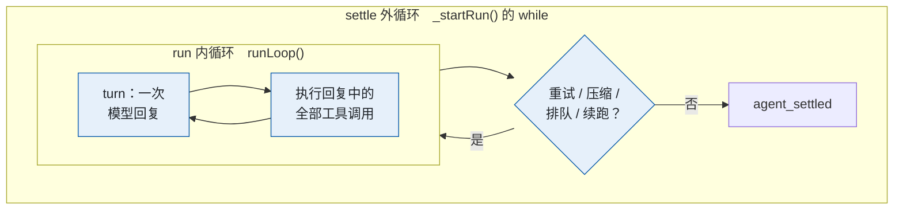

*图 0-1　settle 外循环与 run 内循环*

- 外循环位于 `AgentSession._startRun()`；`agent_before_settle` 可以请求续跑。
- 内循环位于 `agent-loop.js` 的 `runLoop()`。
- 计数：`N` = run 数，`M` = turn 数（即模型请求数），`K` = 工具调用数。

### 0.3 代码快照

撰写时工作区有一轮未提交的改动。改动新增 `skills/`、`.pi/`、`skill-loader.ts`、`turn-prompt.ts`、`decision.ts`、`turn-context.ts`、`turn-timing.ts` 和渲染器文件，并修改驱动、扩展、`GameService`、`knowledge.ts`。最近一次相关提交是 `e15f2ee`。

- 实施记录：`docs/l3-skills-refactor.md`、`docs/turn-latency.md`。
- 引用格式：`路径:行号`，相对 `apps/chinese-chess/`。
- `pi/` 指 `node_modules/@earendil-works/` 下 1.4.0 的编译产物。

### 0.4 参考资料

| 文档 | 用途 |
|---|---|
| `discussions/2026-10-28-four-layer-harness.md` | 四层划分与 L3 原则（3.1 节、第 6 章） |
| `discussions/2026-10-28-l4-web-desktop-and-plugin-harness.md` | L4 迁移与 Pi 接入选型（7.1、7.2 节） |
| `discussions/2026-10-30-pstack-analysis-grok.md` | 设计血统（5.9 节）；二手资料，未核验上游 |
| `discussions/2026-10-30-refactor-chinese-chess-pi-skills.md` | 技能化提案，与实现对照（5.10 节） |
| `docs/l3-skills-refactor.md`、`docs/turn-latency.md` | 设计意图与测量数据 |
| `apps/five-llm/docs/five-llm-whitepaper.md` | 对照基线；与弈境相同处不再展开 |

可信度：源码与测试 > 实施记录 > 讨论稿 > Grok 二手分析。冲突时以源码为准。

---

## 1. 引言

### 1.1 Why：象棋比五子棋难在哪里

楚河和弈境回答同一个问题：通用模型怎样在硬规则、有时限、有对抗的领域里做出可审计的决策。象棋把难度提高了一个量级：

| 维度 | 五子棋（弈境） | 中国象棋（楚河） |
|---|---|---|
| 规则 | 合法 = 空点 | 7 种棋子；马腿、象眼、炮架、九宫、照面；应将、困毙、长将、120 半回合 |
| 战术 | 连五威胁可全盘扫描 | 交换、牵制、闪击、连续将军，需要搜索 |
| 典型失误 | 漏防成五 | 平车送车、贪兵丢炮 |
| 领域知识 | 几乎没有开局库 | ECCO 体系、CCPD 公开棋谱 |
| 时间 | 每回合约 10 秒 | 每方 30 分钟包干 |

弈境有四条约束：规则不可协商、模型真正做决定、过程可审计、时间是真实资源。楚河另加两条：

5. 模型容易高估主动、低估丢子。业务层必须给出可验证的反例，并在提交时独立复查。
6. 知识量大且分层。宿主按局面路由、按需读取，技能文本与人读文档同源。

### 1.2 What：三个工程视角

| 视角 | 关注点 | 楚河的做法 |
|---|---|---|
| Harness | 怎样分层，权威在哪 | 四层；9 成员 `TurnPort`；单写者 `GameService`；两个 Worker |
| Loop | 循环在哪里受约束 | 每手一次 settle；预搜索；`tool_call` 预算；`terminate`；棋钟 |
| Prompt / Context | 模型每次看到什么 | 技能组、剧本路由、索引、`signals` 投影、错误即提示词、重建 |

Prompt / Context 横跨四层，见第 8 章。

---

## 2. 住宅比喻

把 Agent Harness 看成一栋智能住宅：工程师设计房子，用户是住户。与真实住宅不同，这里的「电」会自己拿主意。

### 2.1 总表

| 层 | 住宅 | Agent Harness | 楚河中的实物 |
|--|--|--|--|
| L0 | 水电煤气 / WiFi 公司 | 模型提供商 | Codex 订阅、DeepSeek API、Anthropic API |
| L1 | 管线：墙内管网、总闸、水表 | run 内循环 + settle 外循环 | 每手一个 Session；`prompt()`；`abort()` |
| L2 | 接口：插座、断路器、计量表 | ExtensionAPI：事件、工具、命令 | `tool_call`；8 个工具；宿主订阅 |
| L3 | 家电：本体、保险丝、程序、说明书 | 规则、数据、经验、技能组 | `engine` / `expert` / `search` / `knowledge` / `learning` / `skills/` |
| L4 | 墙上屏幕 / 手机 App / 遥控器 | TUI、Electron、Web | Electron 主窗口；Pi TUI（复盘技能） |

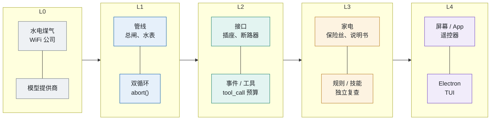

*图 2-1　住宅与四层的对应（上行住宅，下行 Harness；箭头为供给方向）*

### 2.2 逐层要点

**L0 水电煤气公司。**

- 包月宽带对应订阅制，按度计费对应按量 API。用电度数对应 token，水管口径对应上下文窗口。
- 停水限电对应限流和中断，由 L1 重试兜底（`retry.maxRetries = 1`）。
- 物业不会偷偷换供应商：默认模型缺失时，`model-selection.ts:7-15` 直接报错，不静默换模型。在第三方 harness 里用 `anthropic/*` 走按量计费，静默切换会产生费用。

**L1 管线。**

- 开一次龙头 = 一个 turn；只要还有工具调用，水就在 run 内循环里流。
- 水表和补水泵 = settle 外循环；停转即 `agent_settled`。
- 水箱容量 = 上下文窗口；沉淀浓缩 = 压缩（楚河关闭）。总闸 = `session.abort()`。
- 管网按规范铺设，住户不能改；Pi 的循环也只能 fork。

**L2 接口。** 接口按能力分类，不放业务规则：

| 接口 | 对应 | 楚河实例 |
|---|---|---|
| 表计读数口（只看） | 观察类事件 | 宿主订阅：请求计数、耗时、审计 |
| 断路器（切断并说明原因） | `tool_call` 拦截 | 16 次工具预算；回合结束后拒绝 |
| 净水器（改写流过的东西） | `context` / `tool_result` 等 | 未使用 |
| 新装插座 | `registerTool` | 8 个象棋工具 |
| 墙上开关 | `registerCommand` | 仅 TUI 的 `/skill:xiangqi-review` |
| 定时器、限流阀 | 预算 | 8 次请求；16 次工具调用；搜索 2600 ms / 70000 节点 |
| 燃气计费阀 | 棋钟 | 网络、思考、工具都扣钟，超时判负 |

**L3 家电。**

- 保险丝 = 硬规则（`engine.ts`、`clock.ts`、revision 校验）；传感器 = 确定性事实（攻击者、牵制、合法着法）。
- 智能推荐 = 启发式分数，标注「不是胜率」；食材 = 棋谱和 73 条开局路线 / 1360 个节点。
- 菜谱 = 剧本和专项技能；目录页 = 索引；翻某一页 = `read_skill`。
- 自动选程序 = 宿主用 `turnGuidance()` 选剧本，模型不能自选。
- 按钮 = 工具；电机 = 业务服务（`commit()`、搜索 Worker）。出厂复检 = `commit()` 的独立复查。
- 扫地机器人充电时整理地图 = 赛后复盘。它不改固件：楚河不训练权重，只积累已验证案例，用前按当前棋盘重验。
- 整箱发货 = Pi Package，楚河有意不发（见 5.8 节）。售后检修口 = `.pi/skills/xiangqi-review`。

一句话：菜谱是方法，按钮是接口，电机是实现，三者不必一一对应。

**L4 屏幕。** 遥控器 = Pi TUI，墙上屏幕 = Electron，手机 App = Web。屏幕上的温度读温度计，不问厨师：棋盘、棋钟、比分直接来自 L3 状态。屏幕上另有回合阶段指示灯和落子后的耗时分解（见 7.5 节）。

### 2.3 跨层概念

| 概念 | 比喻 |
|---|---|
| Prompt | 指令和菜谱写得清不清楚 |
| Context | 备菜：放什么、放多少，由 L3 决定 |
| 压缩 / 重建 | 剩菜合并装盒 / 不留剩菜，每顿按清单现做 |
| `signals` 投影 | 只摆今天要用的食材，其余留在冰箱 |
| 委派给工具 / Worker | 交给洗碗机 / 送去楼下洗衣房 |
| 子 Agent | 请家政（另一份 L0 账单）；楚河未采用 |
| revision | 订单号：旧订单签收被拒 |
| RPC / SDK 接入 Pi | 独立家电插插座 / 嵌入式入墙家电 |

### 2.4 比喻失效之处

1. **智能所在的层相反。** 住宅里水电是「笨」的；Harness 里做决策的是 L0 的模型，L3 负责把关和提供事实。所以 L2 需要断路器，L3 需要复检。
2. **水会回流，还会自己开龙头。** 工具结果流回上下文，模型据此决定下一步。
3. **家电决定管道里流什么。** L3 通过 L1/L2 决定系统提示词和每一份工具结果。

### 2.5 用楚河走一手

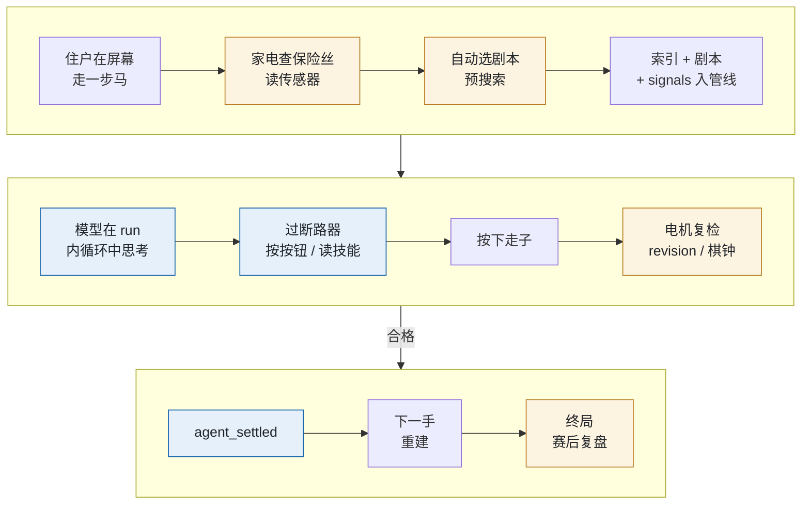

*图 2-2　一手棋穿过住宅*

复检发现「这步白丢车」时，电机退单并附原因，模型改选。端到端时序见 3.5 节。


## 3. 四层架构

### 3.1 来历与原则

四层划分来自 2026-10-28 的讨论。依据是 Pi Agent Harness 的四层分析和 IndyDevDan 的 Pi 扩展示例。两条原则如下：

1. **上下文管理是手段，业务语义是内容。** 每个进入上下文的字段，都要服务一个业务决策。`turnSignals()` 按这条标准挑字段：己方受攻子、前 6 个候选的风险与反击线、搜索摘要（见 6.3、8.3 节）。
2. **界面通道与上下文通道分离，冲突时以界面为准。** 专家参谋面板显示完整报告和原则全文，模型只看到 `advice` 与 `id/evidence`。两边读同一份 Markdown 源（见 7.5 节）。

楚河用进程内 SDK，所以 L1 还包括宿主一侧的 `PiDriver`、技能目录 `SkillCatalog` 和用户提示词模板 `turnPrompt`。

### 3.2 全景

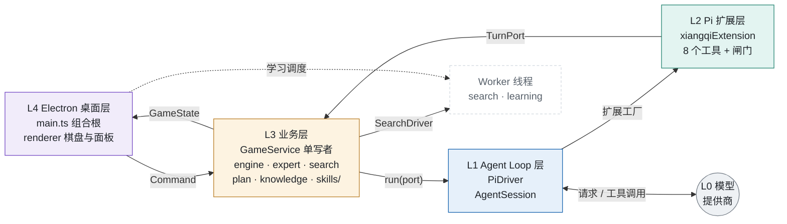

*图 3-1　四层运行时链路*

`Command` 含 move、new、undo、retry、cancel、model 等。

### 3.3 各层职责

| 层 | 拥有的权威 | 不做什么 |
|---|---|---|
| L1 `PiDriver` | 本回合 Pi session：模型解析、技能目录与隔离校验、请求预算 8、预搜索、遥测与审计订阅、取消转发 | 不判断内容好坏或着法是否合法，不碰棋钟 |
| L2 `xiangqiExtension` | 本回合工具面：8 个工具、调用预算 16、`active()` 守卫、revision 预检、把 `MoveRiskError` 转成可纠错结果 | 不放业务规则，不直接改棋谱（只走 `port.commit`） |
| L3 `GameService` 等 | 决定什么信息进上下文、进多少、以什么形式进；棋谱、revision、轮次、棋钟、比分、胜负、计划、证据链、耗时；唯一写入入口；独立复查 | 不碰渲染，不 import Pi 或 Electron |
| L4 main / renderer | 进程组合、200ms 权威心跳、白名单 IPC、原子保存、学习调度、可视化 | 不占上下文；渲染器不提交模型走子，不改权威状态 |

### 3.4 依赖方向：9 成员的 `TurnPort`

图 3-1 是运行时链路；编译依赖指向中心的 L3（依赖倒置）：

- `game-service.ts:16-26` 定义 `TurnPort`，`:27` 定义 `AgentDriver { run(port) }`。业务层只知道这两个接口。
- L1 的 `PiDriver implements AgentDriver`（`pi-driver.ts:16`）。L2 的 `xiangqiExtension(port, …)` 接收同一个 `TurnPort`。两者只 import 业务层纯函数，无反向 import。
- L4 的 `main.ts` 是组合根。它创建 `PiDriver`（`main.ts:94`）、`LearningCoordinator`、`WorkerSearchDriver` 并注入 `GameService`（`:107-108`），再把 `service.subscribe` 接到 IPC 推送和自动保存（`:115-119`）。
- 冒烟测试注入标注过的 UI fixture driver（`:76-92`）。

弈境的 `TurnPort` 有 4 个成员，楚河有 9 个，对应 L3 新增的能力：

| 成员 | 方向 | 用途 | 调用方 |
|---|---|---|---|
| `state` | L3 → L1/L2 | 回合开始时的深拷贝 | 驱动、工具 |
| `signal` | L3 → L1/L2 | 取消、超时、局面被替换 | 驱动据此 `abort()` |
| `log` | L1/L2 → L3 | 链路日志，回合失效后静默 | 驱动、扩展 |
| `commit` | L2 → L3 | 唯一写入；含独立复查与最终搜索 | `move_piece` |
| `search` | L1/L2 → L3 | 有界搜索，受本回合累计预算约束 | 预搜索、`search_position` |
| `updatePlan` | L2 → L3 | 暂存计划，只随落子持久化 | `update_plan` |
| `recall` | L2 → L3 | 按当前局面召回已验证案例 | 复查、比较、试算工具 |
| `setDecision` | L1 → L3 | 暂存 `DecisionTrace`，在提交事务内定稿 | 驱动 |
| `telemetry` | L1 → L3 | 耗时区间：setup / pre-search / model / tool / review | 驱动 |

这是六边形（Ports & Adapters）架构。L1、L2 是 Agent 适配器；L4 是 UI 与持久化适配器；Worker 是计算适配器。

### 3.5 一手棋的端到端时序

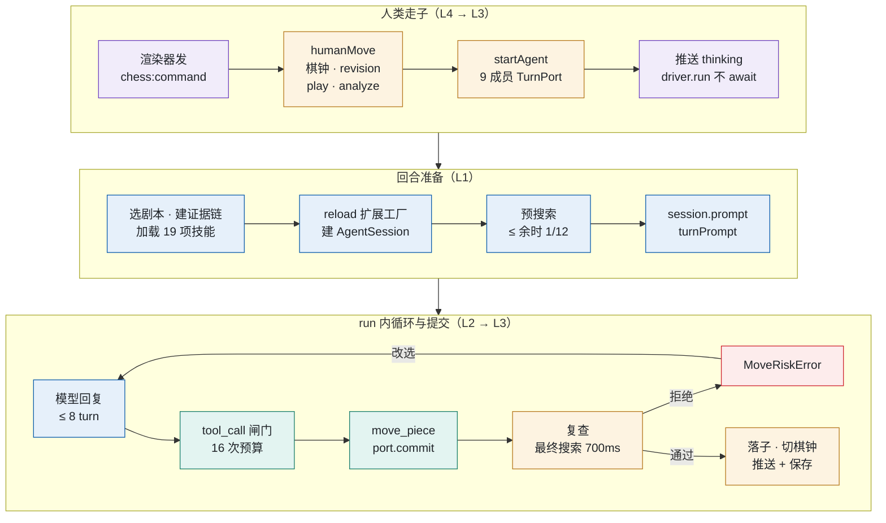

*图 3-2　一手棋的端到端时序*

- `analyze` 含定式与案例召回。
- 建证据链即 `createDecisionTrace()`。预搜索在 Worker 里运行，`SearchReport` 写回快照。
- `turnPrompt` 含棋谱、棋盘、搜索摘要和 `signals`。
- 明显亏子或败着且无风险说明时，复查拒绝。`MoveRiskError` 带四个字段和读剧本提示。
- 模型收到 `isError` 结果后改选。落子后扩展返回 accepted 和 `terminate:true`；`agent_settled` 后宿主 `dispose()`。
- `recordSaveKey` 变化时才自动保存。

### 3.6 不变量：谁是权威

| 不变量 | 守护位置 | 机制 |
|---|---|---|
| 棋谱只有一个写者 | `GameService` | 写入都走 `calculate()`（`game-service.ts:124-137`）|
| 过期回合不能落子 | `valid()`（`:236`） | 未取消、未终局、同局、同 revision、同控制器 |
| 迟到响应赢不了超时的棋钟 | `commit` 第一行 `this.charge()`（`:280`） | 先结算时间再判有效；复查与搜索后各再结算一次（`:296`、`:310`） |
| 不并发、不重复提交 | `committed / submitting / searching` 三个标志（`:230`、`:285`） | 复查期间冻结坐标（`:284` 深拷贝） |
| 着法合法 | `engine.ts` 的 `play()`；每次提交后 `replay()` | 全谱重放 |
| 不白丢大子（可覆盖的拒绝） | `needsRiskAcknowledgement`（`expert.ts:269`）+ `commit` 内独立复查（`:295-316`） | `loss` / `material-loss` 且无 `riskAcknowledgement` 时拒绝，不落子 |
| 计划不越过局面变化 | `planForPosition`（`plan.ts:35-45`） | 被将军、被吃子、过期即失效；对方走子后复核 |
| 审计与提交原子一致 | `commit` 内定稿 `DecisionTrace`（`:322-325`） | 不等 `tool_execution_end` 再补写（见 4.3 节接入点 ⑦） |

**revision 版本号贯穿四层。** 人类走子、悔棋、取消、换模型、新局都 `revision++` 并 `abort` 当前回合（`invalidate()`，`:88-92`）。模型提交必须带当前 revision。`move_piece` 先在 L2 预检（`xiangqi.ts:97`），L3 再用 `valid()` 终审。


## 4. Pi 双循环与 L2 接入点

### 4.1 双循环的源码位置

Pi 版本为 1.4.0，`pi/` 的含义见 0.3 节。

| 结构 | 源码位置 | 作用 |
|---|---|---|
| settle 外循环 | `agent-session.js:1423` `_startRun()`；`:1450` 起 `while` | 检查重试、压缩、排队消息和 `agent_before_settle`；需要时 `continue()` 再起一个 run；`finally` 发出 `agent_settled` |
| run 内循环 | `agent-loop.js:84` `runLoop()` | 每个 turn：`turn_start` → LLM 流 → 执行工具 → `turn_end` |
| 工具前置钩子 | `agent-loop.js:499` 调 `beforeToolCall`；`agent-session.js:322-326` 接到扩展的 `tool_call` | schema 校验之后、执行之前 |
| 顺序执行 | `agent-loop.js:374-375` | 同批只要一个工具声明 `sequential`，整批串行 |
| 中途停止 | `agent-loop.js:408` | 每个工具执行完检查 `signal.aborted` |
| 批次终止 | `agent-loop.js:471` `shouldTerminateToolBatch` | 同批全部返回 `terminate` 才终止 |
| 压缩闸 | `agent-session.js:2391` `_checkCompaction` | 设置关闭时直接返回 |

### 4.2 楚河怎样使用双循环

图 4-1 是一手棋的时间线。圆圈编号对应表 4-1。

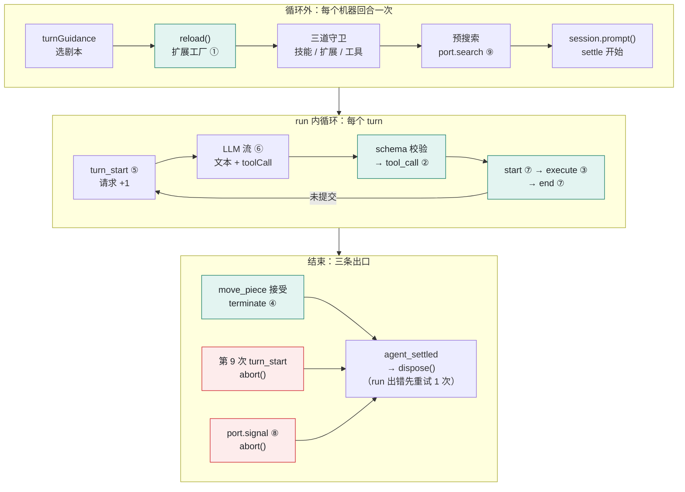

*图 4-1　一手棋的 settle 时间线与接入点*

图外的事实：

- **一手棋 = 一个 Session = 一次 settle。** 驱动用 `SessionManager.inMemory()`（`pi-driver.ts:66`），在 `finally` 里 `session.dispose()`（`:119`）。回合之间不留对话。
- **settle 外循环几乎只转一圈。** 压缩关闭（`:44`），没有 `agent_before_settle` 处理函数，也没有排队消息。只有 `retry: { maxRetries: 1, baseDelayMs: 800 }` 会再起一个 run，所以 `N ∈ {1, 2}`。
- **run 内循环是主战场。** `M ≤ 8`，`K ≤ 16`，工具全部 `sequential`。
- **预搜索在循环外。** 它在 `session.prompt()` 之前运行（`:97-106`），结果写回快照。模型的首个请求即可看到搜索摘要。
- **没有技术超时。** 弈境有 90 秒回合超时，楚河删掉了它（`:35-36`）。唯一的截止是棋钟，到时由 `GameService` 中止 `port.signal`（`:38-39`）。测试 `tests/pi-integration.test.ts:194`、`:220` 验证超过 90 秒的长考合法。

### 4.3 接入点总表（5W1H）

次数按每次 settle 计，符号见 0.2 节。

**表 4-1　接入点 ①–⑨**

| # | 接入点（What） | 谁注册 → 谁调用（Who） | 挂在哪里（Where） | 次数（When） | 作用（Why） |
|--|--|--|--|--|--|
| ① | 扩展工厂 `xiangqiExtension(port, skills, onRead)` | L1 传入 `extensionFactories` → Pi `reload()` | 循环外，建 Session 前（`pi-driver.ts:59`） | 每回合 1 | 把本回合的 `TurnPort`、技能、审计回调闭包进工具 |
| ② | `pi.on('tool_call')` | L2 → Pi `_beforeToolCall` | run 内，schema 校验后、执行前 | K（含拦截的） | 16 次工具预算、回合结束守卫、日志 |
| ③ | 8 个工具的 `execute()` | L2 → Pi 工具执行阶段 | run 内，工具执行 | 每个工具 0..K | 读技能、观察、比较、计划、提交 |
| ④ | `move_piece` 返回 `terminate: true` | L2 → Pi `shouldTerminateToolBatch` | run 内，批次收尾 | ≤ 1 | 告诉 Pi 本批之后不再请求模型 |
| ⑤ | 订阅 `turn_start` | L1 `session.subscribe` | run 内，turn 开头 | M | 请求计数，第 9 次 `abort()`；开启 model 区间 |
| ⑥ | 订阅 `message_update` / `message_end` | L1 `session.subscribe` | run 内，LLM 流 | update 多次；end M | 记首个增量 `firstDeltaMs` 并结束 model 区间 |
| ⑦ | 订阅 `tool_execution_start` / `_end` | L1 `session.subscribe` | run 内，工具前后 | 各 K（不含拦截的） | 工具耗时区间；审计；暂存决策 |
| ⑧ | `port.signal` 的 `abort` 监听 | L1 注册，L3 触发 | 任意时刻 | 0..1 | 棋钟耗尽或取消时中止 |
| ⑨ | `TurnPort` 的 9 个成员 | L3 提供，L1/L2 调用 | 预搜索，以及 ③ 之内 | 提交可多次，成功 ≤ 1 | 跨层读写的唯一通道（3.4 节） |

⑤⑥⑦ 是宿主订阅的 Pi 事件。L2 只挂一个扩展事件：②。⑦ 的两个处理函数：`recordDecisionTool` 追加证据链，`setDecision` 暂存决策。

### 4.4 接入点的关键细节

#### ① 扩展工厂

- 工厂是内联函数（`xiangqi.ts:13-14`），不经 jiti 导入。它声明本回合的闭包状态 `calls`、`committed` 和守卫 `active()`（`:15-16`）。
- `read_skill` 的参数 `name` 是由 `skills.names` 生成的 `Type.Union` 枚举（`:28`）。技能清单在 schema 层就是白名单。
- `reload()` 之后有三道守卫，任何一项不符就抛错，回合失败，棋钟照走：
  1. 技能集合恰好是 `EXPECTED_SKILLS` 的 19 项，`diagnostics` 为空（`pi-driver.ts:61`）。
  2. 扩展加载无错误（`:62`）。
  3. 活跃工具集合恰好等于 `XIANGQI_TOOLS`（`:69-72`）。

#### ② `tool_call`

处理函数在 `xiangqi.ts:17-24`，按顺序执行三步：

1. 调 `active()`；回合已取消或已提交时抛错。
2. `++calls > 16` 时返回 `{ block: true, reason }`。
3. 写日志；`move_piece` 记录着法与 revision。然后放行。

Pi 先做 TypeBox 校验，再调用处理函数（`agent-loop.js:499`），所以 `event.input` 一定合法。

`block` 和抛错都变成一条 `isError` 工具结果回到模型，run 不会崩溃。这是「错误即提示词」的基础（8.4 节）。`read_skill` 也计入 16 次预算（测试 `pi-integration.test.ts:175`）。

#### ③ 八个工具

| 工具 | 步骤 | 关键约束 |
|---|---|---|
| `read_skill` | 路由 | `name` 是 19 项枚举；`reference` 只收平面小写 `*.md`；真实路径校验拒绝遍历和软链（`skill-loader.ts:44-55`） |
| `analyze_position` | observe | 完整分析；`signals` 够用时不必调用 |
| `search_position` | compare | 全部合法根或 1–6 个候选；深度 ≤ 6；单次 ≤ 1000 ms；消耗搜索预算 |
| `review_move` | compare | 单个候选的应手、交换、`losingReply`，附召回案例 |
| `compare_moves` | compare | 1–6 个候选平分预算后排序（`expert.ts:185-191`） |
| `simulate_moves` | compare | 只验证 1–6 手路线合法，不证明对手会配合 |
| `update_plan` | plan | 经 `port.updatePlan` 暂存；只随落子持久化 |
| `move_piece` | commit | 唯一的写操作，见下 |

`move_piece.execute()`（`xiangqi.ts:95-105`）按顺序执行：

1. `active()`；`signal.aborted` 时抛错。
2. `params.revision` 与当前局面不符时抛「版本错误」。
3. `await port.commit(...)`。提交是异步的，本身就是一次独立复查。
4. 捕获 `MoveRiskError`，返回 `isError: true` 的可纠错结果；其他错误照常抛出。
5. 成功时置 `committed = true`，返回 `terminate: true`。

`MoveRiskError` 把完整审查放进 `details`，`details` 不进模型上下文。`content` 只有风险、交换估计、反击线、警告，外加一句路由提示（`expert.ts:270-275`）：先比较替代着法，坚持时先读 `playbook-risk-acknowledgement`。这段文本既是纠错提示词，也是路由信号。

#### ④ `terminate` 与提交即停

Pi 要求同批全部返回 `terminate: true` 才停 run（`agent-loop.js:471`）。弈境在 `tool_execution_end` 看到成功落子就 `abort()`。楚河没有这一步，`tool_execution_end` 只记遥测和审计（`pi-driver.ts:89-94`）。

后果（源码推断，未见测试）：模型同批调用 `[move_piece, X]` 时，`tool_call` 的 `active()` 拒绝 `X`，整批不满足条件，Pi 再请求一次模型。revision 已变，`GameService.valid()` 拒绝一切写入，所以业务上安全；代价是一次多余往返，计入棋钟。改进建议见 9.2 节。

#### ⑦ 审计必须在提交事务内写完

`move_piece` 的 `tool_execution_end` 在 `port.commit()` 返回之后才发出。此时 `commit()` 内的 `calculate()` 已经 `emit()` 并自动保存。等这个事件再写「commit: done」，就会错过那次原子保存。所以：

- `GameService.commit()` 在事务内用 `stagedDecision` 补上 `move_piece` 成功，再写 `TurnNote`（`game-service.ts:322-330`）。
- `timer.finish(true)` 也在事务内完成（`:320`）。
- 之后的 `setDecision` 因 `committed` 为真而忽略（`:268`）。

#### ⑧ 取消信号贯穿四层

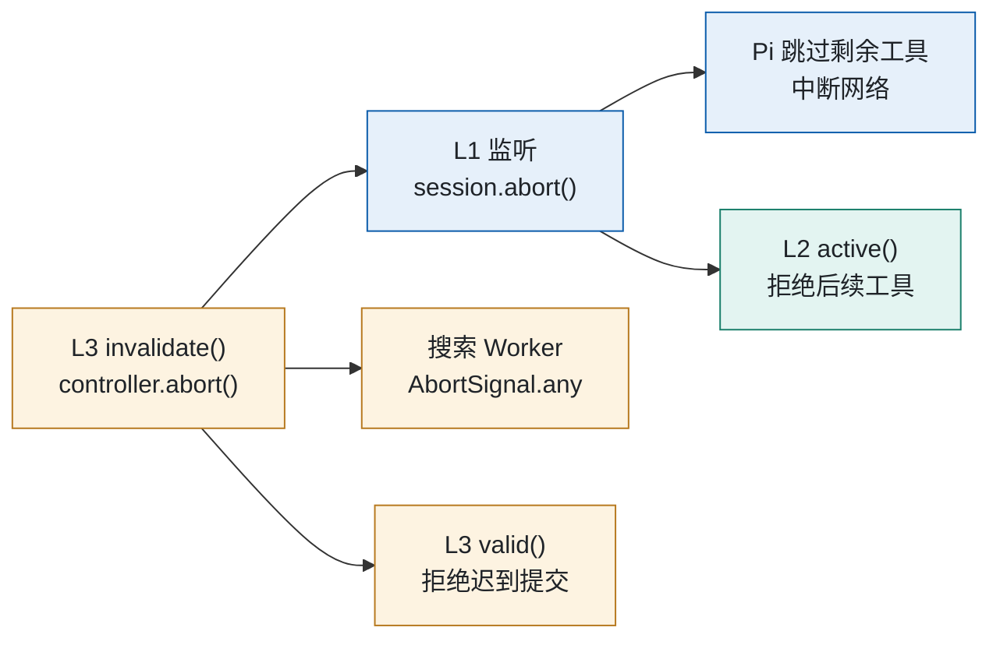

*图 4-2　取消信号的传播*

`invalidate()` 在 `game-service.ts:88-92`，监听器在 `pi-driver.ts:38-39`，Worker 取消在 `game-service.ts:246`。失败、取消、超时的回合写入 `attempts[]`，保留最近 80 条（`:220-227`）。revision 没变时也触发保存（`recordSaveKey`，`turn-timing.ts:25-27`）。

### 4.5 settle 时间线

见图 4-1。

### 4.6 未使用的回调

| 回调 | 通常用途 | 楚河为什么不需要 |
|---|---|---|
| `before_agent_start` | run 前改提示词或工具集 | 宿主在建 Session 前装配提示词 |
| `context` | 请求前改消息列表 | 每手新 Session，没有历史要裁剪 |
| `agent_end` / `agent_before_settle` | 催促续跑（TillDone） | 停机由 L1/L3 掌握：提交，或预算、棋钟用尽 |
| `session_start` / `session_tree` | 从会话历史恢复状态 | 状态权威在 `GameService` |
| `input`、`registerCommand` | 用户输入与斜杠命令 | 没有人类聊天输入；`noPromptTemplates: true` |
| `resources_discover` | 扩展自带技能路径 | 宿主建 loader 时直接给出 |
| `before_provider_request` | 改 provider 请求体 | 不需要 |
| `tool_result` | 改工具结果 | 结果由本扩展生成，`details` / `content` 已分离 |
| `turn_end` | 再跑一个 turn | 不需要 |

结论与弈境相同：状态和流程控制留在宿主，扩展需要的回调就少。楚河新增的能力都走 `TurnPort` 和宿主订阅，L2 仍只挂一个钩子。

### 4.7 闸门

| 闸门 | 位置 | 触发后 |
|---|---|---|
| 请求预算 8 | L1 `turn_start` 计数 | `abort()`，回合失败，棋钟继续 |
| 工具预算 16 | L2 `tool_call` | 返回 `block`，模型收到「预算耗尽」 |
| 搜索总预算 | L3：每次尝试 2600 ms / 70000 节点，为最终复查预留 700 ms / 20000 节点（`live-search.ts:6-8`、`game-service.ts:241-244`） | 单次 ≤ 余时 1/12 且 ≤ 1000 ms；截断时只留最后完整迭代，标为未知 |
| 搜索 / 提交互斥 | L3 `searching / submitting` | 拒绝并发请求，反馈给模型 |
| 棋钟 | L3 `charge()`，主进程 200 ms 心跳 | 到时判负；`port.signal` 中止网络与 Worker |
| 取消 / 悔棋 / 换模型 / 新局 | L3 `invalidate()` | 见图 4-2 |


## 5. L3 业务层：知识怎样变成信号

### 5.1 六类知识与载体

楚河沿用弈境的做法，按可信程度把知识分六类安放。

| 类别 | 例子 | 载体 | 模型怎样看到 |
|---|---|---|---|
| 硬规则 | 走法、九宫与照面、应将、困毙、重复与长将、120 半回合、棋钟、一次提交 | `engine.ts`、`clock.ts`、`GameService` | 只通过错误文本 |
| 确定性事实 | 合法走法；每子的合法攻击者、几何保护者、牵制；阵型；一步杀反例 | `expert.ts`（`inspectSafety` / `formation` / `review`） | `signals` 摘要；`analyze_position` 全量 |
| 有界计算 | 同格交换（≤ 6 次后续吃子）；迭代加深搜索 | `expert.ts`、`search.ts`、`live-search.ts`（Worker） | 候选的 `risk / estimatedNet / line / coverage`；搜索的 `completedDepth / rootScope / line` |
| 启发式 | 阶段子力值、位置六项、候选排序分 | `expert.ts` / `evaluation.ts` | 随结果出现，附 `limitations` |
| 结构化数据 | 手写 12 条 + CCPD 61 条，共 73 路线 / 1360 节点 / 7 个来源；已验证案例 | `knowledge.ts`、`src/data/ccpd/`、`userData/learning/library.json` | 匹配并当场复查后，进 `knowledge` / `experiences` |
| 流程知识 | 读报告、工具顺序、计划协议、风险说明 | `skills/**/SKILL.md` + `references/` | 入口和一份剧本常驻；其余用 `read_skill` |

三类输入的落点：

- **业务规则**在代码里，提示词改不了。入口技能规定冲突时的顺序：代码规则 > 当前计算事实 > 有界启发式 > 技能经验。
- **数据**：棋谱 `position.moves` 每手全量重放。定式是确定性信号，不是背给模型的文本：先做全盘局面匹配（含镜像和换色），再复查推荐着法，不通过就不提供（`knowledge.ts:52-79`）。
- **专家经验**分两层。代码触发的原则（`expert.ts:200-217`）按局面输出 `{id, title, advice, evidence}`，回答「此刻触发了什么」。文本技能回答「该怎么想」。两层用 `id` 对接，全文在 `read-expert-report/references/principles.md` 的同名小节。

### 5.2 专家计算

专家计算有界、可复算，并标注局限。`expert.ts:10-12` 定位它是「有界的战术辅助，不是替身棋手」。它只回答「这一步会不会白丢子」。

| 模块 | 能力 | 设计要点 |
|---|---|---|
| `reviewMove`（`expert.ts:119-184`） | 枚举对方应手，查一步杀和困毙，算同格交换 | 一个合法败着即反例；截断时 `coverage.complete = false` |
| `analyzeExpert`（`:218-268`） | 完整报告，含 12 个候选 | 短名单混入受攻大子的撤退，防止位置分挤掉逃生着法 |
| `searchPosition` + `liveSearchOptions` | 迭代加深、将军延伸、静态搜索 | 只信完成的迭代；危险局面加预算 |
| `mergeSearchReview`（`live-search.ts:21-41`） | 把最终搜索并入审查 | 完成迭代、将杀分、主变化可重放到判负，三者都满足才升为 `loss` |
| `updatePlan` / `planForPosition`（`plan.ts`） | 跨回合计划：目标、1–3 步、放弃条件 | 只随落子保存；被将军、对方吃子或 8 半回合后失效 |

关键设计：不管模型调没调审查工具，`commit()` 都执行独立复查和最终搜索（`game-service.ts:289-316`）。这一条来自实战的「平车送车」「贪兵丢炮」，两步棋已进回归测试。复查失败后的拒绝文本见 8.4 节。

### 5.3 技能组：19 项 Pi 原生技能

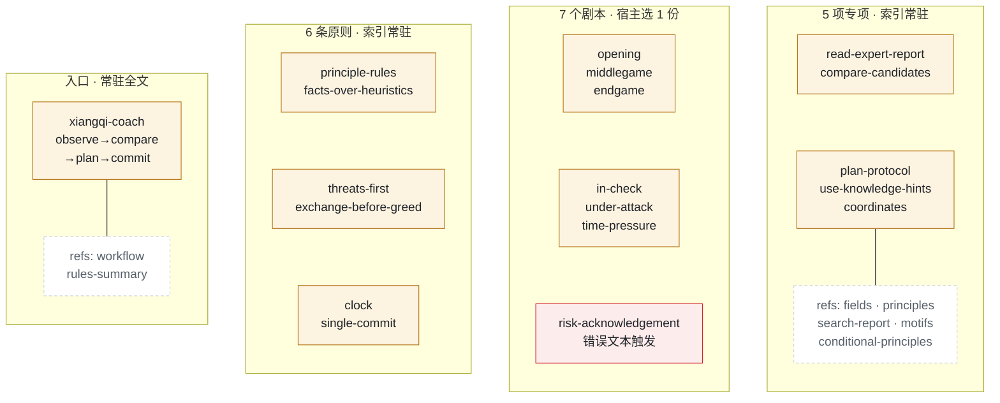

*图 5-1　技能组：1 入口 + 6 原则 + 7 剧本 + 5 专项，加 7 份 references*

技能放在 `skills/`，构建时复制到 `dist/skills`，全部约 23 KB。每项是标准 Agent Skills 格式：`name` 与目录同名；中文 `description` 写「何时用」；正文统一为「步骤 → 证据 → 局限」。入口带 `metadata.version: xiangqi-skills/v2`。剧本都设 `disable-model-invocation: true`。

离线复盘技能 `.pi/skills/xiangqi-review` 只在 Pi TUI 用，应用不加载。

### 5.4 设计更正：使用 Pi 原生 Skill，不自建支持子系统

**原方案把优先级弄反了。** 不应为了禁用内置工具，再增加 Skill 目录、索引拼接和专用读取协议。“没有自写解析器”不等于“没有自建 Skill 子系统”。v3 已删除 `skill-loader.ts`、`SkillCatalog`、`SkillReader` 和 `read_skill`。

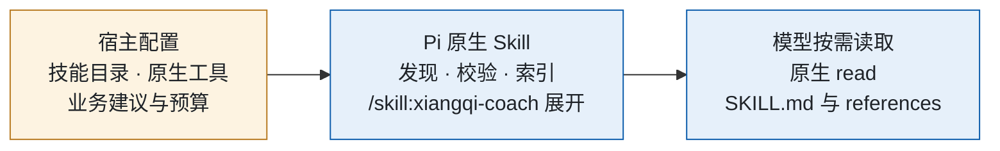

*图 5-2　v3 原生加载分工*

- `DefaultResourceLoader` 配置 `noSkills: true` + `additionalSkillPaths: [workspace/skills]`，只发现应用配置的技能目录。
- 开放原生 `read/bash/edit/write`，加 8 个象棋业务工具；不再设置 `noTools: 'builtin'`。
- Pi 自动生成19项技能索引与真实路径。宿主不格式化索引，不改写 location，也不拼接全文。
- 用 `session.prompt('/skill:xiangqi-coach ' + turnPrompt(state))`，由 Pi 展开入口到用户消息，不是系统提示词。
- 宿主只给建议剧本和依据；模型按索引用 read 加载剧本及 references。七个剧本不再隐藏于自动索引。
- 规则、棋钟、revision、搜索和独立提交复查不变；8次模型请求、16次工具调用预算包含内置工具。

开发版工作目录是 `apps/chinese-chess`；安装版是可写的 `userData/chinese-chess`，复制自带技能且不覆盖已有编辑。提示词要求只操作项目目录，但 **cwd 不是安全沙箱**，不能阻止绝对路径、../、软链或 shell 越界。需要硬隔离时另接成熟 OS 沙箱或容器，不自写命令过滤器。

v3 审计只把原生展开的入口记入 `skillsInjected`，`playbook` 表示建议，旧 `skillsRead` 留空。原生工具统一记入工具完成序列与耗时；并行工具的完成顺序不等于调用顺序，也不能仅凭 read 工具名推断读了哪项技能。

**下文保留 v2 历史快照。** “唯一剧本全文注入”“11项索引”“enum read_skill”“禁止文件系统”等旧说法不再适用。当前细节见 [原生 Skill 与内置工具](../native-skills.md)。

### 5.5 路由：三级路由加信号

应用内没有斜杠命令。知识按三级路由：

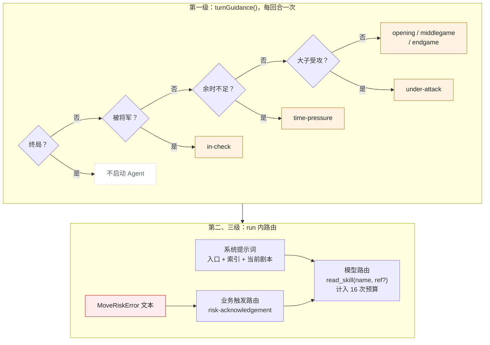

*图 5-3　三级路由（剧本名省略前缀 `playbook-`）*

图中阈值：

- 余时不足：余时 < max(60 s, 3 × 近 8 手平均, 包干制 90 s)。
- 大子受攻：己方价值 ≥ 400 的子遭合法攻击。
- 阶段（`phaseOf`）：大子 ≤ 6 为残局；不足 20 半回合为开局。

1. **宿主路由**（代码，回合开始，`decision.ts:35-49`）。纯函数，`tests/decision.test.ts` 用两盘实战的每个前缀回放验证。剧本不在索引里，模型不能自选剧本。
2. **模型路由**（模型，run 内任意 turn）。索引列 11 项（6 原则 + 5 专项）。模型可以读其他剧本作参考，但不切换宿主路由。
3. **业务触发路由**（L3 规则，拒绝提交时）。`MoveRiskError` 的文本点名 `playbook-risk-acknowledgement`。

信号不经过技能机制。L3 把 `principles[{id, evidence}]`、`knowledge[]`、`experiences[]` 算好放进 `signals`。代码决定此刻哪条相关，技能说明字段怎么读。

测试发现：初始局面就路由到 `playbook-under-attack`，因为隔着炮架的炮开局就能攻击马。阈值是启发式，会压低开局剧本的使用频率（见 9.2 节）。

### 5.6 信号契约

`turnSignals()`（`turn-context.ts:4-24`）是一份投影，不改权威分析。下例有删节，数值只作示意：

```json
{
  "inCheck": false, "lastMove": "黑炮 H2 → E2", "phase": "opening",
  "threatened": [{ "piece": "红马@H9", "legalAttackers": ["黑炮@H2"], "geometricDefenders": ["红车@I9"] }],
  "principles": [{ "id": "development", "evidence": ["…"] }],
  "candidates": [{ "risk": "no-direct-loss-found", "estimatedNet": 0, "line": ["…"], "coverage": {} }],
  "search": { "completedDepth": 4, "rootScope": "all-legal", "line": ["…"], "limitations": ["…"] },
  "knowledge": [{ "id": "screen-horses", "caution": "…", "verification": "legal-and-tactically-reviewed" }],
  "experiences": [], "plan": null, "coverage": { "reviewedMoves": 12, "totalMoves": 44 },
  "limitations": ["未覆盖候选和预算截断不代表安全。"]
}
```

工程要点：

1. 只给己方受攻子和前 6 个候选的摘要（取舍见 6.1 节）。
2. 局限写在数据里：`coverage`、`limitations`、`caution`、`verification` 每次都出现。
3. `geometricDefenders` 和 `legalAttackers` 分开。技能反复强调：几何保护不等于能合法回吃。
4. 完整报告用 `analyze_position` 按需取。

### 5.7 证据链：`DecisionTrace` v2

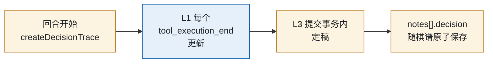

*图 5-4　`DecisionTrace` 的生命周期（`decision.ts:10-23`）*

| 字段 | 内容 | 相对弈境 |
|---|---|---|
| `revision` | 回合的 revision | 新增；`setDecision` 校验版本与 revision（`game-service.ts:269`） |
| `version`、`playbook` | 技能版本（v1 仍可读）；注入的剧本 | 相同 |
| `skillsInjected` | `['xiangqi-coach', 当前剧本]` | 与读取分开；弈境混在一个列表 |
| `skillsRead` | `read_skill` 实际读过的 `name/reference` | 代码登记，不靠模型自述 |
| `tools` | 按顺序的 `{name, ok}`，含失败调用 | 新增；弈境只有覆盖式标志 |
| `steps` | 四步的 done / skipped + evidence | 预搜索完成时 compare 标为宿主证据（`pi-driver.ts:108-111`） |

配套记录有两项。`notes[].timing` 记总耗时和按墙钟互斥归属的五项分解。`attempts[]` 记失败、取消、超时、被替换的回合，保留最近 80 条。

弈境白皮书列出四个证据粒度问题，楚河解决了三个。「试算证据与最终候选的绑定」仍未做。

### 5.8 为什么现在不发 Pi Package

决策 D8：目录按 package 约定命名，现阶段不发布。

| 用途 | 要 Package？ | 楚河的做法 |
|---|---|---|
| A. 应用运行时加载技能 | 否 | `additionalSkillPaths` 指向 `dist/skills` |
| B. 在 Pi TUI 复用技能做复盘或调试 | 否 | `.pi/settings.json` 加 `"skills": ["../skills"]` |
| C. 把技能和 TUI 复盘扩展分发给别人 | 是 | 未做；应用 `package.json` 不能兼做 manifest |

根本理由：剧本只为宿主路由服务，TUI 没有 `turnGuidance()`。将来走 C，manifest 会用 `"!./skills/playbooks/**"` 排除剧本。按住宅比喻：家电已按套装装箱，只自用，不上架。

### 5.9 设计血统

| pstack 模式 | 弈境 | 楚河 |
|---|---|---|
| poteto-mode 编排入口 | `gomoku-coach` + `turnGuidance()` | `xiangqi-coach` + `turnGuidance()` |
| 原则索引 | 5 条，自拼索引 | 6 条，Pi 的 `<available_skills>` |
| 任务剧本 | 4 个 | 7 个；新增被将军、大子受攻、风险说明 |
| 专项技能 | 3 项 | 5 项，带 references |
| 加载器 | 自写 20 行 + 白名单 | Pi 加载器（见 5.4 节） |
| prove it works | 提交前一步扫描 | 提交时独立复查 + 最终搜索 |
| 决策 artifact | `notes[].decision` | `notes[].decision` v2 + `timing` + `attempts[]` |
| 子 Agent、多模型 | 无；单一模型 | 无；单一模型，用确定性复查和 Worker 代替 |
| reflect / 自我改进 | 无 | 赛后学习 Worker + TUI 复盘技能 |

楚河借用 pstack「原则索引 → 编排 → 剧本 → 技能 → 证据 → 验证」的骨架，但把路由权、验证时机和状态所有权收回宿主。

### 5.10 讨论稿与实现对照

| 讨论稿 | 实际实现 | 状态 |
|---|---|---|
| P1 流程知识散在四处 TS 字符串 | 迁入 19 项技能；SYSTEM 约 170 字 | 已解决 |
| P2 零渐进披露；P3 无剧本路由 | 入口 + 索引 + 唯一剧本；`turnGuidance()` | 已解决 |
| P4 用户消息全量注入 analysis 且重复 | `turnSignals()` 投影；三个固定局面首次请求降 65%–67% | 已解决 |
| P5 工具描述承担流程；P6 没有决策证据 | 描述只讲参数和返回；`DecisionTrace` v2（5.7 节） | 已解决 |
| P7 原则文案与触发耦合 | 代码给 `id/evidence` + 一句话；全文在 references | 已解决 |
| P8 `MoveRiskError` 塞整个 review | 四字段 + 技能提示（8.4 节） | 已解决 |
| P9 人读文档与模型知识分叉 | L4 与模型读同一份 references（见 7.5 节） | 部分解决：`EXPERT.md` 仍有复述 |
| P10 CCPD 数据闲置 | 64 个文件接受 61 条，拒绝 3 条非标准初始阵型 | 已解决；实施更正了讨论稿的「64 条」 |
| D1 注入系统提示词；D4 复盘技能放 `.pi/skills/`；D5 `caution` 留在数据里；D8 不发 package | 采纳 | — |
| D2 七个剧本；D3 允许读其他剧本 | 采纳；读其他剧本不切换路由 | — |

### 5.11 自我改进的两条线

数据层的线已自动闭环。知识文本的线证据齐全，但闭环靠人工。

**线一：赛后学习。**

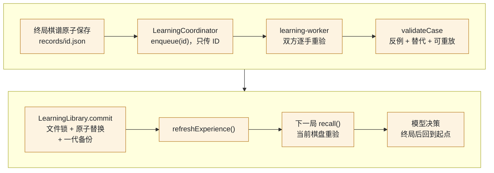

*图 5-5　赛后学习环（第二行末尾回到第一行开头）*

工程选择（`learning.ts`、`src/learning/*`）：

- 不按输赢贴标签，双方每一手都重验。
- 只学已验证的局部事实。三项齐全才算 `verified-local`，否则只是 `candidate`，不注入模型（`learning.ts:131-153`、`:157-199`）。
- 模型明确接受风险的手（`acknowledgedPlies`）不算错误。
- 加载时和召回时各重验一次（`library.ts:34-35`；`learning.ts:204-241`）。
- 召回要在当前棋盘上算出新证据。模型只能用 `currentMove/currentLine`，不能照搬 `historicalLine`。
- 不训练权重，只检索已验证经验。

**线二：知识文本的改进。**

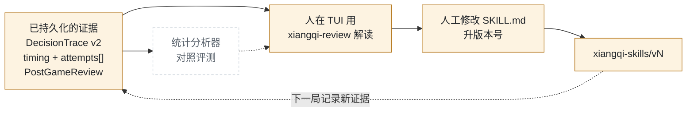

*图 5-6　知识文本改进环（虚线框为缺失环节）*

证据的用途：

- 技能版本把行为归因到版本。v1 → v2 是一次基于耗时测量的人工迭代。
- `DecisionTrace` 可统计技能读取频率，以及读 `compare-candidates` 后风险拒绝是否减少。
- `PostGameReview` 的机器方局部错误数可作回归指标。
- 本地 SSE 测试替身驱动真实 Pi Agent Loop，可扩展为固定局面的回归评测。

缺失的部分：

- 没有读回 `notes[].decision` 做统计的分析器。
- 没有「仅工具 / 入口 + 原则 / 完整技能组」的对照评测。
- 没有真实模型主动读取技能的实战统计。

结论与弈境相同：最后一步保留人工审阅。技能文本进入每一回合的系统提示词，自动改写会带来提示词漂移和对单一模型的过拟合。

## 6. L3 决定什么进上下文

本章按「进上下文的门槛」重排第 5 章，为第 8 章铺垫。

### 6.1 每类信息的去向

| 信息 | 进上下文？ | 形式 | 帮模型做什么决策 |
|---|---|---|---|
| 完整棋谱 + 棋盘字符画 | 是，每回合全量 | 用户消息 | 局面的唯一权威表示 |
| 逐手评估 | 是 | 最近 20 手 + 所有吃子手，5 个字段（`turn-context.ts:25-28`） | 看局势走向 |
| 最近两条机器理由 | 是 | 标注「历史数据，须重验」 | 延续意图，不把旧结论当事实 |
| 32 子安全表 | 否，只给己方受攻子 | `threatened` | 只有受攻子影响本手 |
| 12 个候选完整审查 | 否，只给前 6 个摘要 | `candidates` | 摘要足够比较 |
| 全部合法走法 | 否，按需 | `analyze_position` | 被将军等少数场景才要穷举 |
| 定式与案例 | 是，仅在复查通过时 | `knowledge` / `experiences` | 有证据的候选线索 |
| 原则 | `id/evidence` 进；全文按需 | references | 触发事实是信号，解释是经验 |
| 技能 | 入口和一份剧本进；其余只给索引 | `read_skill` | 渐进披露 |
| 完整 `MoveReview`（风险拒绝时） | 否，只给四个字段 | 存于 `details` | 改选只需四个字段 |
| 耗时、进度 | 否 | L4 与记录 | 与决策无关，还会诱导赶时间 |

### 6.2 与「受保护内容」提案的关系

四层讨论稿担心受保护内容在压缩后丢失，提议用 `context` 钩子从 L3 重新注入。楚河和弈境走得更远：整个上下文都是受保护内容，每回合从 L3 状态完整重建，所以不需要 `context` 钩子。跨回合要保留的意图建模成 `StrategicPlan`，它是业务状态，不是对话记忆。


## 7. L4 Electron 桌面层

### 7.1 从 TUI 迁移到 Electron

Pi 1.4.0 的 L4 是终端界面 pi-tui，扩展用 `setFooter`、`setWidget`、`ui.custom()` 等在终端里绘制。终端画不出木纹棋盘、吃子动画和交互式专家报告。

2026-10-28 的讨论稿列出三条路线：A 保留 TUI，扩展内起本地网页；B 用 RPC / SDK 宿主加 Web 客户端；C 在 B 外套 Electron 壳。当时的判断是「先 A 后 B」。实际推进更快：

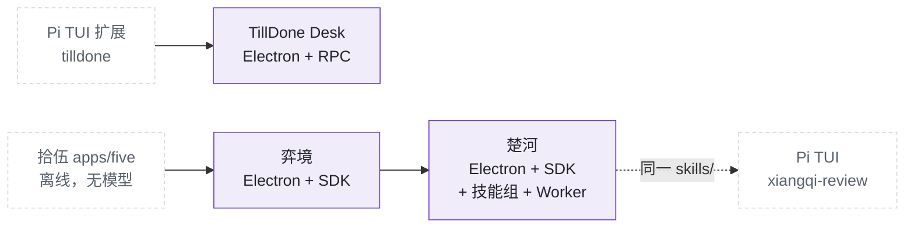

*图 7-1　L4 迁移路径*

楚河继承弈境的 C 路线，并多一个特点：同一套 L3 技能服务两个 L4。在应用里，宿主路由注入技能。在 Pi TUI 里，`.pi/settings.json` 让 Pi 发现同一个 `skills/` 目录，TUI 专用的 `xiangqi-review` 做离线复盘。遥控器和墙上屏幕控制同一台家电。

迁移带来三个变化（与弈境相同）：

1. 扩展里没有绘制代码。界面数据全部来自 L3 状态视图。
2. 权威状态在主进程的 `GameService`，Pi Session 每手用完即弃。
3. 界面用领域原生的表达：SVG 棋盘、DOM 棋子、吃子粒子、棋钟、回看滑条、背景音乐。

### 7.2 接入方式：RPC 还是 SDK

Pi 有四种程序驱动方式：print、JSON 事件流、RPC 子进程、SDK（`createAgentSession`）。交互式桌面应用只能用后两种，本仓库两种都有：

| 维度 | TillDone Desk：Pi CLI + RPC | 楚河：进程内 Pi SDK |
|---|---|---|
| 启动 | `spawn('pi', ['--mode', 'rpc', …, '-e', 扩展目录])` | `createAgentSession({ resourceLoader, tools, sessionManager, … })` |
| 扩展 | 磁盘上现成的 TUI 扩展 | 内联工厂，不落盘 |
| Session | 长寿命子进程，对话累积 | 每手一个内存 Session，用完 `dispose()` |
| 系统提示词 | Pi 默认组装 | 宿主整段替换（见 8.2 节） |
| 技能、工具 | Pi 按设置和 CLI 参数决定 | `noSkills`、`noTools: 'builtin'`，只加载应用技能和 8 个工具，再断言 |
| 写业务状态 | 从事件流推断；审查要跨进程请求 | 工具内 `await port.commit()`，审查结果直接作工具结果 |
| 遥测 | 解析事件流 | 订阅 `turn_start` / `message_*` / `tool_execution_*` |
| 隔离 | 进程隔离 | 同进程；重计算放进 Worker |
| 依赖 | 本机安装的 `pi` | 锁定 1.4.0，打进 DMG |

选型规则：复用现成的 Pi 体验，用 RPC；把 Pi 作为引擎嵌入领域应用，用 SDK。楚河需要的能力只有 SDK 能干净提供。例如每手新 Session、按局面换系统提示词、异步而权威的提交。

SDK 的代价：

- 没有进程级故障隔离。楚河用 Worker 隔离计算侧。
- Pi 版本锁进应用依赖。
- 内存 Session 不落盘，原始提示词和 token 用量无法恢复。`DecisionTrace`、`timing`、`attempts[]` 记录「发生了什么」，不记录「模型看到了什么」。

### 7.3 进程模型与安全边界

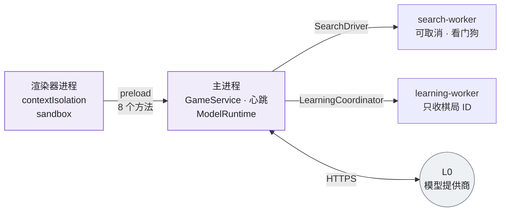

*图 7-2　进程模型*

- 主进程持有权威：`GameService` 和 200 ms 心跳都在这里（`main.ts:190`）。后台渲染器的定时器会节流，主进程不会。
- 渲染器隔离：`nodeIntegration=false`，禁止新窗口和导航，拒绝全部权限请求（`main.ts:163-167`）。
- IPC 双重校验：`trusted(event)` 确认发送方是主窗口主框架；`validCommand()` 和 `validateSettings` 校验形状（`main.ts:49-61`）。
- 密钥只在主进程。Worker 只收棋局 ID，不接触 Pi 会话。
- DMG 用 ad-hoc 签名，并删除 Electron 默认的 ATS 明文例外（`scripts/after-pack.cjs`）。

### 7.4 状态推送

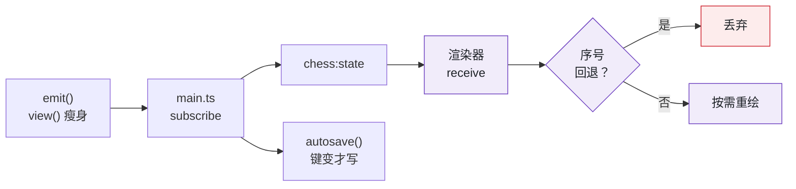

*图 7-3　状态推送与去抖*

- 瘦身：长局的逐手 `evaluations` 可达数 MB，5 Hz 心跳每次克隆太贵。`view()` 去掉它们，只带最后一次 attempt（`game-service.ts:70-73`）。回看时用 `chess:evaluation` 按需取。
- 防倒退：`revision`、`clock.updatedAt`、`updateSequence` 任一回退即丢弃，迟到的 IPC 回复不会覆盖进度（`app.ts:217-220`）。
- 重绘：手数或 revision 变化才重绘棋盘；棋钟、状态卡、手记、日志每次刷新。
- 保存键 `recordSaveKey` 含最后一次 attempt 的 ID，所以失败尝试也会落盘（`turn-timing.ts:25-27`）。

### 7.5 可视化范围与缺口

| 已可视化 | 来源 | 位置 |
|---|---|---|
| 棋盘、合法落点、将军标记、吃子动画 | `position`、`analysis` | 主棋盘 |
| 状态与实时阶段（预搜索、第 N 次模型响应、提交复查等）、本回合用时 | `status`、`progress` | 状态卡（`turn-feedback.ts:8-13`） |
| 棋钟、比分、赛制 | `clock`、`match` | 侧栏 |
| 公开理由、耗时分解、最近未落子尝试 | `notes[]`、`attempts[]` | 手记 |
| 定式、案例、评价、搜索、计划、原则全文、独立复查 | `analysis.expert`、`plan`、`notes[].review` | 专家对话框（`app.ts:140-215`） |
| 复盘进度与历史 | `LearningOverview`、`PostGameReview` | 复盘面板 |
| 四层链路日志 | `logs` | 页脚 |

L4 与模型读同一份 Markdown，详略不同。`skill-text.ts` 在构建时把 `principles.md`、`conditional-principles.md`、`motifs.md` 打进渲染器 bundle，按 `## id` 切节（`skill-text.ts:1-14`）。专家面板显示全文；模型在 `signals` 里只看到 `id/evidence`。这样做不新增 IPC，也不给渲染器文件系统权限。

缺口：渲染器不显示 `DecisionTrace`。`grep decision src/renderer` 无结果，`notes[].decision` 只出现在导出的 JSON 里。用户看得到用时，看不到「按哪个剧本、读了哪些技能、走了哪几步」。

### 7.6 持久化

| 文件 | 内容 | 写入方式 |
|---|---|---|
| `userData/records/<game-id>.json` | `chinese-chess/v1`：棋谱、逐手评估、手记（含 `review`、`plan`、`decision`、`timing`）、棋钟、比分、`attempts[]` | 串行写临时文件再 rename；退出时最多等 3 秒 |
| `userData/learning/library.json` | `xiangqi-learning/v1`：已验证案例（≤ 500）、复盘报告 | 文件锁、锁内重读、原子替换、一代备份 |

`normalizeRecord` 接受缺少 `decision` / `timing` 的旧棋谱，界面显示「未记录」，不当作零。

---

## 8. Prompt 与 Context 工程

### 8.1 单次请求的上下文

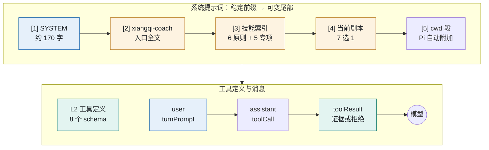

*图 8-1　单次请求的上下文栈*

SYSTEM 只写身份、坐标约定、规则由代码裁决、只经工具落子、公开理由不含思维链。入口全文写四步、复用证据、路由与预算、冲突优先级。

### 8.2 系统提示词：载入与切换

`PiDriver` 把 `catalog.systemPrompt(SYSTEM, guidance.playbook)` 交给 `DefaultResourceLoader`（`pi-driver.ts:56`）。Pi 把它作为 `customPrompt`，整段替换默认的编码助手前言（`pi/…/agent-session.js:1305`）。下表的设置屏蔽其余来源，最终只剩楚河的内容和 `<cwd>` 段：

| 设置 | 屏蔽对象 |
|---|---|
| `appendSystemPromptOverride: () => []` | `APPEND_SYSTEM.md` |
| `noContextFiles: true` | `AGENTS.md`、`CLAUDE.md` 等 |
| `noSkills: true` + `additionalSkillPaths` | 用户 / 项目技能；无 `read`/`bash` 时 Pi 不生成技能段 |
| `noExtensions: true` + 内联工厂 | 用户 / 项目扩展 |
| `noPromptTemplates`、`noThemes` | 提示词模板、主题 |
| `noTools: 'builtin'` + `tools: XIANGQI_TOOLS` | read / bash / edit / write 等编码工具 |

楚河不在会话内换系统提示词，也不用 `before_agent_start`。宿主每手新建 Session，用新剧本装配新提示词。所以一局之内，剧本随局面切换：开局受攻用 `under-attack`，被将军用 `in-check`，余时紧张用 `time-pressure`，大子减少用 `endgame`。

[1][2][3] 整局不变，只有 [4] 每手可能变化，这适合 provider 的前缀缓存。驱动设置了 `cacheWarming: 'off'`（`pi-driver.ts:45`），实际命中取决于 provider。回合中途局面判断变了，剧本不会更换；模型可以 `read_skill` 读另一份剧本。

### 8.3 用户消息的装配

`turnPrompt(state)` 每手装配一次（`turn-prompt.ts:5-15`），数据全部来自 L3：

| 段落 | 内容 |
|---|---|
| 角色与 revision | 「现在轮到你，执红。revision=N。」 |
| 棋钟 | 剩余秒数与赛制；不设单步上限，网络、思考、工具都扣棋钟 |
| 完整棋谱 | `1. 红炮 H7 → E7`，标注吃子、将军；业务坐标不随桌面翻转 |
| 棋盘 | `boardText()`：9 × 10 字符画，大写红、小写黑 |
| 逐手摘要 | `evaluationSummaries()`：最近 20 手 + 吃子手，5 个字段 |
| 最近机器理由 | 最近两条，标注「历史数据，须重验」 |
| `signals` | `turnSignals()` 的紧凑投影（见 5.6 节） |

提示词还在另外三处：

1. 技能文本：流程说明从 SYSTEM 常量和工具描述移进 `SKILL.md`，只有一份事实源（`tests/skills.test.ts`）。
2. 工具描述：只讲接口，即做什么、参数、返回什么、是否提交。流程语句全部移进技能。
3. 工具结果与错误：结果附 `revision`、`coverage`、`warnings` 等字段，以及 `completedDepth` 和 `limitations`。错误文本是纠正性提示词，例如「版本错误：当前 revision=N」。

### 8.4 错误即提示词：风险反驳回路

弈境的 `place_stone` 成功即终止，模型提交前看不到策略警告。楚河用可覆盖的拒绝补上这个缺口：

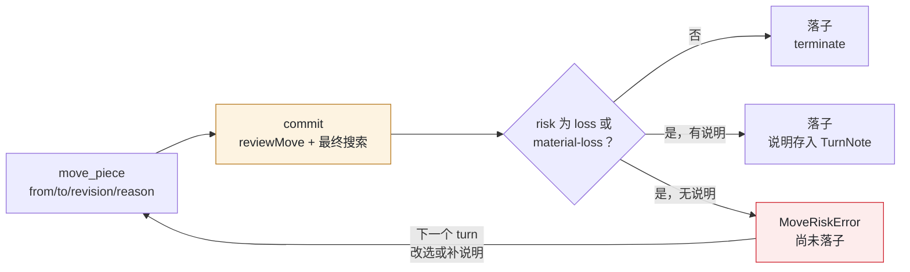

*图 8-2　风险反驳回路*

- 说明字段 `riskAcknowledgement` 长 12–400 字。赛后学习不把带说明的手当作错误。
- `MoveRiskError` 只给四个字段，并提示 `read_skill('playbook-risk-acknowledgement')`。
- 取舍：策略建议不伪装成规则，弃子仍然可以下；关键反馈在行动前进入上下文。
- `pi-integration.test.ts:79` 验证：真实 Pi 循环里，模型收到送车反例后改选。

### 8.5 C&D 框架

#### 压缩：用重建和投影替代

| 手段 | 位置 | 说明 |
|---|---|---|
| 关闭自动压缩 | `compaction: { enabled: false }`（`pi-driver.ts:44`） | `_checkCompaction` 直接返回 |
| 每手重建 | 每手新建内存 Session | 对话不累积；记忆是权威棋谱和计划 |
| 投影 | `turnSignals()` | 从完整分析挑字段，不改原数据 |
| 装配时摘要 | `evaluationSummaries()` | 见 8.3 节 |
| 渐进披露 | 入口 + 索引 + 1 份剧本 | 其余 17 项技能和 7 份 references 按需读 |
| 错误瘦身 | `MoveRiskError` 四字段 | 完整 review 进 `details`，不进上下文 |
| 硬上限 | 8 次请求 / 16 次工具调用 | 单回合上下文有界 |

首次请求（system + user，不含工具 schema）改用 `signals` 投影后，字符数下降（`docs/l3-skills-refactor.md`）：

- 初始局面：26665 → 9316（-65%）
- `human-mistakes` 第 42 手前：32881 → 11668（-65%）
- `passive-game` 第 53 手前：36994 → 12049（-67%）

字符数不等于 token 或费用。状态能完整序列化时，压缩有损，重建无损。投影也无损，因为 `analyze_position` 随时取回投影去掉的字段。代价是棋谱随手数线性增长，系统提示词每手重付。

#### 委派：把上下文内容换成可调用的能力

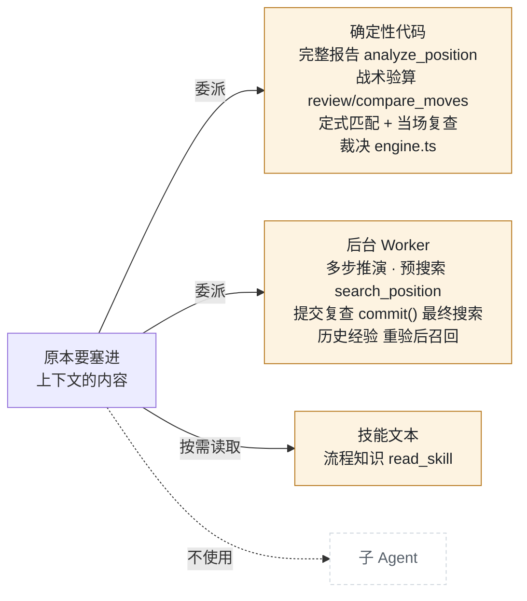

*图 8-3　委派的三个去向*

每项能力替代一类上下文内容，例如 32 子安全表、12 个候选的完整审查、模型心算的多步推演、过去的对局。楚河不委派给子 Agent。棋钟每秒都在扣，确定性计算几乎零延迟；子 Agent 至少多一次网络往返和一份 L0 账单。

### 8.6 各层的分布

| 层 | 对提示词与上下文的贡献 |
|---|---|
| L0 | 模型先验；`thinkingLevel: 'low'` |
| L1 | 系统提示词装配与屏蔽；索引格式化；用户消息模板；请求预算；注入预搜索结果 |
| L2 | 工具 schema（含技能枚举）；结果 JSON；拦截、错误与风险反驳文本；`terminate` |
| L3 | 技能文本；剧本路由；`signals` 契约；原则证据；定式与案例；`DecisionTrace` |
| L4 | 不参与提示词；与模型共享 references 但显示全文；不索取思维链 |


## 9. 评审

### 9.1 亮点

| # | 亮点 | 要点 |
|--|------|------|
| 1 | Pi 原生技能 + 宿主路由 | Pi 负责发现、校验、索引；宿主负责选择、授权、审计。自写加载器已删除 |
| 2 | 提交即复查 | 不靠模型自觉审查；风险提交得到可覆盖的拒绝 |
| 3 | 定式是确定性信号 | 全盘匹配 + 镜像换色 + 当场复查，模型不背谱 |
| 4 | 数据级自我改进环已闭合 | 复盘、验证、持久化、召回，每步重验；不训练权重 |
| 5 | 审计与落子原子一致 | 在 `commit()` 事务内定稿证据链和耗时 |
| 6 | 先测量，后优化 | 耗时诊断区分「模型往返」与「思考」；v2 技能据此修改 |
| 7 | 人机同源 | L4 与模型共用 references |
| 8 | 测试驱动真实 Pi 循环 | 本地 SSE 模拟模型，覆盖隔离、纠错、预算、取消、棋钟耗尽 |

### 9.2 风险与建议

| # | 风险 | 层 | 建议 |
|--|------|--|------|
| 1 | 渲染器不显示 `DecisionTrace` | L4 | 手记卡片显示剧本、技能、工具序列 |
| 2 | `move_piece` 成功后不 `abort()`；同批有其他工具时多一次请求，占用棋钟（源码推断） | L1 | 在 `tool_execution_end` 见到落子即 `void session.abort()`；补混合批次测试 |
| 3 | 路由阈值靠经验；开局即路由到 `under-attack` | L3 | 统计剧本分布；改为「受攻且无法保护」才触发 |
| 4 | 缺少真实模型的技能读取统计（弈境 40 手读取为 0） | L3 | 实战统计 `skillsRead`；必要时在 `signals` 中提示 |
| 5 | `cwd` 是 `userData`，Pi 把本机路径写进系统提示词 | L1 | 传中性 cwd，或用 `sections` 覆盖 |
| 6 | `cacheWarming: 'off'`，每手重发系统提示词 | L1 | 评估开启预热 |
| 7 | 回合中推荐剧本变化时不重载 | L1/L3 | 搜索结果附 `recommendedPlaybook`，不同时显式提示 |
| 8 | 搜索证据未绑定最终候选 | L3 | 记录候选摘要；优先级低 |
| 9 | 知识文本的改进环未闭合，无法证明 v1 → v2 有提升 | L3 | 见图 10-1 |
| 10 | 案例只覆盖局部战术 | L3 | 先做准局部动机，再考虑计划类案例 |
| 11 | 规则是简化竞赛规则（无长捉） | L3 | `rules-summary.md` 同步声明，避免模型按正式规则推理 |

## 10. 结论

楚河用约 3000 行 TypeScript 和 19 项技能，让模型在真实棋钟下可审计地决策。

- **Harness**：权威留在宿主；9 成员的 `TurnPort` 是唯一端口；重计算放进 Worker。
- **Loop**：一手棋 = 一次 settle；循环外加载技能、做预搜索；run 内循环只挂 `tool_call`；棋钟是唯一时间权威。
- **Skills**：宿主选剧本，模型在白名单内按需读取；定式和案例是信号。
- **Context**：每手重建，`signals` 投影代替全量注入，渐进披露代替长提示词。

下一步：

1. 显示 `DecisionTrace`，补上落子后的 `abort()`。
2. 用真实模型跑几局，校准路由阈值和技能描述。
3. 接通知识文本的改进环（图 10-1）。

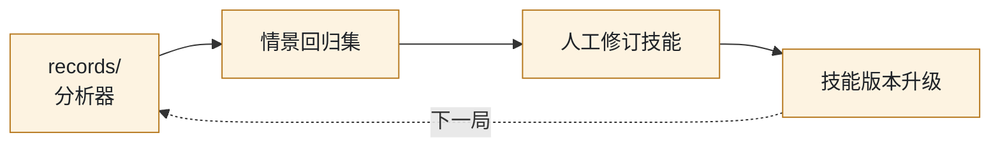

*图 10-1　知识文本改进环*

## 附录 A：源码索引

路径相对 `apps/chinese-chess/`；`pi/` = `node_modules/@earendil-works/`。

| 主题 | 位置 |
|---|---|
| SYSTEM、压缩与预热开关 | `src/agent/pi-driver.ts:12-46` |
| ResourceLoader、隔离校验 | `src/agent/pi-driver.ts:47-72` |
| 宿主订阅、预搜索、发送提示词 | `src/agent/pi-driver.ts:73-113` |
| 技能目录、索引、系统提示词 | `src/agent/skill-loader.ts:6-59` |
| 用户提示词模板 | `src/agent/turn-prompt.ts:5-15` |
| 预算闸门、`read_skill`、`move_piece` | `src/extensions/xiangqi.ts:17-35`、`:90-106` |
| `DecisionTrace`、路由 | `src/business/decision.ts:10-49` |
| `signals` 投影 | `src/business/turn-context.ts:4-28` |
| 耗时遥测 | `src/business/turn-timing.ts:25-85` |
| `TurnPort` | `src/business/game-service.ts:16-27` |
| `commit()` 独立复查 | `src/business/game-service.ts:279-336` |
| 专家计算 | `src/business/expert.ts:119-275` |
| 搜索 / 计划 / 定式 | `live-search.ts:6-41`、`plan.ts:18-45`、`knowledge.ts:52-79` |
| 案例验证、复盘、召回 | `src/business/learning.ts:131-241` |
| 组合根、IPC | `src/electron/main.ts:62-155` |
| 渲染、人机同源 | `src/renderer/app.ts:95-230`、`skill-text.ts:1-14` |
| Pi settle 外循环、`tool_call` 桥接 | `pi/pi-coding-agent/dist/core/agent-session.js:1423-1472`、`:322-330` |
| Pi 技能加载与索引 | `pi/pi-coding-agent/dist/core/skills.js:278-301` |
| Pi run 内循环 | `pi/pi-agent-core/dist/agent-loop.js:84`、`:471` |

## 附录 B：术语表

| 术语 | 含义 |
|---|---|
| 宿主 | 驱动 Pi 的我方代码 |
| settle 外循环 | `_startRun()` 中反复起 run 直到停稳 |
| run 内循环 | `runLoop()` 中反复执行 turn |
| revision | 业务状态版本号；改变棋盘或回合有效性的操作都会递增 |
| turn | Pi 的一次模型回复 + 其中全部工具调用 |
| 回合 | 机器的一次走子回合，不指 turn |
| 接入点 | L2/L1 挂进 Pi 循环的位置 |
| `TurnPort` | L3 定义的单回合端口，9 个成员 |
| 技能 | 含 `SKILL.md` 的目录；分入口技能、原则、剧本、专项技能 |
| 索引 | `<available_skills>`，列出可读技能 |
| 渐进披露 | 只注入入口、索引和当前剧本，其余按需读取 |
| 信号 | `signals`，从完整分析投影出的紧凑决策数据 |
| 投影 / 重建 | 挑字段送入上下文 / 每手从权威棋谱重新生成上下文 |
| 预搜索 | 回合前宿主做的全根搜索 |
| 独立复查 | `commit()` 内不依赖模型的审查与最终搜索 |
| 可覆盖的拒绝 | 风险提交未落子；附说明后可再提交 |
| 证据链 | `DecisionTrace`，一次落子的可审计记录 |
| 已验证案例 | 反例与替代都通过重验的局部经验 |
| C&D | Compaction & Delegation，压缩与委派 |
| ASD-STE100 | 简化技术英语规范；本文借用其短句、一词一义原则 |


