# 楚河 · Chinese Chess LLM 技术白皮书：四层 Agent Harness、双循环接入点、Pi 原生技能组与上下文工程

> 设计更正：5.4 节已更新为 `xiangqi-skills/v3` 原生方案；其余章节及行号、测试数字保留 v2 历史快照，不应当作当前实现。当前完整说明见 [原生 Skill 与内置工具](native-skills.md)。现有 PDF 尚未重生成。
> 版本：v1.0 · 2026-10-30
> 对象：`apps/chinese-chess`（工作区快照，含尚未提交的 L3 技能组重构 `xiangqi-skills/v2` 与回合耗时诊断）
> 依赖：`@earendil-works/pi-coding-agent` 1.4.0、`@earendil-works/pi-ai` 1.4.0、Electron 45
> 验证：撰写时在工作区运行 `bun test tests/*.test.ts`，15 个文件 136 项测试全部通过（1599 个断言）
> 姊妹篇：`apps/five-llm/docs/five-llm-whitepaper.md`（弈境 · 五子棋）

## 摘要

楚河是一个 Electron 人机中国象棋桌面应用。它的机器棋手不是被包装成聊天界面的搜索引擎，而是**一个只能通过 Pi Agent Harness 的工具调用走子的大语言模型**。它是本仓库第二个“真由 LLM 落子”的棋类应用，直接继承了弈境（five-llm）的骨架，但在三个方向上走得更远：

1. **Harness Engineering**：仍是自下而上的四层：L1 Agent Loop（Pi SDK 驱动）、L2 Pi 扩展、L3 业务、L4 Electron 桌面，依赖方向是“端口与适配器”。不同之处在于 L3 的体量（规则、专家审查、有界多步搜索、局面评价、跨回合计划、定式库、赛后学习约为 five-llm 的 3 倍），以及 `TurnPort` 从 4 个成员扩展到 9 个：搜索、计划、案例召回、决策审计、耗时遥测都通过同一个端口进出。
2. **Loop Engineering**：每个机器回合 = 一个全新的内存 Pi Session = 一次 `session.prompt()` = 一次 settle。L2 只挂一个扩展事件 `tool_call`（16 次工具预算），注册 8 个领域工具；L1 宿主另外订阅 `turn_start`、`message_update`、`message_end`、`tool_execution_start/end` 五类观察事件，用来做 8 次请求上限、逐请求耗时与首个增量、决策审计。与弈境不同，楚河**取消了 90 秒技术超时**，唯一的时间权威是业务层的比赛棋钟；并且在 run 开始**之前**由宿主自动做一次全根搜索。
3. **Prompt / Context Engineering**：L3 的流程知识从散在四处的 TypeScript 字符串，迁移成了 **19 项 Pi 原生 `SKILL.md` 技能**（1 个入口、6 条原则、7 个剧本、5 项专项技能，加 7 份 references）。Pi 的加载器负责发现、校验、去 frontmatter 和索引格式化，宿主负责“注入哪份、允许读哪些、记录读了什么”。系统提示词 = 精简 SYSTEM（约 170 字）+ 入口全文 + `<available_skills>` 索引 + 宿主按局面选出的**唯一**剧本；其余通过枚举参数的 `read_skill` 工具按需读取。用户消息从“整份分析 JSON”改为紧凑的 `signals` 投影，三份固定局面首次请求的字符数下降 65%–67%。Pi 自动压缩被关闭，取而代之的是“每手从权威棋谱重建”。

L3 还埋了两条**自我改进**的线。第一条已经**自动闭环**：每局终局保存后，独立 Worker 复盘双方每一手，验证“局部合法反例 + 较安全替代”，原子写入案例库，下一局按当前棋盘重验后召回进上下文（这是弈境没有的）。第二条是**知识文本的改进环**：`DecisionTrace`、逐回合耗时与失败尝试都已持久化，TUI 专用的 `xiangqi-review` 技能可以离线解读；但从“证据”到“修改技能文本”这一步仍是人工的。

本文按 5W1H 逐层走读，第 2 章先用一个“智能住宅”的比喻建立直觉，之后每章都回到源码行号。文末给出亮点、风险与改进建议。

---

## 0. 阅读约定

### 0.1 层的编号

与 four-layer 讨论稿、弈境白皮书一致，采用**自下而上**编号：

| 编号 | 名称 | 主要文件 |
|---|---|---|
| L0 | 模型提供商 | 经 Pi `ModelRuntime` 访问；默认 `openai-codex/gpt-6.1-sol` |
| L1 | Agent Loop 层（Pi SDK 驱动） | `src/agent/pi-driver.ts`、`skill-loader.ts`、`turn-prompt.ts`、`model-selection.ts` |
| L2 | Pi 扩展层（接入点） | `src/extensions/xiangqi.ts` |
| L3 | 业务层（规则、专家计算、知识、技能、学习） | `src/business/*.ts`、`skills/**`、`src/learning/*`、`src/data/ccpd` |
| L4 | Electron 桌面层 | `src/electron/*.ts`、`src/renderer/*` |

README 里“四层结构”的 ASCII 图是**自上而下**画的（Electron → 业务 → Pi 扩展 → Agent Loop），描述的是一次请求的流向。两种编号指同一组层。

### 0.2 双循环术语

沿用本仓库走读系列的定义：

- **settle 外循环**（续跑—停稳，Settle Loop）：`AgentSession._startRun()` 中的 `while`。首个 run 结束后，因重试、压缩、排队消息或 `agent_before_settle` 续跑请求而再起一个 run，直到停稳，最后发出 `agent_settled`。
- **run 内循环**（模型—工具，Agent Loop）：`agent-loop.js` 的 `runLoop()`，反复执行 turn。一个 turn = 一次 LLM 流式回复 + 这条回复里所有工具调用的执行。
- 计数符号：`N` = run 数，`M` = turn 数（即 LLM 请求数），`K` = 工具调用数。

### 0.3 代码快照说明

撰写时 `apps/chinese-chess` 有一轮**尚未提交**的改动：新增 `skills/`、`.pi/`、`src/agent/skill-loader.ts`、`turn-prompt.ts`、`src/business/decision.ts`、`turn-context.ts`、`turn-timing.ts`、`src/renderer/skill-text.ts`、`turn-feedback.ts` 及对应测试，并修改了驱动、扩展、`GameService`、`knowledge.ts`（接入 CCPD）和渲染器。最近一次相关提交是 `e15f2ee`（DMG 打包）。本文描述的是这份工作区代码；实施记录见 `docs/l3-skills-refactor.md` 与 `docs/turn-latency.md`。引用写作 `路径:行号`（相对 `apps/chinese-chess/`）；Pi 源码引用的是 `node_modules/@earendil-works/` 下 1.4.0 的编译产物，下文简写为 `pi/`。

### 0.4 参考资料与可信度

| 文档 | 内容 | 本文如何使用 |
|---|---|---|
| `discussions/2026-10-28-four-layer-harness.md` | 四层定义、L3 原则“上下文管理是手段，业务语义是内容”、L2 插入点核对清单 | 四层划分与 L3 原则的来源（3.1、6.4 节） |
| `discussions/2026-10-28-l4-web-desktop-and-plugin-harness.md` | L4 走向 Web / 桌面的 A/B/C 路线，Pi 被驱动的四种方式 | L4 迁移与 Pi 接入选型（7.1、7.2 节） |
| `discussions/2026-10-30-pstack-analysis-grok.md` | Grok 对 pstack 的结构分析 | “设计血统”参照（5.9 节），二手资料，未重新核验上游 |
| `discussions/2026-10-30-refactor-chinese-chess-pi-skills.md` | 楚河 L3 用 Pi 原生 Skill / Package 承载业务知识的提案，问题清单 P1–P11、决策点 D1–D8、Pi 机制核对 | 与实际实现逐条对照（5.10 节） |
| `docs/l3-skills-refactor.md`、`docs/turn-latency.md` | 重构实施与验收记录；耗时诊断口径 | 设计意图与测量数据的权威说明 |
| `apps/five-llm/docs/five-llm-whitepaper.md` | 弈境白皮书 | 对照基线；凡“与弈境相同”处不再展开 |

可信度排序：源码与测试 > 实施记录 > 讨论稿 > Grok 的二手分析。不一致之处以源码为准。

---

## 1. 引言：要解决什么问题

### 1.1 Why：为什么象棋比五子棋难得多

弈境要回答的问题是“如何让通用 LLM 在有硬规则、有时限、有对抗的领域里做出可审计的决策”。楚河继承这个问题，但象棋把难度提高了一个量级：

| 维度 | 五子棋（弈境） | 中国象棋（楚河） |
|---|---|---|
| 规则 | 落子不可移动，合法性 = 空点 | 7 种棋子、马腿 / 象眼 / 炮架 / 九宫 / 照面、应将、困毙、重复、长将、120 半回合 |
| 战术 | 连五威胁基本可全盘扫描 | 吃子交换、牵制、闪击、连续将军，需要搜索 |
| 典型失误 | 漏防一手成五 | “平车送车”“贪兵丢炮”：看似主动，实则白丢大子 |
| 领域知识 | 几乎没有可用的开局库 | ECCO 体系、CCPD 公开棋谱，可做局面匹配 |
| 回合时间 | 平均 10 秒级 | 每方 30 分钟包干，长考合法 |

所以楚河在弈境的四条约束（规则不可协商、LLM 必须真的做决定、过程可审计、时间是真实资源）之外，又加了两条：

5. **模型容易高估“主动”而低估“丢子”**，业务层必须给出可验证的反例，并在提交时独立复查。
6. **知识量大且分层**，不能一股脑塞进提示词，需要按局面路由、按需读取，并且要和人读文档同源。

### 1.2 What：三层工程视角

| 视角 | 关注点 | 在楚河中的体现 |
|---|---|---|
| Harness Engineering | 系统怎么分层，权威在哪 | 四层架构 + 9 成员 `TurnPort` + 单写者 `GameService` + 两个 Worker |
| Loop Engineering | Agent 循环在哪些点被约束 | 每手一次 settle；回合前自动搜索；`tool_call` 预算；`terminate`；棋钟取代技术超时 |
| Prompt / Context Engineering | 模型每次看到什么 | Pi 原生技能组、剧本路由、`<available_skills>` 索引、`signals` 投影、错误即提示、重建取代压缩 |

四层架构本身就是 Harness Engineering 的框架；Pi 的双循环及其接入点的设计属于（Agent 层面的）Loop Engineering；而 Prompt / Context Engineering 是**跨四层**的视角，第 8 章专门讨论。

---

## 2. 一个比喻：把 Agent Harness 看成一栋智能住宅

在钻进源码之前，先用一个日常的比喻建立直觉。**一整栋装修好的智能住宅 = Agent Harness；设计这栋房子的人 = Harness 工程师；住户 = 用户；而这栋房子里最特别的“电”，是会自己拿主意的电。**

### 2.1 总表

| 层 | 比喻 | 对应 Agent Harness | 在楚河中的具体物 |
|--|--------------|----------------|------------------|
| L0 | **公用事业公司**：电力、自来水、燃气、宽带 | 模型提供商 | Codex 订阅、DeepSeek 按量 API、Anthropic API |
| L1 | **入户管网**：墙里看不见的电线、水管、燃气管、网线，加总闸和水表 | Pi 双循环：run 内循环（Agent Loop）+ settle 外循环（Settle Loop） | 每手一个 Session；`prompt()`；`abort()` |
| L2 | **墙上的标准接口面板**：插座、水龙头接口、燃气接口、网口，外加断路器和计量表 | ExtensionAPI：事件钩子、注册工具、注册命令 | `tool_call` 钩子；8 个工具；宿主事件订阅 |
| L3 | **家电**：本体、保险丝、传感器、程序模式、说明书，以及整套品牌的打包分发 | 业务规则、领域数据、专家经验、技能组、Plugin | `engine` / `expert` / `search` / `knowledge` / `learning` / `skills/` |
| L4 | **控制与显示终端**：墙上固定触屏、手机 App、遥控器 | TUI、Electron 桌面、Web / 移动 | Electron 主窗口；Pi TUI（复盘技能） |

### 2.2 逐层展开

**L0 公用事业公司（大模型）。**

| 住宅 | Agent Harness |
|---|---|
| 包月宽带 vs 按度计费的电 | 订阅制（Claude Code、Codex 订阅）vs 按量 API（DeepSeek、在第三方 harness 里用 Anthropic） |
| 用电度数 | token 用量 |
| 水管口径 | 上下文窗口 |
| 限电、停水 | 限流、服务中断，由 L1 的重试兜底（楚河 `retry.maxRetries = 1`） |
| 同一台家电接哪家电力公司，账单差很多 | 同一个应用选哪个 provider，费用模型完全不同 |
| 物业不会在你不知情时换供应商 | `model-selection.ts:7-15`：默认模型缺失时**明确报错，绝不静默换成 Claude 或其他模型** |

最后一行是楚河里一个很实际的设计：在 Pi 这类第三方 harness 里使用 `anthropic/*` 走的是按量计费的 API，静默切换可能直接产生费用。

**L1 入户管网（双循环）。**

| 管网部件 | 对应 |
|---|---|
| 打开一次水龙头：放水、用水、回水 | 一个 turn：LLM 回复一次，执行工具，结果流回上下文 |
| 回路里的水循环：只要还有工具调用就继续流 | run 内循环（Agent Loop） |
| 总水表 + 自动补水泵：水停了先看要不要补（重试、排队消息、续跑），确认没有了才停转 | settle 外循环（Settle Loop）；停转即 `agent_settled` |
| 水箱容量；快满时把旧水沉淀浓缩 | 上下文窗口；Compaction（楚河把它关掉了） |
| 总闸 | `session.abort()` / `AbortSignal` |
| 管网按建筑规范铺设，住户不能改 | Pi 的循环是固定的，只能 fork |

**L2 接口面板（接入点）。** 墙上的接口按能力分成几类：

| 墙上的东西 | 能做什么 | 对应 | 楚河里的实例 |
|---|---|---|---|
| 电表、水表读数口 | 只能看 | 观察类事件 `turn_start` / `message_*` / `tool_execution_*` | L1 宿主订阅：请求计数、耗时、审计 |
| 断路器、漏电保护 | 能切断，跳闸后告诉你原因 | `tool_call` 拦截，理由作为工具结果回给模型 | 16 次工具预算；回合已结束即拒绝 |
| 净水器、稳压器 | 改变流过的东西 | 改写类钩子 `context` / `tool_result` / `before_provider_request` | 楚河一个都没用 |
| 新装一个插座 | 增加能力 | `registerTool` | 8 个象棋工具 |
| 墙上的开关 | 住户一按就触发 | `registerCommand`（斜杠命令） | 应用内没有；TUI 里有 `/skill:xiangqi-review` |
| 定时器、限流阀 | 到点或到量就断 | 预算闸 | 8 次请求、16 次工具调用、搜索 2600 ms / 70000 节点 |
| 燃气表的计费阀 | 用多少扣多少，扣完自动关 | 比赛棋钟 | 网络、思考、工具全部扣钟，到时判负 |

接口是“国标”的：插头符合 ExtensionAPI 的家电都能插。接口里不放家电的逻辑，即 **L2 不放业务规则**。

**L3 家电（业务层）。** 这一层是整栋房子里最有“智能家居”味道的部分：

| 家电的组成 | 对应 | 楚河中的例子 |
|---|---|---|
| 保险丝、安全规范 | 硬规则 | `engine.ts` 走法与将帅安全、`clock.ts`、`GameService` 的 revision 与一次提交 |
| 传感器读数 | 确定性事实 | 每子的合法攻击者、牵制、全部合法走法 |
| “智能推荐”模式 | 启发式 | 候选分数、位置六项、同格交换估计（都标注“不是胜率”） |
| 放进去的食材 | 领域数据 | 棋谱；73 条开局路线 / 1360 个节点 |
| 菜谱、洗涤程序 | 剧本、技能（专家经验） | 7 个剧本、5 项专项技能 |
| 说明书的目录页 | 技能索引 | `<available_skills>` 常驻系统提示词 |
| 翻说明书的某一页 | 按需读取 | `read_skill(name, reference?)` |
| 按重量和材质自动选程序，住户不能手动切 | 宿主确定性路由 + `disable-model-invocation` | `turnGuidance()` 选剧本；剧本不进模型可选索引 |
| 家电上的按钮 | 工具：能力的受限接口 | `review_move` / `search_position` / `move_piece` |
| 电机、压缩机 | 业务服务：权威实现 | `commit()`；`reviewMove()`；搜索 Worker |
| 出厂质检 + 每次开机自检 | 提交时独立复查 | 无论模型是否主动审查，`commit()` 都会做反击审查 + 最终搜索 |
| 扫地机器人充电时整理地图，下次绕开障碍 | 赛后学习闭环 | 学习 Worker 复盘终局棋谱 → 验证案例 → 下一局召回 |
| 品牌套装整箱发货 | Plugin / Pi Package：打包分发技能组 | 楚河**有意不发**（5.8 节），但目录按包约定命名 |
| 售后上门的检修接口 | 离线诊断技能 | `.pi/skills/xiangqi-review`，只在 TUI 用 |

一句话区分：**菜谱是方法，按钮是接口，电机是实现。** 技能组（SKILL.md）是“菜谱 + 说明书”，工具是“按钮”，`GameService` 与专家计算是“电机”。三者不必一一对应。

扫地机器人这个比喻值得多说一句：它在充电座上（独立 Worker）整理这次清扫的地图，下次出发时绕开上次撞过的桌腿，但**它没有改写自己的固件**。楚河的学习闭环也一样：不训练模型权重，只是积累“已验证的局部经验”，并且每次使用前都按当前地形（棋盘）重新核对。

**L4 控制与显示终端（UI）。** 遥控器对应 Pi TUI；墙上固定触屏对应 Electron 桌面；手机 App 对应 Web / 移动端。从“遥控器 + 小液晶屏”升级为“墙上大触屏”，就是从 Pi 原生 TUI 迁到 Electron（7.1 节）。原则是：**面板上的温度读的是温度计，不是问厨师**。棋盘、棋钟、比分都直接来自 L3 状态，不经过模型转述；模型的公开理由只是“厨师的一句话备注”。

楚河的触屏上还有两块新的“仪表”：实时的“本回合正在做什么”（准备会话 / 预搜索 / 等待模型响应 / 比较候选 / 提交复查），相当于家电面板上的运行阶段指示灯；落子后的“耗时分解”，相当于电表的分时计量。

### 2.3 跨层概念

| 概念 | 比喻 |
|---|---|
| Prompt Engineering | 给家电的指令和菜谱写得清不清楚 |
| Context Engineering | 备菜：每次往锅里放什么、放多少，由家电（L3）决定 |
| Compaction | 冰箱太满，把剩菜合并装盒 |
| 每手重建（楚河 / 弈境） | 不留剩菜，每顿按完整清单现买现做 |
| `signals` 投影 | 只把今天要用的食材摆上台面，其余留在冰箱（`analyze_position` 随时可取） |
| Delegation 给确定性工具 | 让洗碗机洗，而不是用手洗 |
| Delegation 给 Worker | 把衣服送去楼下洗衣房，自己不用守着 |
| 子 Agent | 请家政公司派人来（另一份 L0 账单）；楚河暂未采用 |
| revision 版本号 | 订单号：旧订单的配送员上门签收会被拒绝 |
| RPC 子进程接入 Pi | 独立摆放的家电插标准插座：坏了不影响房子，只能用面板上有的功能（TillDone Desk） |
| SDK 进程内接入 Pi | 嵌入式入墙家电：控制更深更精细，维修要拆柜（弈境、楚河） |

### 2.4 比喻失效的地方

1. **智能在哪一层，正好反了。** 真实住宅里水电是“笨”的，聪明的是家电；在 Agent Harness 里，**做决策的是 L0 送来的大模型**，L3 反而负责把关、提供事实和经验。这正是 L2 需要断路器、L3 需要保险丝和出厂复检的原因。
2. **管线里的水会回流，还会自己决定再开一次龙头。** 工具结果流回上下文，模型据此决定下一步，循环是主动的。
3. **家电能改变管道里流的东西。** L3 通过 L1/L2 决定系统提示词和每一份工具结果，等于家电能决定下一次流来什么。

### 2.5 用楚河走一遍

住户在墙上的触屏（L4）走了一步马 → 象棋家电（L3）查保险丝（全谱重放、将帅安全）、读传感器（受攻子、牵制）、自动选好程序（剧本：大子受攻），并在开闸之前先让洗碗机预洗一遍（回合前自动搜索）→ 把菜谱目录、选中的那页菜谱和今天的食材清单（技能索引、剧本全文、`signals`）送进管网（L1）→ 电力公司（L0）送来“会思考的电”，在管网里一圈圈流动（run 内循环），每经过墙上接口（L2）都要过断路器（16 次工具预算）；它可能按下“比较候选”“搜索变化”“复核计划”几个按钮，也可能翻一页说明书（`read_skill`）→ 最后按下“走子”键 → 电机（`GameService`）核对订单号（revision）、燃气表（棋钟），再做一遍出厂复检（独立审查 + 最终搜索）；复检发现“这一步会白丢车”就退单并附上原因，模型改选 → 合格后执行，水表停转（`agent_settled`）→ 下一手不吃剩菜，全部按清单重新准备（每手重建）→ 一局结束，扫地机器人回到充电座整理地图（学习 Worker）。

---

## 3. 四层架构（Harness Engineering）

### 3.1 四层的来历与原则

四层划分来自 2026-10-28 的讨论，当时把 Pi Agent Harness 的四层分析和 IndyDevDan 视频里的 Pi 扩展示例逐层对照后得出：

| 层 | 原始定义 | 不做什么 |
|---|---|---|
| L1 | Pi 运行时：搬运和累积，拼装上下文，把工具结果追加进历史 | 不判断内容好坏 |
| L2 | ExtensionAPI：在 L1 的固定插入点上挂回调，是 L1 和 L3 之间的胶水 | 不放业务规则 |
| L3 | 业务逻辑：**决定什么信息进上下文、进多少、以什么形式进** | 不碰渲染，不直接依赖 Pi 的事件形状 |
| L4 | 界面：一条**独立的数据通道** | 不占上下文，不经过模型转述 |

两条原则在楚河里都落实得很彻底：

1. **上下文管理是手段，业务语义是内容。** 检验标准是“每一个进入上下文的字段，都要能回答它帮模型做哪个业务决策”。楚河的 `turnSignals()` 正是按这条标准从完整分析里**挑字段**：只给己方受攻子、前 6 个候选的风险与反击线、搜索摘要（6.3、8.3 节）。
2. **界面通道与上下文通道分离，冲突时以界面为准。** 专家参谋面板显示完整报告和原则全文，模型只看到一句话 `advice` 与 `id/evidence`；两边读的是同一份 Markdown 源（7.5 节）。

和弈境一样，楚河用的是进程内 SDK，所以 L1 除了 Pi 运行时本身，还包括宿主一侧驱动它的 `PiDriver`、技能目录 `SkillCatalog` 和用户提示词模板 `turnPrompt`。

### 3.2 全景

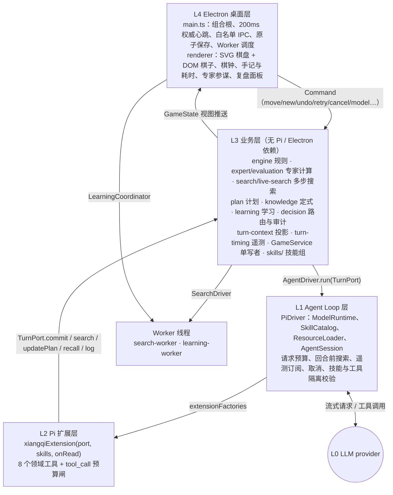

### 3.3 各层职责（What / Who）

| 层 | 拥有的权威 | 不允许做的事 |
|---|---|---|
| L1 PiDriver | 本回合 Pi Session 的生命周期：模型解析、技能目录与隔离校验、请求预算 8、回合前搜索、遥测与审计订阅、取消转发 | 不判断走法是否合法，不碰棋钟 |
| L2 xiangqiExtension | 本回合的工具面：8 个工具、调用预算 16、`active()` 守卫、revision 预检、`MoveRiskError` 转换为可纠错结果 | 不直接改棋谱；提交只能经过 `port.commit` |
| L3 GameService 等 | 棋谱、revision、轮次、棋钟、比分、胜负、计划、决策审计、耗时，以及**唯一写入入口**；提交时的独立审查 | 不 import Pi 或 Electron |
| L4 main / renderer | 进程组合、心跳、IPC 校验、原子保存、学习调度、可视化 | 渲染器不能提交 LLM 走子，也不能改权威状态 |

### 3.4 依赖方向：9 成员的 `TurnPort`

图 3.2 是**运行时**链路，**编译依赖**指向中心的 L3：

- `game-service.ts:16-26` 定义 `TurnPort`，`:27` 定义 `AgentDriver { run(port) }`。业务层只知道这两个接口（依赖倒置）。
- L1 的 `PiDriver implements AgentDriver`（`pi-driver.ts:16`），L2 的 `xiangqiExtension(port, …)` 接收同一个 `TurnPort`。两者 import 业务层的纯函数，反方向的 import 一个都没有。
- L4 的 `main.ts` 是组合根：创建 `PiDriver`（`main.ts:94`）、`LearningCoordinator`、`WorkerSearchDriver`，注入 `GameService`（`:107-108`），再把 `service.subscribe` 接到 IPC 推送和自动保存（`:115-119`）。冒烟测试注入一个显式标注的 UI fixture driver（`:76-92`），业务层不受影响。

与弈境相比，`TurnPort` 从 4 个成员扩展到 9 个，这就是楚河 L3 能力增长在接口上的体现：

| 成员 | 方向 | 用途 | 谁调用 |
|---|---|---|---|
| `state` | L3 → L1/L2 | 回合开始时的深拷贝快照 | 驱动、工具 |
| `signal` | L3 → L1/L2 | 取消、超时、被新局面替换 | 驱动监听后 `abort()` |
| `log` | L1/L2 → L3 | 四层链路日志（回合失效后静默） | 驱动、扩展 |
| `commit` | L2 → L3 | **唯一写入**：异步，含独立审查与最终搜索 | `move_piece` |
| `search` | L1/L2 → L3 | 有界多步搜索，受本回合累计预算约束 | 回合前搜索、`search_position` |
| `updatePlan` | L2 → L3 | 暂存公开计划，只随成功走子持久化 | `update_plan` |
| `recall` | L2 → L3 | 按当前局面召回已验证的赛后案例 | 审查、比较、试算三个工具 |
| `setDecision` | L1 → L3 | 暂存 `DecisionTrace`，在提交事务内定稿 | 驱动 |
| `telemetry` | L1 → L3 | 耗时区间：setup / pre-search / model / tool / review | 驱动 |

这是典型的六边形（Ports & Adapters）架构：L1 和 L2 是 Agent 适配器，L4 是 UI 与持久化适配器，Worker 是计算适配器（`SearchDriver`）。

### 3.5 一手棋的端到端时序

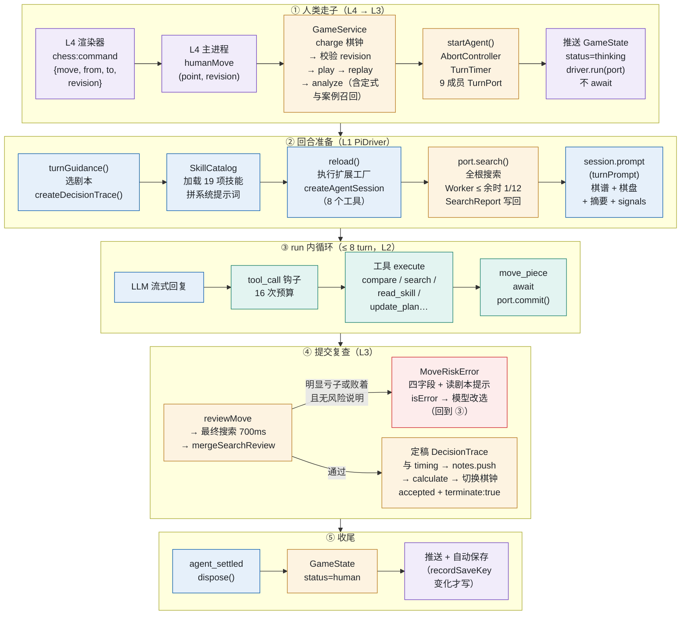

### 3.6 不变量：谁是权威

| 不变量 | 守护位置 | 机制 |
|---|---|---|
| 棋谱只有一个写者 | `GameService` | 所有写入走 `calculate()`（`game-service.ts:124-137`）；渲染器只能读视图 |
| 过期回合不能落子 | `valid()`（`:236`） | 未取消、未终局、同一局、同一 revision、仍是当前控制器 |
| 迟到响应赢不了已超时的棋钟 | `commit` 第一行 `this.charge()`（`:280`） | 先结算时间，再判断回合是否有效；审查与搜索之后再结算两次（`:296`、`:310`） |
| 并发与重复提交 | `committed / submitting / searching` 三个标志（`:230`、`:285`） | 审查进行中坐标被冻结（`:284` 深拷贝） |
| 走法合法 | `engine.ts` 的 `play()` + 每次提交后 `replay()` | 全谱重放 |
| 不白丢大子（可被显式覆盖） | `needsRiskAcknowledgement`（`expert.ts:269`）+ `commit` 内独立审查（`:295-316`） | `loss` / `material-loss` 且无 `riskAcknowledgement` 时拒绝，不落子 |
| 计划不越过局面变化 | `planForPosition`（`plan.ts:35-45`） | 被将军、对方吃子、过期即失效；对方走子后需复核 |
| 审计与提交原子一致 | `commit` 内定稿 `DecisionTrace`（`:322-325`） | 不等提交之后的 `tool_execution_end` 再补写（4.3 节接入点 ⑦） |

**revision 版本号**贯穿全部四层：人类走子、悔棋、取消、换模型、新局都会 `revision++` 并 `abort` 当前回合（`invalidate()`，`:88-92`）。LLM 提交必须带当前 revision，`move_piece` 先在 L2 预检（`xiangqi.ts:97`），L3 再以 `valid()` 终审。

---

## 4. Pi 双循环与 L2 接入点（Loop Engineering）

### 4.1 Pi 1.4.0 的双循环（源码定位）

| 结构 | 源码位置 | 作用 |
|---|---|---|
| settle 外循环 | `pi/…/agent-session.js:1423` `_startRun()`；`:1449` 首次 `agent.prompt`；`:1450` 起 `while` | 先检查重试、压缩、排队消息，再走 before-settle 边界（`agent_before_settle` 事件）；需要则 `continue()` 再起一个 run；`finally` 里发出 `agent_settled` |
| run 内循环 | `pi/…/agent-loop.js:84` `runLoop()` | turn：`turn_start` → LLM 流 → 执行工具 → `turn_end` |
| `turn_start` | `agent-loop.js:56`（首个）、`:118`（后续） | L1 的请求计数器 |
| 工具前置钩子 | `agent-loop.js:499` 调 `config.beforeToolCall`；`agent-session.js:322-326` 把它接到扩展的 `tool_call` 事件 | 参数 schema 校验**之后**、执行**之前** |
| 顺序执行 | `agent-loop.js:374-375`：同批只要有一个工具声明 `sequential`，整批串行 | 楚河 8 个工具全部 `sequential` |
| 中途停止 | `agent-loop.js:408`：每执行完一个工具检查 `signal.aborted` | 配合 `abort()` |
| 批次终止 | `agent-loop.js:471` `shouldTerminateToolBatch`：**同批全部** `terminate` 才终止 | 关系到 `move_piece` 的停机（4.4 节 ④） |
| 压缩闸 | `agent-session.js:2391` `_checkCompaction`：设置关闭即返回 | 楚河关闭 |

### 4.2 楚河怎样使用双循环

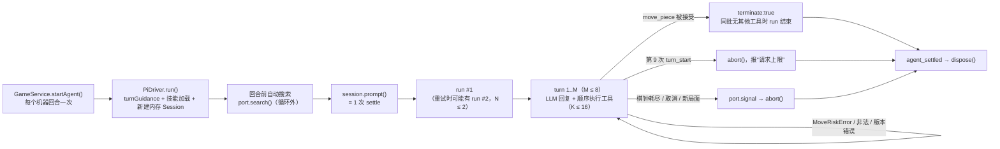

关键事实：

- **一手棋 = 一个 Session = 一次 settle。** `SessionManager.inMemory()`（`pi-driver.ts:66`）+ `finally` 里的 `session.dispose()`（`:119`），回合之间没有任何对话残留。
- **settle 外循环几乎只转一圈。** 压缩关闭（`:44`），没有 `agent_before_settle` 处理器，没有排队消息；唯一可能再起一个 run 的是 `retry: { maxRetries: 1, baseDelayMs: 800 }`。所以 `N ∈ {1, 2}`。
- **run 内循环是主战场。** `M ≤ 8`、`K ≤ 16`，全部 `executionMode: 'sequential'`。
- **有一段工作发生在两个循环之外。** 技能加载、扩展工厂、工具隔离校验，以及**回合前自动搜索**（`:97-106`），都在 `session.prompt()` 之前完成。搜索结果写回快照，所以模型的第一个请求就能看到搜索摘要，不必为此花一次工具调用。
- **没有技术超时。** 弈境有 90 秒回合超时；楚河删掉了它（`:35-36` 的注释），唯一的截止是比赛棋钟：棋钟到时由 `GameService` abort `port.signal`，驱动在 `:38-39` 转成 `session.abort()`。测试 `tests/pi-integration.test.ts:194`、`:220` 专门验证“超过 90 秒的长考是合法的”。

### 4.3 接入点总表（5W1H 速查）

“每次 settle 几次”用 0.2 节的符号表示。总表拆成两张。

**表 4-1　接入点是什么、谁负责、为什么需要**

| # | 接入点（What） | Who：谁注册 / 谁调用 | Why：为什么需要 |
|--|--------------|----------------------|------------------------|
| ① | 扩展工厂 `xiangqiExtension(port, skills, onRead)` | L1 经 `extensionFactories` 传入；Pi 在 `reload()` 中调用 | 把本回合的 `TurnPort`、技能读取器、审计回调闭包进工具，状态按回合隔离 |
| ② | `pi.on('tool_call')` | L2 注册；Pi 的 `_beforeToolCall` 触发 | 16 次调用预算、回合已结束 / 已取消守卫、链路日志 |
| ③ | 8 个工具的 `execute()` | L2 注册；Pi 的工具执行阶段调用 | 读技能、观察、比较、搜索、试算、计划、提交 |
| ④ | `move_piece` 返回 `terminate: true` | L2 返回；Pi 的 `shouldTerminateToolBatch` 读取 | 告诉 Pi“这一批之后不必再请求模型” |
| ⑤ | 订阅 `turn_start` | **L1** `session.subscribe`（宿主订阅，不是扩展事件） | 请求计数，第 9 次 `abort()`；开启 model 耗时区间 |
| ⑥ | 订阅 `message_update` / `message_end` | L1 `session.subscribe` | 记录首个增量 `firstDeltaMs`；结束 model 区间 |
| ⑦ | 订阅 `tool_execution_start` / `_end` | L1 `session.subscribe` | 工具耗时区间；`recordDecisionTool` 追加审计；`setDecision` 暂存 |
| ⑧ | `port.signal` 的 `abort` 监听 | L1 注册，L3 触发 | 棋钟耗尽、取消、悔棋、换模型时中止网络与工具 |
| ⑨ | `TurnPort` 的 9 个成员 | L3 提供，L1/L2 调用 | 跨层读写的唯一通道（3.4 节） |

**表 4-2　接入点挂在哪里、何时执行**

| # | Where：挂在哪层循环、哪一步 | When：每次 settle 几次 |
|--|------------------------------|------------------|
| ① | **循环外**：创建 Session 之前的 `resourceLoader.reload()`（`pi-driver.ts:59`） | 每个机器回合 1 次 |
| ② | **run 内循环 · 工具准备阶段**：schema 校验之后、执行之前 | K 次（含被拦截的） |
| ③ | **run 内循环 · 工具执行阶段** | 每个工具 0..K 次 |
| ④ | **run 内循环 · 批次收尾** | ≤ 1 次 |
| ⑤ | **run 内循环 · turn 开头** | M 次 |
| ⑥ | **run 内循环 · LLM 流式阶段** | update 多次；end M 次 |
| ⑦ | **run 内循环 · 每个工具执行前后** | 各 K 次（被 `tool_call` 拦截的不执行） |
| ⑧ | **任意时刻**（循环外与循环内） | 0..1 次 |
| ⑨ | 在 ① 之后、`session.prompt()` 之前（回合前搜索）及 ③ 内同步 / 异步调用 | commit ≤ 若干次（风险拒绝后可再提交），成功 ≤ 1 次 |

### 4.4 逐个接入点详解

#### ① 扩展工厂：每手“装配”一次

- **What**：`xiangqiExtension(port, skills, onRead)` 返回一个 `ExtensionFactory`，即 `pi => { … }`（`xiangqi.ts:13-14`）。
- **When**：`PiDriver.run()` 创建 `DefaultResourceLoader` 时把它放进 `extensionFactories`（`pi-driver.ts:53-55`），随后 `await resourceLoader.reload()`（`:59`）。这是**内联工厂**，不经过 jiti 按文件路径导入。
- **How**：工厂体内声明本回合的闭包状态 `calls`、`committed`（`xiangqi.ts:15`）和守卫 `active()`（`:16`），然后注册 `tool_call` 处理器和 8 个工具。按项目约定，工具在**工厂顶层**注册。`read_skill` 的参数 `name` 由 `skills.names` 生成 `Type.Union` 枚举（`:28`），即**技能清单在 schema 层面就是白名单**。
- **Why**：工厂每手创建一次，状态天然按回合隔离；`port` 是本回合独有的写入凭证。`onRead` 回调把读取记录写进本回合的 `DecisionTrace.skillsRead`（`pi-driver.ts:55`）。
- **加载后的三道守卫**：`assertSkills` 要求技能集合**恰好**等于 `EXPECTED_SKILLS` 的 19 项且 `diagnostics` 为空（`:61`）；扩展加载无错误（`:62`）；活跃工具集合恰好等于 `XIANGQI_TOOLS`（`:69-72`）。任何一项不符都抛错，回合失败，棋钟照走。

#### ② `tool_call`：唯一挂上的扩展事件

```ts
pi.on('tool_call', event => {
  active();                                         // 已取消或已提交：直接抛错
  if (++calls > 16) return { block: true, reason: '单回合工具调用预算已耗尽' };
  if (isToolCallEventType<'move_piece', …>('move_piece', event))
    port.log('extension', `校验走子：${moveText(event.input)} · revision ${event.input.revision}`);
  else port.log('extension', `工具调用：${event.toolName}`);
  return undefined;                                 // 放行
});
```

（`xiangqi.ts:17-24`）

- **Where / When**：`agent-loop.js` 的 `prepareToolCall` 先做 TypeBox 校验，再调用 `beforeToolCall`（`:499`）。所以处理器看到的 `event.input` 已经通过 schema，例如坐标一定是 `x ∈ 0..8, y ∈ 0..9`。
- **两种拦截方式**：返回 `{ block, reason }`，或 `throw`（`active()`）。两者都会变成一条 `isError` 的工具结果回到模型上下文，**不会让 run 崩溃**。这是“错误即提示词”的基础（8.4 节）。
- **`read_skill` 也计入预算**：测试 `pi-integration.test.ts:175` 验证了即使在同一条回复里批量读技能，也共享这 16 次。技能读取不是“免费的上下文”。

#### ③ 八个工具：观察 / 比较 / 计划 / 提交的执行器

| 工具 | 工作流步骤 | 读 / 写 | 关键约束 |
|---|---|---|---|
| `read_skill` | 路由（按需） | 只读；登记 `skillsRead` | `name` 是 19 项枚举；`reference` 只接受平面小写 `*.md`；真实路径校验拒绝遍历与软链逃逸（`skill-loader.ts:44-55`） |
| `analyze_position` | observe | 只读 | 返回完整分析（全部合法走法、32 子安全、12 个候选完整审查等）；`signals` 已够用时不必调用 |
| `search_position` | compare | 只读；消耗本回合搜索预算 | 省略 `moves` 搜全部合法根，或 1–6 个候选；深度 ≤ 6；单次 ≤ 1000 ms |
| `review_move` | compare | 只读 | 单个候选：对方应手、同格交换、`losingReply`；附带召回案例 |
| `compare_moves` | compare | 只读 | 1–6 个候选**公平分配预算**后排序（`expert.ts:185-191`） |
| `simulate_moves` | compare（辅助） | 只读（副本） | 只验证填入的 1–6 手路线合法，**不证明对手必须配合** |
| `update_plan` | plan | 暂存（经 `port.updatePlan`） | continue / revise / abandon；只随成功走子持久化 |
| `move_piece` | commit | **写**（经 `port.commit`） | revision 预检；`await` 异步提交；`MoveRiskError` 转成可纠错结果；成功返回 `terminate: true` |

`move_piece` 的实现（`xiangqi.ts:95-105`）体现了楚河和弈境最大的不同：**提交是异步的，并且提交本身就是一次独立审查**。

```ts
async execute(_id, params, signal) {
  active(); if (signal?.aborted) throw new Error('落子请求已取消');
  if (params.revision !== port.state.revision) throw new Error(`版本错误：当前 revision=${port.state.revision}`);
  try { await port.commit(params, params.reason, params.riskAcknowledgement, signal); }
  catch (error) {
    if (!(error instanceof MoveRiskError)) throw error;
    return { content: [{ type: 'text', text: error.message }], details: { review: error.review }, isError: true };
  }
  committed = true;
  return { ...result({ accepted: true, move: moveText(params) }), terminate: true };
}
```

`MoveRiskError` 的**完整审查放在 `details`**（Pi 的 `details` 不进入模型上下文），而 `content` 只有风险、交换估计、反击线、警告四个字段外加一句“先比较替代走法；坚持接受风险前 `read_skill('playbook-risk-acknowledgement')`”（`expert.ts:270-275`）。这条错误文本同时是**纠错提示词**和**技能路由信号**。

#### ④ `terminate: true` 与“提交即停”

Pi 的语义是：**同一批工具调用全部**返回 `terminate: true`，run 才停（`agent-loop.js:471`）。弈境为此在 L1 订阅 `tool_execution_end`，看到 `place_stone` 成功就 `abort()`。楚河的驱动**没有**这一步：`tool_execution_end` 只记录遥测与审计（`pi-driver.ts:89-94`）。

后果（源码推断，未见专门测试）：如果模型在一条回复里同时调用 `[move_piece, X]`，`move_piece` 成功后 `committed = true`，紧随其后的 `X` 在 `tool_call` 里被 `active()` 抛错为“本回合已结束或取消”，整批不满足“全部 terminate”，Pi 会**再请求一次模型**。业务上是安全的（`GameService.valid()` 已因 revision 变化而拒绝一切写入，日志也被静默），代价是一次多余的模型往返、计入棋钟。这是 9.2 节的一条改进建议。

#### ⑤⑥⑦：宿主订阅的五类观察事件

`pi-driver.ts:73-95` 的订阅回调同时承担三件事：

| 事件 | 预算 | 遥测（`TurnTimer`） | 审计（`DecisionTrace`） |
|---|---|---|---|
| `turn_start` | `requests++`，> 8 即 `abort()` | 开启 `model-N` 区间 | — |
| `message_update`（`*_delta`） | — | 记录首个增量 `firstDeltaMs` | — |
| `message_end`（assistant） | — | 结束 model 区间；`stopReason` 为 error / aborted 记失败 | — |
| `tool_execution_start` | — | 开启 tool 区间 | — |
| `tool_execution_end` | — | 结束 tool 区间 | `recordDecisionTool` 追加 `{name, ok}`，成功时把对应步骤标为 done；`setDecision` 暂存 |

这里有一个关于 **When** 的微妙之处，值得单独说明。`move_piece` 的 `tool_execution_end` 是在 `port.commit()` **返回之后**才发出的，而 `commit()` 内部的 `calculate()` 已经 `emit()` 并触发了自动保存。如果等 `tool_execution_end` 再把“commit: done”写进审计，就会**错过那次原子保存**。所以 `GameService.commit()` 在提交事务内部，用暂存的 `stagedDecision` 补上 `move_piece` 成功这一条，再写入 `TurnNote`（`game-service.ts:322-330`）；之后的 `setDecision` 因 `committed` 为真被忽略（`:268`）。耗时也一样：`timer.finish(true)` 在事务内完成（`:320`）。这是“接入点何时执行”直接决定数据正确性的一个好例子。

#### ⑧ 取消：一个信号贯穿四层

`invalidate()`（`game-service.ts:88-92`）→ `controller.abort()` → L1 监听器 `session.abort()`（`pi-driver.ts:38-39`）→ Pi 的 `signal.aborted` 让顺序批次跳过剩余工具，网络请求中断 → L2 `active()` 拒绝后续工具 → 搜索 Worker 通过 `AbortSignal.any` 被取消（`game-service.ts:246`）→ L3 `valid()` 拒绝迟到提交。失败、取消、超时的回合会写入 `attempts[]`（最近 80 条，`:220-227`），即使 revision 没变也会触发保存（`recordSaveKey`，`turn-timing.ts:25-27`）。

### 4.5 一次 settle 的时间线

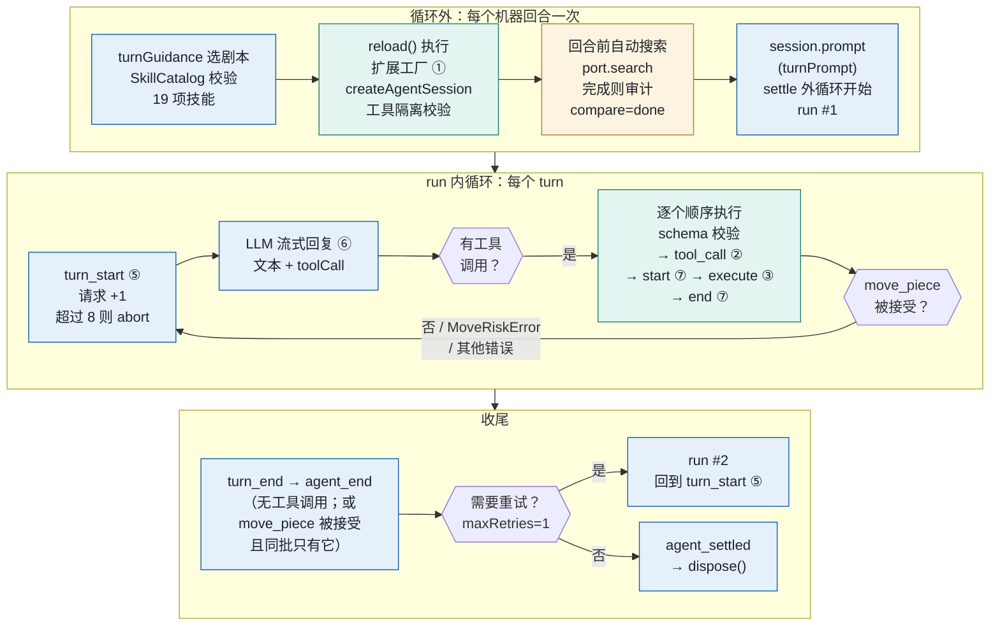

### 4.6 刻意没有使用的回调

| 回调 | 通常用途 | 楚河为什么不需要 |
|---|---|---|
| `before_agent_start` | 每次 run 前改写系统提示词或工具集 | 系统提示词在创建 Session **之前**由宿主装配，每手一个 Session |
| `context` | 每次请求前改写消息列表 | 上下文本来就是新的，没有需要裁剪或“保护”的历史 |
| `agent_end` / `agent_before_settle` | 催促续跑（TillDone 的做法） | 停机由 L1/L3 掌握：要么提交，要么预算或棋钟用尽 |
| `session_start` / `session_tree` | 从会话历史恢复状态 | 状态权威在 `GameService`，不在会话里 |
| `input`、`registerCommand` | 用户输入与斜杠命令 | 应用内没有人类聊天输入；`noPromptTemplates: true` |
| `resources_discover` | 扩展自带技能路径 | 技能路径由宿主在创建 loader 时直接给出 |
| `before_provider_request` | 改写 provider 请求体 | 不需要改传输层 |
| `tool_result` | 改写工具结果 | 结果本来就由本扩展生成；`details` / `content` 已分离 |
| `turn_end` | 再跑一个 turn | 不希望延长回合 |

和弈境的结论一样：**状态和流程控制的权威越是留在宿主，扩展需要挂的回调就越少。** 楚河新增的能力（搜索、计划、审计、遥测）全部通过 `TurnPort` 和宿主订阅实现，L2 依然只挂一个钩子。

### 4.7 闸门：预算、搜索、棋钟、取消

| 闸 | 位置 | 触发后 |
|---|---|---|
| 请求预算 8 | L1 `turn_start` 计数 | `abort()`，回合失败，棋钟继续 |
| 工具预算 16 | L2 `tool_call` | 返回 `block`，模型收到“预算耗尽” |
| 搜索总预算 | L3：每次尝试 2600 ms / 70000 节点，为最终复查预留 700 ms / 20000 节点（`live-search.ts:6-8`、`game-service.ts:241-244`） | 单次 ≤ 余时 1/12、≤ 1000 ms；截断只保留最后完整迭代，标记为未知 |
| 同时只能有一个搜索 / 提交 | L3 `searching / submitting` | 并发请求被拒绝并反馈给模型 |
| 比赛棋钟 | L3 `charge()`，主进程 200 ms 心跳 | 到时判负；`port.signal` 中止网络与 Worker |
| 取消 / 悔棋 / 换模型 / 新局 | L3 `invalidate()` | 同 4.4 节 ⑧ |

---

## 5. L3 业务层：知识怎样变成推理信号

### 5.1 六类知识，六种载体

延续弈境“按可信程度分别安放”的做法，楚河的 L3 可以分成六类：

| 类别 | 例子 | 载体 | 模型如何看到 |
|---|---|---|---|
| **硬规则** | 走法、马腿象眼炮架、九宫与照面、应将、困毙判负、重复与长将、120 半回合、棋钟、revision、一次提交 | `engine.ts`、`clock.ts`、`GameService`（代码） | 只通过错误文本间接看到 |
| **确定性事实** | 全部合法走法、每子合法攻击者 / 几何保护者 / 牵制、阵型、一步杀反例 | `expert.ts` 的 `inspectSafety`、`formation`、`review` | `signals` 摘要；`analyze_position` 全量 |
| **有界计算** | 同格交换（≤ 6 次后续吃子）、迭代加深搜索（将军延伸、静态搜索） | `expert.ts`、`search.ts`、`live-search.ts`（Worker 执行） | 候选的 `risk / estimatedNet / line / coverage`；搜索的 `completedDepth / rootScope / line` |
| **启发式** | 阶段子力值、位置六项（出子、活动、协同、九宫压力、牵制、往返）、候选排序分 | `expert.ts`、`evaluation.ts` | 随结果出现，并附 `limitations` |
| **结构化领域数据** | 12 条手写开局示例 + CCPD 61 条，共 73 路线 / 1360 节点 / 7 个来源；赛后已验证案例 | `knowledge.ts` + `src/data/ccpd/`；`userData/learning/library.json` | 局面匹配并**当场复查**后，以 `knowledge` / `experiences` 字段注入 |
| **流程知识 / 专家经验** | 怎么读报告、先查什么、何时用哪个工具、计划协议、何时允许风险说明、开中残局要点 | `skills/**/SKILL.md` + `references/` | 入口与一份剧本常驻；其余按需 `read_skill` |

这正对应“业务规则、领域知识与数据、专家经验”三类输入：

- **业务规则**在代码里，提示词无法改写，冲突时“代码规则 > 当前计算事实 > 有界启发式 > 技能经验”（入口技能原文）。
- **数据（棋谱）**：权威棋谱 `position.moves` 每手全量重放；逐手评估 `evaluations` 随记录保存；定式不是背给模型的 Markdown，而是**确定性信号**：全盘局面（含左右镜像、旋转换色）匹配，并对推荐着法做一次本地反击 / 交换复查，不通过就不提供（`knowledge.ts:52-79`）。这正是弈境白皮书改进建议第 7 条（“把定式做成确定性信号”）在楚河里的落地。
- **专家经验**分两层：一层是**代码触发的原则**（`expert.ts:200-217`，按局面产生 `{id, title, advice, evidence}`，如失守大子、牵制、开局出子、马腿空间、炮架、九宫、残局、优劣势处理）；另一层是**文本技能**（剧本与专项技能）。前者负责“此刻触发了什么、证据是什么”，后者负责“遇到这种情况该怎么想”。两者通过 `id` 对接：代码只给一句话 `advice`，全文在 `skills/skills/read-expert-report/references/principles.md` 的同名小节里。

### 5.2 专家计算：模型的“出厂质检员”

楚河 L3 中最有分量的是一组**有界、可复算、显式标注局限**的专家计算：

| 模块 | 能力 | 设计要点 |
|---|---|---|
| `reviewMove`（`expert.ts:119-184`） | 候选走后，枚举对方应手（吃子与将军优先排序），检查一步杀 / 困毙，再对吃子应手做同格连续交换 | 发现一个合法的一步败着即足够作为反例；预算截断标记 `coverage.complete = false`，“未算完不等于安全” |
| `analyzeExpert`（`:218-268`） | 生成报告：阶段、子力、位置、安全、阵型、优先级、原则、12 个候选 | 候选短名单混合“战术排序 + 受攻大子的安全撤退 + 位置排序”，避免新加的位置分挤掉逃生着法（`:222-237`） |
| `searchPosition` + `liveSearchOptions` | 迭代加深、将军 / 唯一应将延伸、吃子与应将静态搜索 | 只信任完成的迭代；危险局面（被将或敌方大子逼近九宫）增加预算 |
| `mergeSearchReview`（`live-search.ts:21-41`） | 把最终搜索结果并入审查 | 只有“完成迭代 + 将杀分 + 主变化可重放到判负”才升级为 `loss`，可重放的主变化本身不是证明 |
| `updatePlan` / `planForPosition`（`plan.ts`） | 跨回合公开计划：目标、问题、对方计划、1–3 步、放弃条件 | 只随合法走子持久化；被将军、对方吃子、8 半回合过期即失效 |

这套计算的定位，在 `expert.ts:10-12` 的注释里写得很清楚：**“业务拥有的、有界的战术辅助，不是替身棋手。”** 它不替模型选着法，只回答“这一步会不会白丢东西”。最关键的设计是：**无论模型有没有主动调用审查工具，`commit()` 都会独立做一次审查 + 最终搜索**（`game-service.ts:289-316`）。这条是从一盘真实对局里的“平车送车”“贪兵丢炮”教训来的，二者已加入回归测试（README）。

### 5.3 技能组：19 项 Pi 原生技能

```text
skills/                                   # 按 Pi package 约定命名，构建时复制到 dist/skills
├── xiangqi-coach/                        # 入口（常驻全文）
│   ├── SKILL.md                          # observe / compare / plan / commit 四步 + 路由与预算
│   └── references/{workflow.md, rules-summary.md}
├── principles/                           # 6 条原则（索引常驻，全文按需）
│   ├── principle-rules/                  # 代码规则与当前 revision 为准
│   ├── principle-facts-over-heuristics/  # 事实优先，覆盖不足保持未知
│   ├── principle-threats-first/          # 先应将、杀与大子受攻
│   ├── principle-exchange-before-greed/  # 吃兵前先算丢马炮
│   ├── principle-clock/                  # 时间紧时减少读取，不降低硬校验
│   └── principle-single-commit/          # 一回合一次权威提交
├── playbooks/                            # 7 个剧本，全部 disable-model-invocation: true
│   ├── playbook-opening/  playbook-middlegame/  playbook-endgame/
│   ├── playbook-in-check/  playbook-under-attack/  playbook-time-pressure/
│   └── playbook-risk-acknowledgement/    # 不参与路由，由 MoveRiskError 指引读取
└── skills/                               # 5 项专项技能（索引常驻，全文按需）
    ├── read-expert-report/{SKILL.md, references/fields.md, references/principles.md}
    ├── compare-candidates/{SKILL.md, references/search-report.md}
    ├── plan-protocol/SKILL.md
    ├── use-knowledge-hints/{SKILL.md, references/motifs.md, references/conditional-principles.md}
    └── coordinates/SKILL.md

.pi/
├── settings.json                         # { "skills": ["../skills"] }：让 Pi TUI 也能发现应用技能
└── skills/xiangqi-review/SKILL.md        # TUI 专用离线复盘，应用运行时不加载
```

每个条目都是标准 Agent Skills 格式：frontmatter 的 `name`（与目录同名的小写 ASCII）、中文 `description`（写“**何时用**”而不是“是什么”），正文统一为“步骤 → 证据 → 局限”。入口技能带 `metadata.version: xiangqi-skills/v2`。全部技能与参考文件合计约 23 KB。

各组件的分工：

| 组件 | 角色（pstack 类比） | 在上下文中的位置 |
|---|---|---|
| `xiangqi-coach` | 编排入口（poteto-mode） | 系统提示词，常驻全文 |
| 6 条 `principle-*` | 一句话原则 | `<available_skills>` 索引常驻；全文按需 |
| 7 个 `playbook-*` | 情景剧本 | 宿主选 1 份全文注入；其余可按需读作参考，**不切换路由** |
| 5 项专项技能 | 工作流技能 | 索引常驻；全文与 references 按需 |
| `xiangqi-review` | 离线复盘技能 | 只在 Pi TUI，`/skill:xiangqi-review <棋谱>` |

### 5.4 设计更正：直接使用 Pi 原生 Skill，不自建支持子系统

**原设计把优先级弄反了。** 禁用内置工具不是业务目标，不应因此增加宿主技能目录、索引拼接和专用读取协议。“没有自写解析器”也不等于“没有自建 Skill 子系统”。v3 已删除 `src/agent/skill-loader.ts`、`SkillCatalog`、`SkillReader` 和 `read_skill`。

| 能力 | v3 的负责人和方式 |
|---|---|
| 发现与校验 | Pi `DefaultResourceLoader`，宿主只配置 `noSkills: true` + `additionalSkillPaths: [workspace/skills]` |
| 技能索引 | Pi 原生生成 `<available_skills>` 和真实文件路径；宿主不格式化、不改写 location |
| 入口展开 | `session.prompt('/skill:xiangqi-coach ' + turnPrompt(state))`，由 Pi 展开到用户消息，不再由宿主读入系统提示词 |
| 按需全文与 references | 模型使用原生 `read`，不经过应用专用 Skill 协议 |
| 工具权限 | 原生 `read/bash/edit/write` + 8 个象棋业务工具，不再设 `noTools: 'builtin'` |
| 业务流程 | `turnGuidance()` 只给建议剧本和依据，不选择并拼接全文；19 项技能均可由 Pi 原生索引发现 |
| 规则与预算 | 宿主继续负责规则、棋钟、revision、搜索、提交复查、8 次模型请求和16次工具调用预算 |

资源发现限制不是权限沙箱。开发版工作目录为 `apps/chinese-chess`；安装版为可写的 `userData/chinese-chess` 工作区，复制自带技能且不覆盖已有编辑。提示词要求文件与脚本只在项目目录内操作，但 **Pi 的 cwd 不阻止绝对路径、../、软链或 shell 越界**；本次没有自建路径过滤器或 OS 沙箱。如需硬隔离，应另接成熟沙箱或容器。

新记录为 `xiangqi-skills/v3`：`playbook` 是建议，`skillsInjected` 仅记录原生展开的入口。旧 `skillsRead` 字段保留为空，原生读写和 shell 统一记入通用工具完成序列及耗时，不根据工具名推断读了哪项技能。原生工具可能并行，完成顺序不等于调用顺序。

**以下章节保留 v2 历史快照。** 其中“唯一剧本全文注入”“11项索引”“enum read_skill”“禁止文件系统”等说法已由本节替代；当前工作区、升级与权限细节见 [原生 Skill 与内置工具](native-skills.md)。

### 5.5 路由：三级，外加数据驱动的信号

楚河应用内**没有任何斜杠命令**（没有人类与模型聊天），知识的路由分三级：

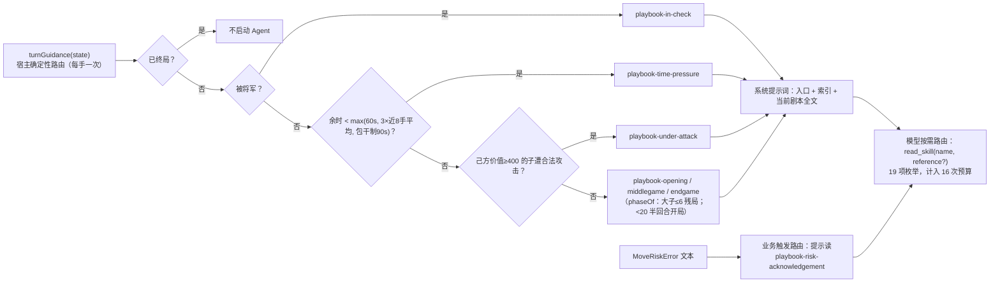

- **第一级：宿主路由（Who = 代码，When = 每手开始，`decision.ts:35-49`）。** 纯函数，不修改状态（测试 `tests/decision.test.ts` 用两盘真实对局的每个前缀回放验证）。优先级是“应将 > 时间 > 大子受攻 > 阶段”。剧本带 `disable-model-invocation: true`，因此**不出现在模型可选的索引里**：模型不能自选剧本当作当前流程。
- **第二级：模型路由（Who = LLM，When = run 内任意 turn）。** 模型看到的是 11 项（6 原则 + 5 专项）带“何时用”描述的索引，自行决定 `read_skill('compare-candidates')` 或 `read_skill('read-expert-report', 'principles.md')`。允许读其他剧本作参考，但入口技能写明“read_skill 不会切换宿主路由”。
- **第三级：业务触发路由（Who = L3 规则，When = 提交被拒时）。** `MoveRiskError` 的文本直接点名 `playbook-risk-acknowledgement`，这是一种“由事实触发、由错误文本承载”的路由。
- **数据驱动的信号**不经过技能机制：`principles[{id, evidence}]`、`knowledge[]`、`experiences[]` 在 L3 计算后放进 `signals`。代码决定“此刻相关的是哪条”，技能负责“它的字段怎么读”。

一个从测试里得到的有意思的事实：**初始局面就会路由到 `playbook-under-attack`**，因为隔着炮架的炮在开局就能合法攻击对方的马（`docs/l3-skills-refactor.md` 记录，测试据此不把初始局面当成“无威胁的开局”）。这说明路由阈值是启发式，会影响开局剧本的实际使用频率（9.2 节）。

### 5.6 信号契约：模型第一眼看到的结构

`turnSignals()`（`turn-context.ts:4-24`）是一份**投影**，不修改权威分析，工具和界面仍使用完整数据：

```json
{
  "inCheck": false, "lastMove": "黑炮 H2 → E2", "phase": "opening",
  "priorities": ["先审查对方将军与直接杀，再评估吃子、交换和布局。", "红马@H9 可被 黑炮@H2 合法攻击；有保护仍须验算交换。"],
  "material": { "red": 4710, "black": 4710, "balanceForSideToMove": 0 },
  "threatened": [{ "piece": "红马@H9", "value": 400, "legalAttackers": ["黑炮@H2"], "geometricDefenders": ["红车@I9"], "pinnedToKing": false, "loose": false }],
  "principles": [{ "id": "development", "evidence": ["…"] }, { "id": "cannon-screen", "evidence": ["…"] }],
  "candidates": [{ "notation": "…", "risk": "no-direct-loss-found", "estimatedNet": 0, "line": ["…"], "coverage": { "complete": true, "exchangeComplete": true } }],
  "search": { "bestMove": { "…": "…" }, "completedDepth": 4, "rootScope": "all-legal", "searchedRoots": 44, "legalRoots": 44, "stopped": "depth", "line": ["…"], "limitations": ["…"] },
  "knowledge": [{ "id": "screen-horses", "applicability": "ECCO C0 的一条示例路线；全盘局面匹配到第 2 半回合…", "caution": "…", "verification": "legal-and-tactically-reviewed", "currentMove": { "…": "…" } }],
  "experiences": [], "plan": null,
  "coverage": { "reviewedMoves": 12, "totalMoves": 44, "nodes": 4800, "budgetExhausted": false },
  "limitations": ["反击检查覆盖候选后的对方一手；未覆盖候选和预算截断不代表安全。", "…"]
}
```

（字段结构取自源码，数值仅作示意。）工程要点：

1. **只给己方受攻子**，而不是 32 子全量安全表；**只给前 6 个候选**的风险、交换估计、反击线和覆盖，去掉了完整审查里的 `variation`、`warnings`、搜索明细。
2. **局限写在数据里**：`coverage`、`limitations`、`knowledge[].caution`、`verification` 每次都随数据出现，而不只写在提示词里。
3. **几何保护与合法攻击分开**：`geometricDefenders` 和 `legalAttackers` 是两个字段，技能里反复强调“几何保护不等于可以合法回吃”。
4. **完整报告按需取**：`analyze_position` 仍返回全量，入口技能说明“只有缺少全部合法走法或完整字段时才读取”。

### 5.7 证据链：`DecisionTrace` v2

`DecisionTrace`（`decision.ts:10-15`）在回合开始时创建（`createDecisionTrace`，`:16-23`），由 L1 在每个 `tool_execution_end` 更新，由 L3 在提交事务内定稿，写进 `notes[].decision`，随棋谱原子保存：

| 字段 | 内容 | 相对弈境的改进 |
|---|---|---|
| `version` | `xiangqi-skills/v2`（旧 v1 记录仍可读） | 同 |
| `revision` | 回合的 revision | 新增；`setDecision` 校验版本与 revision 一致（`game-service.ts:269`） |
| `playbook` | 宿主注入的剧本 | 同 |
| `skillsInjected` | `['xiangqi-coach', 当前剧本]` | **与读取分开**（弈境把两者混在一个列表里） |
| `skillsRead` | `read_skill` 实际读过的条目，含 `name/reference` | 由代码登记，不靠模型自述 |
| `tools` | 按顺序的 `{name, ok}`，**包括失败的调用** | 新增；弈境只有覆盖式标志 |
| `steps` | observe / compare / plan / commit 的 done / skipped + evidence | 回合前搜索完成时 compare 标注为“宿主证据”，不谎报为模型调用（`pi-driver.ts:108-111`） |

配套的还有 `notes[].timing`（`TurnTiming`：总耗时、按墙钟互斥归属的五项分解、原始区间）和 `attempts[]`（失败 / 取消 / 超时 / 被替换的回合，最近 80 条）。弈境白皮书里列出的四个证据粒度问题（覆盖式变量、compare 含义偏弱、注入与读取混合、失败回合不留记录），楚河解决了其中三个；“试算证据与最终候选的绑定”仍未做。

### 5.8 Plugin / Pi Package：为什么现在不打包

讨论稿和实施记录（决策 D8）的结论是：**目录按 package 约定命名（`skills/`），但现阶段不发布 Pi Package。**

| 用途 | 需要 Package 吗 | 楚河的做法 |
|---|---|---|
| A. 应用运行时加载技能 | 不需要 | `additionalSkillPaths` 指向 `dist/skills`；应用用 `SettingsManager.inMemory()`，根本不读 `pi install` 写的设置 |
| B. 在 Pi TUI 里复用同一套技能做复盘或调试 | 不需要 | 项目 `.pi/settings.json` 加 `"skills": ["../skills"]` |
| C. 把技能 + TUI 复盘扩展分发给别人 | 需要 | 未做：需要独立目录，宿主包放 `peerDependencies`；应用的 `package.json` 把 Pi 放在 `dependencies`，不能兼做 package manifest |

还有一个更本质的理由：剧本是**宿主路由专用**的。分发到没有 `turnGuidance()` 的 TUI 环境，模型就会自己挑剧本；而 `read_skill` 的枚举与 `DecisionTrace` 只在应用内有意义。所以如果将来走 C，manifest 草图里会用 `"!./skills/playbooks/**"` 把剧本排除。

用比喻说：家电（技能）已经按“品牌套装”的规格装箱了，但暂时只在自家用，不上架。

### 5.9 设计血统：pstack、弈境与楚河

| pstack 模式 | 弈境的对应物 | 楚河的对应物 |
|---|---|---|
| poteto-mode 编排入口 | `gomoku-coach` + `turnGuidance()` | `xiangqi-coach` + `turnGuidance()` |
| 原则索引 | 5 条原则，自拼索引 | 6 条原则，**Pi 的 `<available_skills>`** 索引 |
| 任务剧本 | 4 个剧本 | 7 个剧本；多了“被将军”“大子受攻”“风险说明” |
| 专项技能 | 3 项 | 5 项，带 references |
| 加载器 | 自写 20 行 + `KNOWLEDGE_ITEMS` 白名单 | Pi 的 `loadSkillsFromDir` / `formatSkillsForPrompt` / `stripFrontmatter` |
| prove it works | 提交前一步扫描 | 提交时独立审查 + 最终多步搜索 |
| 共享 todo / 决策 artifact | `notes[].decision` | `notes[].decision` v2 + `timing` + `attempts[]` |
| 子 Agent、多模型审查 | 无 | 无（用确定性审查与 Worker 代替） |
| 模型角色配置 | 单一模型 | 单一模型，默认不可静默切换 |
| reflect / 自我改进 | 无 | 赛后学习 Worker（数据级自动闭环）+ TUI 复盘技能 |

准确的定位是：**一个用 Pi 原生 Skill 机制承载、由宿主显式路由和授权的领域技能组，加上一个确定性的专家计算服务层和一个数据级的自动学习环。** 它借用了 pstack“原则索引 → 编排 → 剧本 → 技能 → 证据 → 验证”的骨架，却把路由权、验证时机和状态所有权都收回到了宿主。

### 5.10 讨论稿与实际落地的对照

| 讨论稿（P / D 编号） | 实际实现 | 状态 |
|---|---|---|
| P1 流程知识散在四处 TS 字符串 | 迁入 19 项技能；SYSTEM 只剩约 170 字 | 已解决 |
| P2 零渐进披露 / P3 无剧本路由 | 入口 + 索引 + 唯一剧本；`turnGuidance()` | 已解决 |
| P4 用户消息全量注入 analysis，且重复 | `turnSignals()` 投影；三份固定局面首次请求下降 65%–67% | 已解决 |
| P5 工具描述承担流程说明 | 描述只讲参数和返回 | 已解决 |
| P6 没有决策证据 | `DecisionTrace` v2 + `timing` + `attempts[]` | 已解决 |
| P7 原则文案与触发耦合 | 代码给 `id/evidence` + 一句话；全文在 references | 已解决 |
| P8 `MoveRiskError` 塞整个 review | 四字段 + 技能提示；完整 review 在 `details` | 已解决 |
| P9 人读文档与模型知识分叉 | L4 与模型读同一份 references（7.5 节） | 部分解决（`EXPERT.md` 仍有复述） |
| P10 CCPD 数据闲置 | 接线：64 个文件接受 61 条，拒绝 3 条非标准初始阵型 | 已解决（讨论稿“64 条”的说法被实施更正） |
| D1 注入位置：系统提示词 | 采纳 | — |
| D2 七个剧本 | 采纳（6 个参与路由 + 1 个错误触发） | — |
| D3 允许读其他剧本 | 采纳，但不切换路由 | — |
| D4 复盘技能放 `.pi/skills/` | 采纳，物理隔离 | — |
| D5 `caution` 留在数据里 | 采纳 | — |
| D8 不发 package | 采纳 | — |

### 5.11 这一层埋有自我改进的线吗？

**结论：有两条线。数据层的那条已经自动闭环；知识文本的那条线头齐全，但闭环仍需人工。**

**线一：赛后学习（已自动闭环）。**

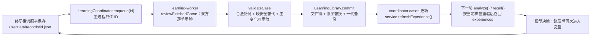

几个关键的工程选择（`learning.ts`、`src/learning/*`）：

- **不按输赢贴标签**：双方每一手都重验，人类和模型的失误都学。
- **只学“已验证的局部事实”**：一手败着或明显亏子，必须同时找到合法反驳与较安全的替代，主变化能在规则引擎里重放，才算 `verified-local`；否则只是 `candidate`，不注入模型（`learning.ts:131-153`、`:157-199`）。
- **模型明确接受风险的手不当成错误**（`acknowledgedPlies`）。
- **加载时再验一次**：磁盘上的案例每次启动都用 `validateCase` 重新验证，“不把未经验证的磁盘文字喂给模型”（`library.ts:34-35`）。
- **召回时再验一次**：精确局面匹配（含镜像与换色）或同动机匹配，都必须在**当前棋盘**上算出新的证据才给出（`recallExperience`，`learning.ts:204-241`），模型只能用 `currentMove/currentLine`，不能照搬 `historicalLine`。
- **不训练权重**：它是“已验证经验的检索”，不是微调。

**线二：知识文本的改进（线头齐全，环未闭合）。**

| 线头 | 现状 | 价值 |
|---|---|---|
| 版本化技能 `xiangqi-skills/v2` | 已有；v1 → v2 的升级本身就是一次基于耗时测量的人工迭代 | 能把行为归因到某个技能版本 |
| `DecisionTrace` v2 | 已持久化：注入、读取、完整工具序列、四步证据 | 能统计“技能被读的频率”“读了 compare-candidates 后是否更少被风险拒绝” |
| `timing` + `attempts[]` | 已持久化 | 能定位模型往返、工具、复查各占多少，以及失败原因 |
| `PostGameReview` | 已持久化：双方局部错误、机会把握 | 能把“机器方局部错误数”作为技能修改的回归指标 |
| `xiangqi-review` TUI 技能 | 已有 | 人在 Pi TUI 里用同一套技能解读上述证据 |
| 本地 SSE 测试替身 | 已有，驱动真实 Pi Agent Loop | 可扩展为固定局面的回归评测 |

缺少的部分：没有读回 `notes[].decision` 做统计的分析器；没有“仅工具 / 入口 + 原则 / 完整技能组”的对照评测；没有真实模型的实战统计（实施记录明确写了“真实模型主动读取频率尚需人工实战验证”）；从证据到修改 SKILL.md 完全靠人。和弈境的结论一样，最后一步应当**保留人工审阅**：技能文本会进入每一手的系统提示词，自动改写的风险（提示词漂移、对单一模型过拟合）高于收益。

---

## 6. 回到四层原则：L3 如何决定“什么进上下文”

这一章把第 5 章的内容按“进上下文的门槛”重新整理一遍，作为第 8 章的铺垫。

### 6.1 一张表：每类信息的去向

| 信息 | 进上下文？ | 形式 | 理由（帮模型做哪个决策） |
|---|---|---|---|
| 完整棋谱 + 棋盘字符画 | 是，每手 | 全量 | 局面的唯一权威表示 |
| 逐手评估 | 是 | 最近 20 手 + 所有吃子手，5 个字段（`turn-context.ts:25-28`） | 理解局势走向，不需要每手的候选细节 |
| 最近两条机器理由 | 是 | 标注“历史数据，须重验” | 延续意图，但防止把旧结论当事实 |
| 32 子安全表 | 否（只给己方受攻子） | `threatened` | 只有受攻的子影响本手决策 |
| 12 个候选完整审查 | 否（只给前 6 个的摘要） | `candidates` | 风险、交换估计、反击线足够比较 |
| 全部合法走法 | 否（按需） | `analyze_position` | 被将军等少数场景才需要穷举 |
| 定式与案例 | 是，但只在匹配且当场复查通过时 | `knowledge` / `experiences` | 有证据的候选线索 |
| 原则 | `id/evidence` 是；全文否 | references 按需 | 触发事实是信号，解释是经验 |
| 技能 | 入口与一份剧本是；其余只给索引 | `read_skill` | 渐进披露 |
| 完整 `MoveReview`（风险拒绝时） | 否（只给四个字段） | `details` 保存 | 改选只需要风险、估计、反击线、警告 |
| 耗时、进度 | 否 | L4 与记录 | 与决策无关，且可能诱导“赶时间” |

### 6.2 与“受保护内容”提案的关系

四层讨论稿担心用户偏好、持仓这类“受保护内容”在压缩后消失，提议让 `context` 钩子每次从 L3 状态重新注入。楚河和弈境一样把这条推到了极致：**整个上下文都是受保护内容，每手从 L3 状态完整重建**，所以连 `context` 钩子都不需要。跨回合需要保留的“意图”，则被显式建模成 `StrategicPlan`，作为业务状态而不是对话记忆存在。

---

## 7. L4 Electron 桌面层：把进展和状态可视化

### 7.1 从 Pi 原生 TUI 到 Electron：L4 的迁移

Pi 1.4.0 的 L4 是终端界面（pi-tui）。扩展通过 `setFooter`、`setWidget`、`setStatus`、`ui.custom()` 往终端里画东西，本仓库的走读系列（tilldone、pure-focus、subagent-widget 等）都是在这个 L4 上做的。终端画不了木纹棋盘、立体棋子、吃子动画、交互式专家报告。

2026-10-28 的讨论稿列出三条路线：A（TUI 不变，扩展内起本地网页）、B（RPC / SDK 宿主 + Web 客户端）、C（B 外面套 Electron 桌面壳）；当时的判断是“先 A 后 B，C 是 B 的外壳”，前提是 L3 已经和 L4 分开。实际推进比这更快：

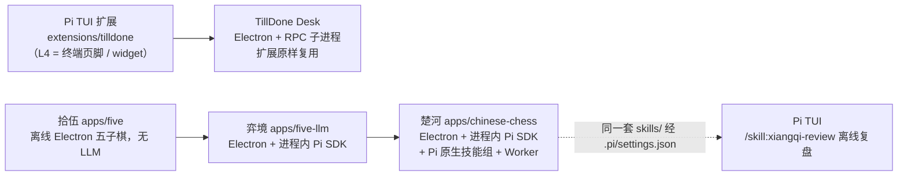

楚河是“生在 Electron 里”的：它直接继承了弈境的 C 路线。但它有一个弈境没有的特点：**同一套 L3 技能同时服务于两个 L4**。应用里，技能由宿主路由注入；在 Pi TUI 里，`.pi/settings.json` 让同一个 `skills/` 目录被原生发现，再加一个 TUI 专用的 `xiangqi-review` 做离线复盘。这正是“L3 与 L4 分开”带来的回报：遥控器和墙上触屏控制的是同一台家电。

迁移到 Electron 时，三件事发生了根本变化（与弈境相同）：

1. **L4 不再寄生在 Pi 的界面里。** 扩展里不再有任何绘制代码，界面数据全部来自 L3 的状态视图。“界面通道与上下文通道分离”在**进程级别**成立。
2. **权威状态从“会话树”搬到了“宿主”。** Pi 会话每手用完即弃，权威在主进程的 `GameService`。
3. **界面可以用领域原生的表达方式。** SVG 棋盘、DOM 棋子、吃子粒子与“隔山打炮 / 马到功成”提示、棋钟、回看滑条、背景音乐。

### 7.2 Pi 接入方式选型：原生 Pi（RPC 子进程）还是 Pi SDK

定下 Electron 之后的下一个决策是：**桌面应用怎样驱动 Pi？** Pi 有四种被程序驱动的方式：print、JSON 事件流、RPC（独立进程，stdin / stdout）、TypeScript SDK（`createAgentSession`）。能支撑交互式桌面应用的是后两种，本仓库两种都有：

| 维度 | TillDone Desk：原生 Pi CLI + RPC | 楚河：进程内 Pi SDK |
|---|---|---|
| 启动 | `spawn('pi', ['--mode', 'rpc', …, '-e', 扩展目录])` | `createAgentSession({ resourceLoader, tools, sessionManager, … })` |
| 扩展从哪来 | 磁盘上现成的 TUI 扩展，原样加载 | 量身定做的内联工厂，不落盘 |
| Session 生命周期 | 长寿命子进程，对话持续累积 | **每手一个**内存 Session，用完 `dispose()` |
| 系统提示词 | Pi 默认组装 | 宿主整段替换 preamble，并屏蔽 APPEND、上下文文件、用户技能 |
| 技能 | Pi 按设置发现 | `noSkills` + `additionalSkillPaths` 只加载应用技能，再断言集合 |
| 工具集 | CLI 参数和扩展决定 | `noTools: 'builtin'` + 8 个工具，运行时校验 |
| 写入业务状态 | 只能从事件流里**推断** | 工具里 `await port.commit()`，当场走权威审查 |
| 异步审查 | 要变成跨进程请求 / 应答 | 同进程 `await`，审查结果直接作为工具结果返回 |
| 遥测 | 解析事件流 | 直接订阅 `turn_start` / `message_*` / `tool_execution_*` |
| 隔离与容错 | 进程隔离 | 同进程；重计算放进 Worker，避免卡住主进程棋钟 |
| 依赖 | 本机装好的 `pi` | `package.json` 锁定 1.4.0，打进 DMG |

**选型逻辑：要“复用一个现成的 Pi 体验”就用 RPC；要“把 Pi 当成引擎嵌进领域应用”就用 SDK。** 楚河需要的几乎每一项能力都只有 SDK 才能干净地提供：每手新 Session、按局面切换系统提示词、技能与工具双重隔离、**异步且权威的同步提交**（审查 + 最终搜索后才返回给模型）、精细的事件订阅（请求预算、首增量耗时、审计）。

SDK 方案的代价：失去进程级故障隔离（楚河用 Worker 部分弥补了计算侧的隔离）；Pi 版本锁进应用依赖；内存 Session 不落盘，原始提示词和 token 用量无法事后恢复（楚河用 `DecisionTrace` + `timing` + `attempts[]` 弥补了“发生了什么”，但仍不保存“模型看到了什么”）。

### 7.3 进程模型与安全边界

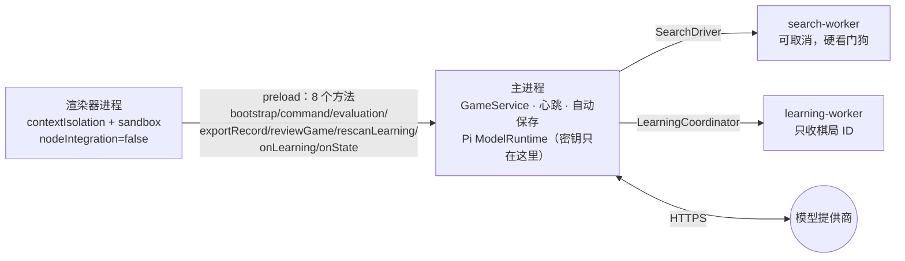

- **主进程是权威所在**：`GameService` 与 200 ms 心跳都在主进程（`main.ts:190`），后台渲染器的定时器会被节流，主进程不会。
- **渲染器被严格隔离**：禁止新窗口、禁止导航、拒绝所有权限请求（`main.ts:163-167`）。
- **IPC 双重校验**：`trusted(event)` 校验发送方是主窗口主框架（`:49-51`）；`validCommand()` 做形状校验，设置项再过 `validateSettings`（`:52-61`）。
- **密钥不进入渲染器**；Worker 也只收棋局 ID，不接触 Pi 会话。
- **打包**：ad-hoc 签名 DMG，删除 Electron 默认的 ATS 明文例外（`scripts/after-pack.cjs`）。

### 7.4 状态推送：视图、序号与去抖

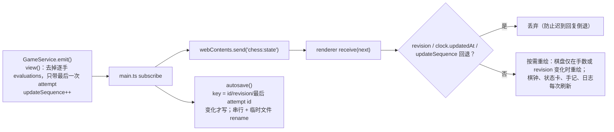

- **视图瘦身**：逐手 `evaluations` 长局可达数 MB，5 Hz 心跳每次克隆代价太高，所以 `view()` 去掉它们（`game-service.ts:70-73`），回看时用 `chess:evaluation` 按需取。
- **序号防倒退**：`updateSequence` 保证同一 revision 下的进度通知不会被迟到的 IPC 回复覆盖（`app.ts:217-220`）。
- **保存键**：`recordSaveKey` 包含最后一次 attempt 的 ID，所以失败尝试即使 revision 没变也会落盘（`turn-timing.ts:25-27`）。

### 7.5 可视化了什么，还缺什么

| 已可视化 | 来源 | 位置 |
|---|---|---|
| 棋盘、合法落点、可吃子、将军标记、吃子动画 | `position`、`analysis` | 主棋盘 |
| 状态卡：轮到你 / 思考中 / 请求未完成 / 本局结束 / 回看 | `status`、`error` | 状态卡 |
| **实时阶段**：准备会话 / 局面预搜索 / 等待或接收模型响应（第 N 次）/ 比较候选 / 复核计划 / 提交复查，及本回合已用时 | `progress`（`TurnTimer.progress()`） | 状态卡（`turn-feedback.ts:8-13`） |
| 双方棋钟、比分、赛制 | `clock`、`match` | 侧栏 |
| 公开落子理由、用时、模型、**耗时分解** | `notes[].reason/timing` | 手记 |
| 最近未落子尝试 | `attempts[]` | 手记、专家面板 |
| 专家参谋：优先级、来源定式、赛后案例、阵型、局面评价、多步搜索、连续计划、原则全文、受攻棋子、候选与反击、独立复查、计算边界 | `analysis.expert`、`plan`、`notes[].review` | 专家对话框（`app.ts:140-215`） |
| 复盘 / 案例库：进度、历史复盘、候选 | `LearningOverview`、`PostGameReview` | 复盘面板（`learning-ui.ts`） |
| 四层链路日志（`[business]/[extension]/[agent]`） | `logs` | 页脚 |

一个值得单独说的设计：**L4 与模型读同一份 Markdown，但读到的详略不同。** `skill-text.ts` 在构建时用 Bun 的文本导入，把 `principles.md`、`conditional-principles.md`、`motifs.md` 打进渲染器 bundle（`skill-text.ts:1-14`），按 `## id` 切成小节。专家面板显示原则和动机的**全文**；模型只在 `signals` 里看到 `id/evidence`，需要时再 `read_skill`。没有新增 IPC，也没有给渲染器任何文件系统权限。这是“界面通道与上下文通道分离”与“人机同源”同时成立的一个例子。

**明显的缺口：`DecisionTrace` 没有被可视化。** 剧本、注入与读取的技能、工具序列、四步进度都已持久化，但渲染器里没有一处读取 `notes[].decision`（`grep decision src/renderer` 无结果），只出现在导出的 JSON 里。用户能看到“它花了多少时间”，却看不到“它按哪个剧本、读了哪些技能、走了哪几步”。这是弈境白皮书第 7.2 节第 1 条在楚河里的同类问题。

### 7.6 持久化

| 文件 | 内容 | 写入方式 |
|---|---|---|
| `userData/records/<game-id>.json` | `chinese-chess/v1`：棋谱、逐手评估、手记（含 `review`、`plan`、`decision`、`timing`、风险说明）、计划、棋钟、比分、`attempts[]` | 串行“临时文件 + rename”；退出时最多等 3 秒 |
| `userData/learning/library.json` | `xiangqi-learning/v1`：已验证案例（≤ 500）、复盘报告 | 文件锁 + 锁内重读 + 原子替换 + 一代备份 |

旧棋谱没有 `decision` / `timing` 字段也能被学习模块的 `normalizeRecord` 接受；界面对缺失字段明确显示“未记录”，不推断为零。

---

## 8. Prompt Engineering 与 Context Engineering（跨层审视）

### 8.1 模型每次请求实际看到的上下文

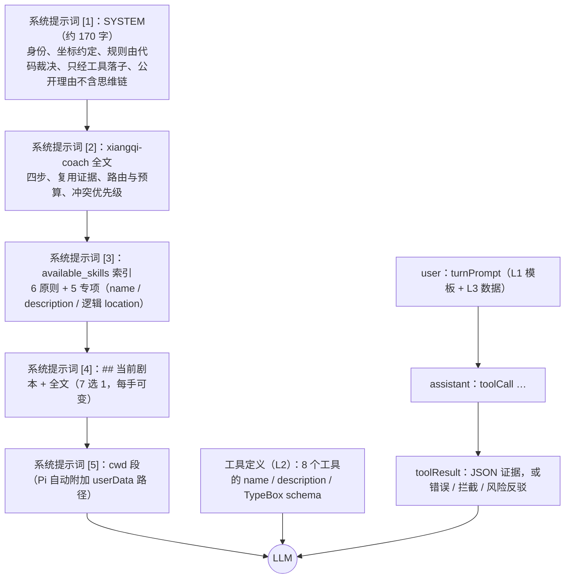

### 8.2 系统提示词的载入与“切换”

**载入。** `PiDriver` 把 `catalog.systemPrompt(SYSTEM, guidance.playbook)` 传给 `DefaultResourceLoader`（`pi-driver.ts:56`），Pi 把它作为 `customPrompt`（`pi/…/agent-session.js:1305`）**整段替换**默认的编码助手前言（`system-prompt.js:78-79`）。再加上以下设置，最终的系统提示词只剩楚河自己的内容和一个 `<cwd>` 段：

| 设置 | 屏蔽了什么 |
|---|---|
| `appendSystemPromptOverride: () => []` | 用户 / 项目的 `APPEND_SYSTEM.md` |
| `noContextFiles: true` | `AGENTS.md` / `CLAUDE.md` 等 |
| `noSkills: true` + `additionalSkillPaths` | 用户 / 项目技能；且因无 `read`/`bash`，Pi 不会自动生成技能段 |
| `noExtensions: true` + 只给内联工厂 | 用户 / 项目扩展 |
| `noPromptTemplates: true`、`noThemes: true` | 提示词模板、主题 |
| `noTools: 'builtin'` + `tools: XIANGQI_TOOLS` | read / bash / edit / write 等编码工具 |

**切换。** 楚河没有在会话里切换系统提示词，也没有用 `before_agent_start`。它的做法是**每手新建 Session，用新的剧本装配一份新的系统提示词**。从一局棋的角度看，系统提示词是**按局面切换**的：初始局面因隔子炮捉马而注入 `under-attack`，被将军时换成 `in-check`，余时紧张换成 `time-pressure`，大子减少后换成 `endgame`。

装配顺序是**稳定前缀 → 可变尾部**：[1][2][3] 在整局内不变，只有 [4] 每手可能变化。这个顺序对 provider 的前缀缓存是友好的；不过驱动同时设置了 `cacheWarming: 'off'`（`pi-driver.ts:45`），实际能否命中缓存取决于 provider。

代价与弈境相同：回合中途如果局面判断变化（例如搜索发现时间突然变紧），系统提示词里的剧本不会更换。设计上接受这一点：审计记录的是“回合开始时实际注入的剧本”，模型需要时可以 `read_skill` 读另一份剧本作参考。

### 8.3 用户提示词的动态装配与模板

`turnPrompt(state)`（`turn-prompt.ts:5-15`）每手装配一次：

| 段落 | 内容 | 来源层 |
|---|---|---|
| 角色与 revision | “现在轮到你，执红。revision=N。” | L3 状态 |
| 棋钟说明 | 回合开始时的剩余秒数；Fischer 加秒或包干；“不另设单步时间上限；网络、思考和工具计算都扣棋钟” | L3 `clock` / `match.settings` |
| 完整棋谱 | `1. 红炮 H7 → E7`（吃子、将军另有标注），并声明“业务坐标不随桌面翻转改变” | L3 `position.moves` |
| 棋盘文本 | 9 × 10 字符画（大写红、小写黑） | L3 `boardText()` |
| 逐手摘要 | 最近 20 手 + 吃子手，5 个字段 | L3 `evaluationSummaries()`（装配时压缩） |
| 最近机器理由 | 最近两条，标注“历史数据，须重验” | L3 `notes` |
| `signals` | 5.6 节的紧凑投影，提示“完整报告按需 analyze_position” | L3 `turnSignals()` |

**提示词还分布在另外三个地方：**

1. **技能文本就是提示词。** 这是本次重构最大的变化：流程说明从 SYSTEM 常量和工具描述里搬进 SKILL.md，**只有一份事实源**，并且可以单独版本化、单独测试（`tests/skills.test.ts`）。
2. **工具描述就是提示词，但只讲接口。** 重构后 8 个工具的 `description` 只说“做什么、参数、返回什么、不提交”，例如 `compare_moves`：“Compare 1–6 legal candidates with equal bounded budgets. Returns ranked reviews and recalled cases; no commit.” 流程性语句（“先调用 analyze_position”）全部移进技能。
3. **工具结果与错误就是动态上下文。** 每个结果都附 `revision`；审查结果带 `coverage`、`warnings`；搜索结果带 `completedDepth`、`rootScope`、`limitations`。错误则是纠正性提示词：“版本错误：当前 revision=N”“该走法不合法”“回合失效或已有搜索 / 提交正在执行”，以及最重要的风险反驳。

### 8.4 错误即提示词：风险反驳回路

弈境白皮书指出过一个缺口：策略警告不是错误，`place_stone` 成功即终止，模型在提交之前看不到警告。楚河用**“可覆盖的拒绝”**补上了这一点：

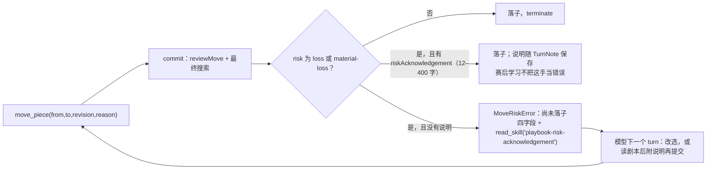

这条回路的设计取舍是：**不把策略建议伪装成规则**（真正的弃子仍然可以下），**但让最关键的反馈在行动之前进入上下文**。集成测试 `pi-integration.test.ts:79` 验证了“收到送车反例后改选”这一行为在真实 Pi 循环里成立。

### 8.5 C&D 框架：Compaction 与 Delegation

#### Compaction（内容压缩）：用“重建 + 投影”取代“压缩”

| 手段 | 位置 | 说明 |
|---|---|---|
| **关闭自动压缩** | `compaction: { enabled: false }`（`pi-driver.ts:44`） | `_checkCompaction` 直接返回 |
| **每手重建（rematerialization）** | 每手新建内存 Session + `dispose()` | 历史对话从不累积；“记忆”是权威棋谱与结构化计划 |
| **投影（projection）** | `turnSignals()` | 从完整分析里挑字段，不修改原数据 |
| **装配时摘要** | `evaluationSummaries()` | 最近 20 手 + 吃子手，5 个字段 |
| **渐进披露** | 入口 + 索引 + 1 份剧本 | 其余 17 项技能与 7 份 references 按需 |
| **错误瘦身** | `MoveRiskError` 四字段；完整 review 进 `details` | `details` 不进模型上下文 |
| **硬上限** | 8 次请求 / 16 次工具调用 | 单回合上下文增长有界 |

效果有测量数据：同样的技能系统前缀下，首次请求（system + user，不含工具 schema）的字符数从全量注入改为 `signals` 投影后，初始局面约 26665 → 9316（-65%），`human-mistakes` 第 42 手前约 32881 → 11668（-65%），`passive-game` 第 53 手前约 36994 → 12049（-67%）（`docs/l3-skills-refactor.md`；本次撰写时测试输出为 37242 → 12291，同样 -67%，耗时字段有少量波动）。字符数不是 token 或费用承诺，但量级是清楚的。

背后的道理与弈境相同：**对“状态可以完整序列化”的领域，压缩是有损的，重建是无损的。** 楚河多了一层：**投影也是无损的**，因为被投影掉的字段并没有丢，`analyze_position` 随时可以取回。代价是单手上下文随棋局线性增长（棋谱 O(手数)），以及每手重新支付系统提示词。

#### Delegation（内容委派）：把“需要放进上下文的东西”换成“可以调用的能力”

| 委派对象 | 原本需要放进上下文的 | 现在 | 委派给谁 |
|---|---|---|---|
| **流程知识** | 全部原则、剧本、字段说明 | 入口 + 索引 + 1 份剧本；其余 `read_skill` | 技能组（渐进披露） |
| **完整报告** | 32 子安全表、12 个候选完整审查、全部合法走法 | `analyze_position` | 确定性代码 |
| **战术验算** | 让模型自己数“吃了之后会不会被回吃” | `review_move` / `compare_moves` | 确定性代码 |
| **多步推演** | 让模型在脑中算几步 | `search_position`；回合前自动搜索 | **搜索 Worker 线程** |
| **提交复查** | 让模型自检“这步会不会白丢车” | `commit()` 内置独立审查 + 最终搜索 | 确定性代码 + Worker |
| **历史经验** | 把过去的对局塞进上下文 | `experiences` 只给当前已重验的少数几条 | **学习 Worker** + 召回 |
| **开局知识** | 让模型背定式 | 局面匹配 + 当场复查的 `knowledge` | 确定性代码 |
| **裁决** | 让模型判断规则 | `engine.ts`，模型无法参与 | 确定性代码 |

这里的 Delegation 有三种去向：委派给**确定性代码**、委派给**后台 Worker**、委派给**按需读取的技能文本**，唯独没有委派给**子 Agent**。理由与弈境相同：在每秒都在扣棋钟的场景里，确定性的只读计算几乎零延迟，而一次子 Agent 调用至少多一次网络往返和一份 L0 账单。

### 8.6 一张表看 Prompt / Context 在四层中的分布

| 层 | 对提示词与上下文的贡献 |
|---|---|
| L0 | 模型本身的先验；`thinkingLevel: 'low'` |
| L1 | 系统提示词装配与屏蔽；技能索引格式化；用户提示词模板；请求预算；回合前搜索的结果注入 |
| L2 | 工具名、描述与 schema（含技能枚举）；工具结果 JSON；拦截、错误与风险反驳文本；`terminate` 语义 |
| L3 | 技能组文本；剧本路由；`signals` 投影契约；原则触发与证据；定式与案例；规则错误文本；`DecisionTrace` |
| L4 | 不参与提示词；与模型共享 references 源，但显示全文；展示公开理由、进度与耗时，不索取思维链 |

---

## 9. 评审：亮点、风险与改进建议

### 9.1 设计亮点

1. **Pi 原生技能 + 宿主路由**：用 Pi 的加载器做发现、校验和索引，用宿主做选择、授权和审计。既保留了弈境的隔离与权威性，又删掉了自写的加载器。
2. **提交即复查**：不依赖模型自觉调用审查工具；风险是“可覆盖的拒绝”，既不禁止弃子，又让关键反馈在行动前进入上下文。
3. **定式做成确定性信号**：全盘局面匹配 + 镜像换色 + 当场复查，而不是让模型背谱。
4. **数据级学习环自动闭合**：赛后复盘、验证、持久化、召回，每一步都重验，不训练权重、不按输赢贴标签。
5. **审计与提交原子一致**：理解了 `tool_execution_end` 的触发时机，在事务内定稿审计和耗时。
6. **测量先于优化**：耗时诊断明确“模型往返不是纯思考”“首增量不是严格 TTFT”，v2 技能的修改以此为依据，同时不宣称已提速。
7. **人机同源**：L4 与模型读同一份 references，详略不同。
8. **测试覆盖真实 Pi Agent Loop**：本地 OpenAI 兼容 SSE 驱动真正的 Pi，覆盖工具与技能隔离、纠错、风险反驳、预算、取消、长考与棋钟耗尽，不消耗 API 额度。

### 9.2 风险与改进建议

| # | 发现 | 影响 | 建议 |
|--|--------------|--------------|------------------|
| 1 | `DecisionTrace` 已持久化，但渲染器不显示 | L3 的路由和技能使用对用户“隐形” | 在手记卡片显示剧本徽标、注入 / 读取的技能、工具序列与四步进度 |
| 2 | `move_piece` 成功后不 `abort()`；同批若还有其他工具，会多一次模型请求（源码推断，无专门测试） | 一次多余往返，计入棋钟 | 仿照弈境在 `tool_execution_end` 看到 `move_piece` 成功即 `void session.abort()`，并补“混合批次”回归测试 |
| 3 | 路由阈值是启发式；初始局面即路由到 `under-attack` | `playbook-opening` 的实际使用频率可能偏低 | 用实战记录统计 `DecisionTrace.playbook` 分布；考虑“受攻且无合法保护 / 交换为负”才触发 |
| 4 | 没有真实模型下的技能读取统计 | 无法判断索引描述是否足以触发读取（弈境 40 手实战中额外技能读取为 0） | 先跑若干实战局，统计 `skillsRead`；必要时在 `signals` 里给出“建议阅读”提示 |
| 5 | `cwd` 是 `userData`，Pi 会把路径附加进系统提示词 | 与任务无关的噪声，暴露本机路径 | 传中性 cwd，或通过 `sections` 覆盖 |
| 6 | `cacheWarming: 'off'`，每手重发完整系统提示词 | 成本与首增量延迟 | 稳定前缀已就位，可评估开启缓存预热 |
| 7 | 回合中途推荐剧本变化时不重载 | 时间突然变紧时仍以原剧本为主 | 搜索类工具结果中附 `recommendedPlaybook`，与注入的不同时显式提示 |
| 8 | 试算 / 搜索证据未绑定最终候选 | 无法区分“比较过别的候选”与“验证了最终那一手” | `tools` 记录候选摘要（不含思维链）；提交审查已独立，此项优先级较低 |
| 9 | 知识文本的改进环未闭合 | 无法证明 v1 → v2 之类的修改是否提升了质量 | 写一个读回 `records/` 的分析器；建立“被将军 / 大子受攻 / 读秒 / 风险纠错”等情景回归集 |
| 10 | 学习案例只覆盖局部战术动机 | 战略层面的失误不会被学到 | 保持克制：先把局部动机做准，再考虑计划失效类案例 |
| 11 | 规则是简化竞赛规则（无长捉等条款） | 某些对局的裁决与正式规则不同 | README 已声明；技能里 `rules-summary.md` 应同步说明，避免模型据正式规则推理 |

---

## 10. 结论

楚河用约 3000 行 TypeScript（`src/` 全部，含界面）和 19 项技能，回答了弈境提出的同一个问题，并把答案推进了一步：**怎样让 LLM 在一个规则复杂、知识量大、时间真实的对抗领域里，真正地、可审计地做决策，而且越下越有据可查。**

它的答案可以概括为四句话：

- **Harness**：权威留在宿主；一个 9 成员的 `TurnPort` 让搜索、计划、召回、审计、遥测都走同一个端口；重计算放进 Worker。
- **Loop**：一手棋就是一次 settle；在循环外做技能加载和回合前搜索，在 run 内循环只挂一个 `tool_call` 钩子；比赛棋钟取代技术超时，成为唯一的时间权威。
- **Skills**：用 Pi 原生 Skill 机制承载流程知识，宿主确定性地选剧本，模型在枚举白名单里按需读取，业务错误也能触发技能路由；定式和案例是确定性信号，不是背诵材料。
- **Context**：每手从权威棋谱重建，用 `signals` 投影代替全量注入，用技能渐进披露代替常驻长提示词，用“可覆盖的拒绝”让关键反馈在提交之前进入上下文。

下一步最有价值的三件事：

1. **把 `DecisionTrace` 显示出来**，并补上“提交即停”的 `abort()`。
2. **用真实模型跑几局，统计剧本分布与技能读取**，校准路由阈值和技能描述。
3. **把知识文本的改进环接上**：记录分析器 → 情景回归集 → 人工修订技能 → 版本升级。

---

## 附录 A：源码索引

| 主题 | 位置 |
|---|---|
| SYSTEM 常量 | `src/agent/pi-driver.ts:12-14` |
| 路由与审计初始化 | `src/agent/pi-driver.ts:27-29` |
| 取消转发 | `src/agent/pi-driver.ts:37-39` |
| 关闭压缩 / 重试 / 关闭缓存预热 | `src/agent/pi-driver.ts:43-46` |
| ResourceLoader 屏蔽项、技能路径、扩展工厂、系统提示词 | `src/agent/pi-driver.ts:47-58` |
| 技能 / 扩展 / 工具隔离校验 | `src/agent/pi-driver.ts:61-72` |
| 宿主订阅：预算、遥测、审计 | `src/agent/pi-driver.ts:73-95` |
| 回合前自动搜索 | `src/agent/pi-driver.ts:97-112` |
| 发送用户提示词 | `src/agent/pi-driver.ts:113` |
| 技能目录、集合断言、越界防护、索引、系统提示词 | `src/agent/skill-loader.ts:6-59` |
| 用户提示词模板 | `src/agent/turn-prompt.ts:5-15` |
| 工具清单 / 扩展工厂 / 预算闸 | `src/extensions/xiangqi.ts:10`、`:13-16`、`:17-24` |
| `read_skill` | `src/extensions/xiangqi.ts:25-35` |
| `move_piece`（异步提交、风险转换、terminate） | `src/extensions/xiangqi.ts:90-106` |
| 技能版本 / `DecisionTrace` / 路由 | `src/business/decision.ts:5`、`:10-31`、`:35-49` |
| `signals` 投影 / 逐手摘要 | `src/business/turn-context.ts:4-28` |
| 耗时遥测 / 保存键 | `src/business/turn-timing.ts:25-85` |
| `TurnPort` / `AgentDriver` | `src/business/game-service.ts:16-27` |
| `view()` / `invalidate()` / `calculate()` | `src/business/game-service.ts:73`、`:88-92`、`:124-137` |
| `startAgent()` / `valid()` / 搜索预算 | `src/business/game-service.ts:208-257` |
| `commit()`：独立审查、最终搜索、风险拒绝、审计定稿 | `src/business/game-service.ts:279-336` |
| 专家报告 / 候选审查 / 原则触发 / 风险错误 | `src/business/expert.ts:119-184`、`:200-217`、`:218-268`、`:269-275` |
| 搜索预算 / 搜索并入审查 | `src/business/live-search.ts:6-17`、`:21-41` |
| 计划协议 | `src/business/plan.ts:18-45` |
| 定式来源 / 路线 / 匹配与复查 | `src/business/knowledge.ts:6-11`、`:15-32`、`:52-79` |
| 案例验证 / 赛后复盘 / 召回 | `src/business/learning.ts:131-153`、`:157-199`、`:204-241` |
| 学习 Worker 调度 / 原子案例库 | `src/learning/coordinator.ts`、`runner.ts`、`library.ts` |
| 组合根 / 推送与保存 / IPC / 心跳 | `src/electron/main.ts:62-155`、`:115-119`、`:120-154`、`:190` |
| 冒烟测试中的 asar 技能加载验证 | `src/electron/main.ts:66-73` |
| 渲染：状态卡 / 专家面板 / 防倒退 | `src/renderer/app.ts:95-124`、`:140-215`、`:217-230` |
| 人机同源的 references | `src/renderer/skill-text.ts:1-14` |
| 进度与耗时文案 | `src/renderer/turn-feedback.ts:8-30` |
| 构建复制技能与 CCPD | `scripts/build.ts:17-18` |
| Pi settle 外循环 | `pi-coding-agent/dist/core/agent-session.js:1423-1472` |
| Pi `tool_call` 桥接 | `pi-coding-agent/dist/core/agent-session.js:322-330` |
| Pi `/skill:` 展开 | `pi-coding-agent/dist/core/agent-session.js:1727` |
| Pi 系统提示词与技能段 | `pi-coding-agent/dist/core/system-prompt.js:78-79`、`:102-106` |
| Pi 技能路径（`noSkills`） | `pi-coding-agent/dist/core/resource-loader.js:424-426` |
| Pi 技能加载与索引格式 | `pi-coding-agent/dist/core/skills.js:121`、`:278-301` |
| Pi run 内循环 / 顺序执行 / 批次终止 | `pi-agent-core/dist/agent-loop.js:84`、`:374-375`、`:471` |

## 附录 B：术语表

| 术语 | 含义 |
|---|---|
| settle 外循环（Settle Loop） | `_startRun()` 中反复启动 run 直到停稳的循环 |
| run 内循环（Agent Loop） | `runLoop()` 中反复执行 turn 的循环 |
| turn | 一次 LLM 回复加上这条回复中所有工具调用的执行 |
| revision | 业务状态版本号；任何改变棋盘或回合有效性的操作都会递增 |
| TurnPort | L3 定义、L1/L2 使用的单回合端口，楚河中有 9 个成员 |
| 技能（Skill） | 含 `SKILL.md` 的目录，Agent Skills 标准格式，可带 `references/` |
| 剧本（playbook） | 由宿主按局面选择的情景技能，`disable-model-invocation: true` |
| 渐进披露 | 只注入入口、索引和当前剧本，其余按需读取 |
| `signals` | 从完整分析投影出的紧凑决策信号 |
| 重建（rematerialization） | 每次从权威数据重新生成上下文，而不是压缩历史对话 |
| 投影（projection） | 从权威数据中挑选字段送入上下文，原数据保持完整 |
| 独立复查 | `commit()` 内不依赖模型的审查与最终搜索 |
| 可覆盖的拒绝 | 风险提交被拒但未落子；附具体说明后可再次提交 |
| DecisionTrace | 一次成功走子的可审计证据：版本、剧本、注入与读取、工具序列、四步 |
| TurnTiming / attempts | 回合耗时分解；未落子的尝试记录 |
| 已验证案例 | 赛后复盘中“合法反例 + 较安全替代”都通过重验的局部经验 |
