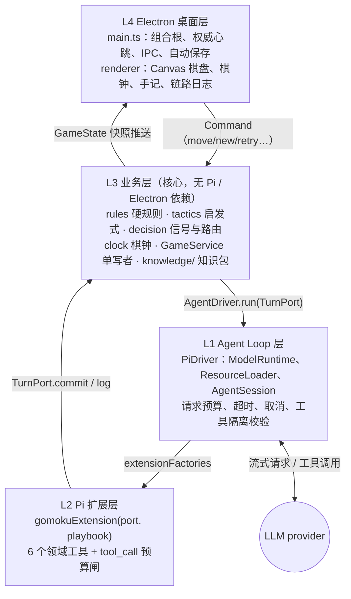
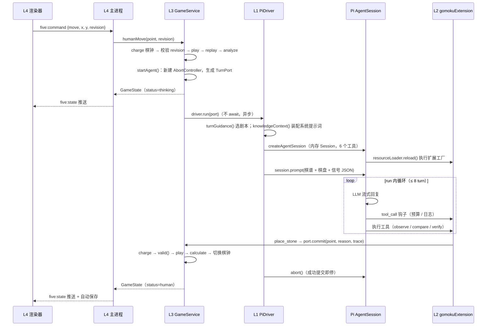
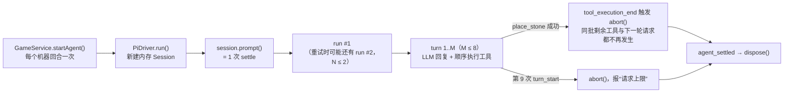
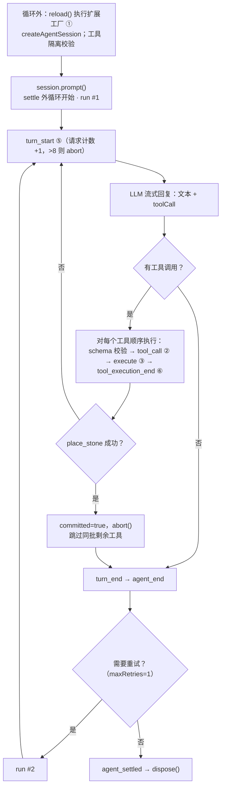
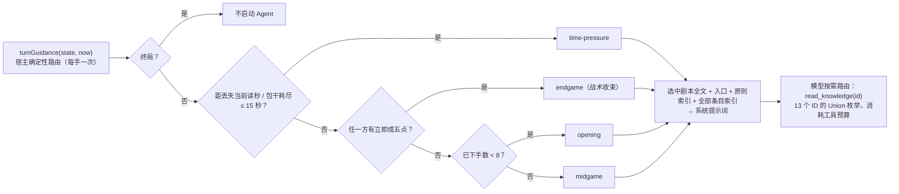
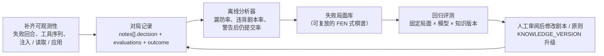
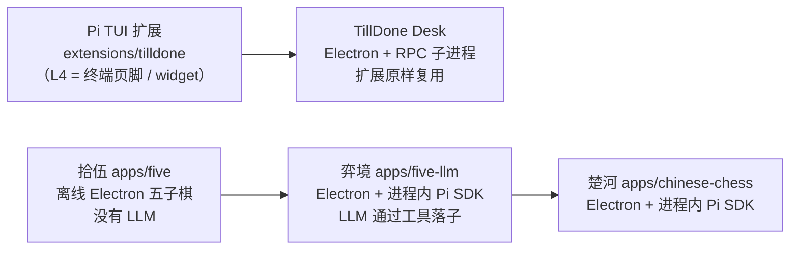
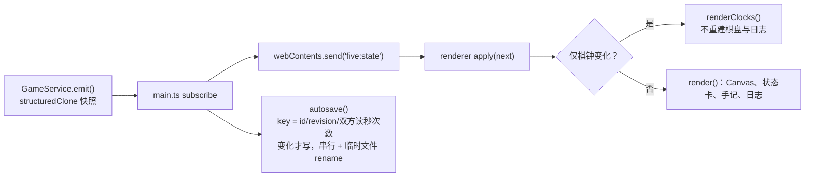
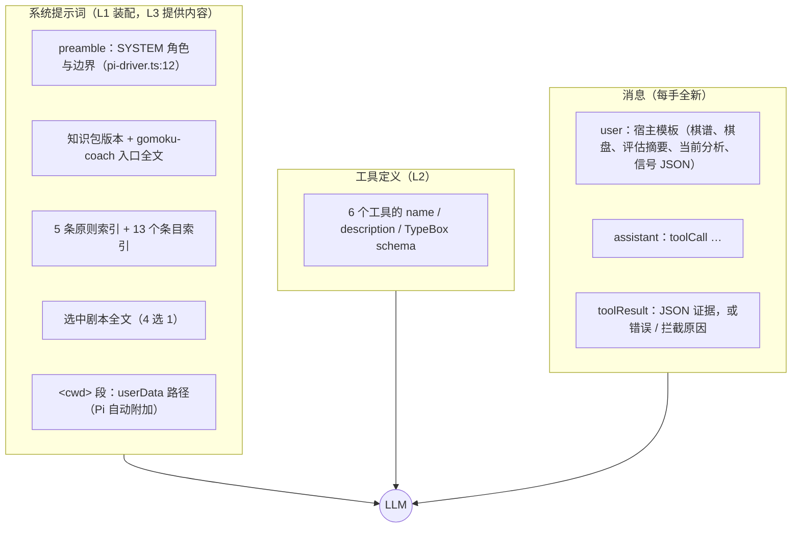

# 弈境 · Five LLM 技术白皮书：一个“真由 LLM 落子”的五子棋应用的四层 Harness、双循环接入与上下文工程

> 版本：v1.0 · 2026-10-30
> 对象：`apps/five-llm`（工作区快照，含尚未提交的 L3 知识层重构）
> 依赖：`@earendil-works/pi-coding-agent` 1.4.0、`@earendil-works/pi-agent-core` 1.4.0、Electron 45
> 验证：撰写时在工作区运行 `bun test tests/*.test.ts`，74 项测试全部通过
> 参考：`discussions/` 下的 pstack 分析、pstack 式重构提案、L3 实战复盘三份文档（见 0.4 节）

## 摘要

弈境（Five LLM）是一个 Electron 人机五子棋应用。它的机器棋手不是被包装成聊天界面的传统搜索 AI，而是**一个通过 Pi Agent Harness 的工具调用来落子的大语言模型**。在 2800 行左右的 TypeScript 里，它完整地展示了 Agentic Engineering 的三个层面：

1. **Harness Engineering**：自下而上分为 L1 Agent Loop（Pi SDK）、L2 Pi 扩展、L3 业务、L4 Electron 桌面四层。依赖方向是“端口与适配器”：业务层位于中心，不依赖 Pi 或 Electron，通过 `TurnPort` / `AgentDriver` 两个接口与 Agent 交互。
2. **Loop Engineering**：每一手棋创建一个全新的内存 Pi Session，并且只调用一次 `session.prompt()`，对应一次 settle 外循环。L2 只挂了一个扩展事件（`tool_call`），注册了 6 个领域工具；L1 驱动层另外通过 `session.subscribe` 观察 `turn_start` 和 `tool_execution_end`，实现“8 次请求上限”和“成功落子即停”。
3. **Prompt / Context Engineering**：系统提示词按局面**每手重新装配**，宿主用确定性规则选出 4 个剧本之一注入，其余知识通过白名单工具 `read_knowledge(id)` 按需读取（渐进披露，默认注入约 2.1k 字符，全量约 4.8k）。Pi 的自动压缩被**关闭**，取而代之的是“每手从权威棋谱重建上下文”，加上装配时的摘要压缩，以及把计算和验证**委派给确定性工具**。

L3 的知识层借鉴了 pstack（Cursor 工程师 poteto 的 Agent 技能插件）的“原则索引 → 编排入口 → 剧本 → 技能 → 工具证据 → 验证”模式，但做了有意识的取舍：路由交给代码而不是模型，“落子后自检”改成“提交前验证”，禁手类技能因规则集不符而被否决，子 Agent 暂缓。一局 40 手的真实对局复盘证实了“剧本编排 + 结构化战术信号 + 受控工具服务”确实在起作用，也暴露了证据粒度不足的问题。

L4 方面，五子棋这条线经历了从 Pi 原生 TUI 到 Electron 桌面的迁移。同一个仓库里，TillDone Desk 用“原生 Pi CLI + RPC 子进程”原样复用一个 TUI 扩展，five-llm 则用“进程内 Pi SDK”把 Pi 当作引擎嵌进领域应用。本文把这两种选型放在一起对照，说明为什么后者是“每手重建、提示词切换、工具隔离、同步提交”这些设计的前提。

本文按 5W1H（Why / What / Who / Where / When / How）逐层走读，并指出设计亮点、风险和改进方向，其中包括 L3 层“自我改进”的现状：线头已经埋好，实战复盘也用人工方式跑通了闭环的第一圈，但自动化的环还没有闭合。

---

## 0. 阅读约定

### 0.1 层的编号

本文采用**自下而上**的编号，与仓库中 TillDone Desk 的 L1–L4 一致：

| 编号 | 名称 | 主要文件 |
|---|---|---|
| L1 | Agent Loop 层（Pi SDK 驱动） | `src/agent/pi-driver.ts`、`model-selection.ts`、`knowledge-loader.ts` |
| L2 | Pi 扩展层（接入点） | `src/extensions/gomoku.ts` |
| L3 | 业务层（规则、计算、知识、比赛） | `src/business/*.ts`、`src/business/knowledge/**` |
| L4 | Electron 桌面层 | `src/electron/*.ts`、`src/renderer/*` |

注意：应用页脚“四层运行链路”是**自上而下**编号的（① Electron → ② 业务 → ③ Pi 扩展 → ④ Agent Loop），描述的是一次请求的流向。两种编号指的是同一组层。

### 0.2 双循环术语

沿用本仓库走读系列的定义：

- **settle 外循环**（续跑—停稳）：`AgentSession._startRun()` 中的 `while`。它反复启动 run，直到没有重试、压缩、排队消息或 `agent_before_settle` 续跑请求为止，最后发出 `agent_settled`。
- **run 内循环**（模型—工具）：`agent-loop.js` 的 `runLoop()`，反复执行 turn。一个 turn = 一次 LLM 流式回复 + 这条回复里所有工具调用的执行。
- 计数符号：`N` = run 数，`M` = turn 数（即 LLM 请求数），`K` = 工具调用数。

### 0.3 代码快照说明

撰写时 `apps/five-llm` 存在一轮**尚未提交**的 L3 重构：新增 `rules.ts`、`tactics.ts`、`decision.ts`、`knowledge/`、`knowledge-loader.ts`，并修改了扩展和驱动。本文描述的是这份工作区代码；设计说明见 `docs/l3-knowledge-refactor.md`。文中引用写作 `路径:行号`，Pi 源码引用的是 `node_modules` 下 1.4.0 的编译产物。

### 0.4 参考资料与可信度

| 文档 | 内容 | 本文如何使用 |
|---|---|---|
| `discussions/2026-10-28-four-layer-harness.md` | 四层架构的原始定义（L1 运行时只搬运、L2 是胶水、L3 决定什么进上下文、L4 是独立于上下文的界面通道），以及 L2 插入点的核对清单 | 作为四层划分和 L3 原则的**来源**（2.1、3.6、6.4 节） |
| `discussions/2026-10-28-l4-web-desktop-and-plugin-harness.md` | L4 从 TUI 走向 Web / 桌面的 A / B / C 三条路线，以及 Pi 被驱动的四种方式 | 作为 L4 迁移与 Pi 接入选型的依据（5.1、5.2 节） |
| `discussions/2026-10-30-pstack-analysis-grok.md` | Grok 对 pstack 0.15.25 的结构分析：poteto-mode 入口、23 个剧本、24 条原则、约 30 个工作流技能、2 个子 Agent、模型角色配置 | 作为“设计血统”的参照（4.6 节）。属于二手分析，本文**未**重新核验 pstack 上游实现 |
| `discussions/2026-10-30-refactor-five-llm-pstack-grok.md` | Grok 针对**重构前**的 five-llm 提出的 pstack 式改造方案 | 与实际实现逐条对照，说明采纳、改造、否决与暂缓（4.6 节） |
| `discussions/2026-10-30-five-llm-l3-live-game-review.md` | 对一局真实对局记录（40 手，`openai-codex/gpt-6.1-sol` 执白获胜）的复盘 | 作为**一手实战证据**（4.7 节），并修正、补强本文的若干判断（4.5、6.3、7.2 节） |
| `apps/five-llm/docs/l3-knowledge-refactor.md` | 本次 L3 重构的目标、实施清单、验收标准、迁移与暂缓项 | 作为设计意图的权威说明 |

可信度排序：源码与测试 > 实战记录复盘 > 重构说明 > Grok 的二手分析。凡是二手分析与源码不一致之处，以源码为准。

---

## 1. 引言：要解决什么问题

### 1.1 Why：为什么不用搜索 AI

做一个“会下五子棋的程序”，最省事的做法是 α-β 搜索，再把结果包装成“AI 说”。弈境刻意不这么做，它要回答的是另一个问题：

> **如何让一个通用 LLM 在一个有硬规则、有时限、有对抗的领域里做出可审计的决策，并且让它的每一步都受到工程约束？**

这需要同时满足四条约束：

1. **规则不可协商**：合法性、胜负、棋钟、轮次只能由代码裁决，任何自然语言都改写不了。
2. **LLM 必须真的做决定**：应用不能替模型下棋，也不能从模型的自然语言里抠出坐标直接落子。
3. **过程可审计**：要能看到模型基于什么证据做了这个决定，但不索取私有思维链。
4. **时间是真实的资源**：网络等待、工具调用、重试都要扣棋钟。

### 1.2 What：三层工程视角

| 视角 | 关注点 | 在弈境中的体现 |
|---|---|---|
| Harness Engineering | 系统怎么分层，权威在哪 | 四层架构 + 端口适配器 + 单写者 `GameService` |
| Loop Engineering | Agent 循环在哪些点被约束 | 每手一次 settle；`tool_call` 预算；`terminate` 加 `abort` |
| Prompt / Context Engineering | 模型每次看到什么 | 剧本路由、渐进披露、结构化信号、每手重建、委派计算 |

---

## 2. 四层架构（Harness Engineering）

### 2.0 四层的来历与原则

四层划分来自 2026-10-28 的讨论（`discussions/2026-10-28-four-layer-harness.md`），当时是把 PyAgent Harness 的四层分析和 IndyDevDan 视频里的 Pi 扩展示例逐层对照后得出的：

| 层 | 原始定义 | 不做什么 |
|---|---|---|
| L1 | Pi 运行时：搬运和累积，拼装上下文，把工具结果追加进历史 | 不判断内容好坏 |
| L2 | ExtensionAPI：在 L1 的固定插入点上挂回调，是 L1 和 L3 之间的胶水 | 不放业务规则 |
| L3 | 业务逻辑：**决定什么信息进上下文、进多少、以什么形式进** | 不碰渲染，不直接依赖 Pi 的事件形状 |
| L4 | 界面：一条**独立的数据通道** | 不占上下文，不经过模型转述 |

讨论中定下的两条原则，在 five-llm 里都能找到落实：

1. **上下文管理是手段，业务语义是内容。** 检验标准是“每一个进入上下文的字段，都要能回答它帮模型做哪个业务决策”。five-llm 的逐手评估只送 5 个字段、信号里每个字段都标明 `source`，就是这条原则的体现（4.4、6.4 节）。
2. **界面通道与上下文通道分离，冲突时以界面为准。** 界面数据直接来自 L3 状态，没有经过模型转述。five-llm 的棋盘、棋钟、比分都来自 `GameState`；模型的 `reason` 只是一段“公开理由”，从不作为状态来源。

在 five-llm 里，L1 不只是“Pi 运行时”本身，还包括宿主一侧驱动它的 `PiDriver`。这是因为这里用的是进程内 SDK（见 5.2 节），宿主代码和 Pi 运行时在同一个进程里，驱动代码自然归入 L1。

### 2.1 全景



### 2.2 各层职责（What / Who）

| 层 | 拥有的权威 | 不允许做的事 |
|---|---|---|
| L1 PiDriver | 本回合的 Pi Session 生命周期：模型解析、请求预算 8、技术超时 90 秒、取消、工具白名单校验 | 不判断落子是否合法，不碰棋钟 |
| L2 gomokuExtension | 本回合的工具面：6 个工具、调用预算 16、证据门禁（先观察再提交）、提交前验证、决策证据组装 | 不直接改棋谱；提交只能经过 `port.commit` |
| L3 GameService 等 | 棋谱、revision、轮次、棋钟、比分、胜负，以及**唯一写入入口** | 不 import Pi 或 Electron |
| L4 main / renderer | 进程组合、200ms 权威心跳、IPC 校验、原子保存、可视化 | 渲染器不能提交 LLM 落子，也不能改权威棋谱 |

### 2.3 依赖方向：运行时链路不等于编译依赖

图 2.1 是**运行时**的调用链。**编译依赖**是另一回事：L3 是中心，其他层都依赖它。

- `game-service.ts:8` 定义 `TurnPort`（state、signal、log、commit），`:14` 定义 `AgentDriver { run(port) }`。业务层只知道这两个接口，不知道 Pi 的存在（**依赖倒置**）。
- L1 的 `PiDriver implements AgentDriver`，L2 的 `gomokuExtension(port)` 接收同一个 `TurnPort`。两者都 import 业务层的纯函数（`engine`、`decision`），反方向的 import 一个都没有。
- L4 的 `main.ts` 是**组合根**：它创建 `PiDriver`（`main.ts:67`），注入 `GameService`，再把 `service.subscribe` 接到 IPC 推送和自动保存（`main.ts:81`）。冒烟测试时它注入一个测试替身 driver，业务层完全不受影响。

这就是典型的六边形（Ports & Adapters）架构：L1 和 L2 是“Agent 适配器”，L4 是“UI 与持久化适配器”。

### 2.4 一手棋的端到端时序

下图是“人类落子 → LLM 应手”的完整往返：



### 2.5 不变量：谁是权威

| 不变量 | 守护位置 | 机制 |
|---|---|---|
| 棋谱只有一个写者 | `GameService` | 所有写入都走 `calculate()`；渲染器只能读快照 |
| 过期回合不能落子 | `game-service.ts:170` 的 `valid()` | 同时校验五个条件：未取消、未终局、同一局、同一 revision、仍是当前控制器 |
| 迟到的响应赢不了已经超时的棋钟 | `commit` 第一行 `this.charge()` | 先结算时间，再判断回合是否有效 |
| 每回合只提交一次 | `committed` 标志（L2 和 L3 各有一个） | 双重防护 |
| 坐标、占用、终局合法 | `rules.ts` 的 `play()` | 每次提交后从完整棋谱 `replay()` |
| 规则是自由五子棋，无禁手 | `RULESET = 'free-gomoku/v1'` | 知识包只能“建议”，不能改写规则 |

这里有一个值得强调的设计：**revision 版本号**贯穿全部四层。人类落子、悔棋、取消、新局都会让 `revision++` 并 `abort` 当前回合（`invalidate()`）。LLM 提交时必须带上 revision，否则 `checkRevision` 报错，错误信息会作为工具结果反馈给模型，让它自行修正。

---

## 3. Pi 双循环与 L2 接入点（Loop Engineering）

### 3.1 Pi 1.4.0 的双循环（源码定位）

| 结构 | 源码位置 | 作用 |
|---|---|---|
| settle 外循环 | `agent-session.js:1423` 的 `_startRun()`；`:1449` 首次 prompt；`:1450` 起 `while` | 首个 run 结束后，因重试、压缩、排队消息或 `agent_before_settle` 续跑而再起一个 run；`finally` 里发出 `agent_settled`（`:1471`） |
| run 内循环 | `agent-loop.js:84` 的 `runLoop()`；`:92` 与 `:95` 两层 `while`（转的都是 turn） | turn：`turn_start` → LLM 流 → 执行工具 → `turn_end` |
| 第一个 `turn_start` | `agent-loop.js:56` | 由 `runAgentLoop` 发出；之后的在 `:118` |
| 工具前置钩子 | `agent-loop.js:499` 调 `config.beforeToolCall`；`agent-session.js:322/326` 把它接到扩展的 `tool_call` 事件 | 参数校验**之后**、执行**之前** |
| 批次终止 | `agent-loop.js:471` `shouldTerminateToolBatch`：**同一批全部** `terminate === true` 才终止 | 关系到 `place_stone` 的停机设计 |
| 顺序批次中途停止 | `agent-loop.js:408` 每执行完一个工具检查 `signal.aborted` | 配合 L1 的 `abort()` |
| 压缩闸 | `agent-session.js:2391` `_checkCompaction`：`settings.enabled` 为假直接返回 | five-llm 把它关掉了 |

### 3.2 five-llm 怎样使用双循环



几个关键事实：

- **一手棋 = 一个 Session = 一次 settle。** `SessionManager.inMemory()` 加上 `finally` 里的 `session.dispose()`（`pi-driver.ts:96`），保证回合之间没有任何对话残留。
- **settle 外循环几乎只转一圈。** 压缩已关闭（`compaction: { enabled: false }`，`pi-driver.ts:42`），没有 `agent_before_settle` 处理器，也没有排队消息；唯一可能再起一个 run 的是 `retry: { maxRetries: 1 }`。所以 `N ∈ {1, 2}`。
- **run 内循环才是主战场。** `M ≤ 8`、`K ≤ 16`，所有工具都声明 `executionMode: 'sequential'`，因此 `agent-loop.js:374` 会走顺序执行分支。

### 3.3 接入点总表（5W1H 速查）

“每次 settle 几次”一列用 0.2 节的符号表示。为了排版，总表拆成两张：第一张回答 What / Who / Why，第二张回答 Where / When。

**表 3-1　接入点是什么、谁负责、为什么需要**

| # | 接入点（What） | Who：谁注册 / 谁调用 | Why：为什么需要 |
|--|--------------|----------------------|------------------------|
| ① | 扩展工厂 `gomokuExtension()` | L1 经 `extensionFactories` 传入；Pi 在 `reload()` 中调用 | 把本回合的 `TurnPort` 和剧本闭包进工具，状态按回合隔离 |
| ② | `pi.on('tool_call')` | L2 注册；Pi 的 `_beforeToolCall` 触发 | 16 次调用预算、取消与已提交守卫、链路日志 |
| ③ | 6 个工具的 `execute()` | L2 注册；Pi 的 `executePreparedToolCall` 调用 | 观察、比较、验证、提交 |
| ④ | `place_stone` 返回 `terminate: true` | L2 返回；Pi 的 `shouldTerminateToolBatch` 读取 | 告诉 Pi “这一批之后不必再请求模型” |
| ⑤ | 订阅 `turn_start` | **L1** 的 `session.subscribe`（宿主订阅，不是扩展事件） | 统计 LLM 请求数，第 9 次即 `abort()` |
| ⑥ | 订阅 `tool_execution_end` | L1 的 `session.subscribe` | 记录工具结果；`place_stone` 成功就 `abort()` |
| ⑦ | `TurnPort.commit` / `log` | L3 提供，L2 调用 | 跨层写入的唯一通道 |

**表 3-2　接入点挂在哪里、何时执行**

| # | Where：挂在哪层循环、哪一步 | When：每次 settle 几次 |
|--|------------------------------|------------------|
| ① | **循环外**：创建 Session 之前（`resource-loader.js:516`、`:875`） | 每个机器回合 1 次 |
| ② | **run 内循环 · 工具准备阶段**：参数校验之后、执行之前 | K 次 |
| ③ | **run 内循环 · 工具执行阶段** | 每个工具 0..K 次 |
| ④ | **run 内循环 · 批次收尾** | ≤ 1 次 |
| ⑤ | **run 内循环 · turn 开头** | M 次 |
| ⑥ | **run 内循环 · 每个工具执行之后** | K 次 |
| ⑦ | 在 ③ 内同步执行 | commit ≤ 1 次；log 0..K 次 |

### 3.4 逐个接入点详解

#### ① 扩展工厂：每手“装配”一次

- **What**：`gomokuExtension(port, selectedPlaybook)` 返回一个 `ExtensionFactory`，即 `pi => { … }`。
- **When**：`PiDriver.run()` 创建 `DefaultResourceLoader` 时把工厂放进 `extensionFactories`（`pi-driver.ts:46`），随后 `await resourceLoader.reload()`。Pi 在 reload 中执行内联工厂（`resource-loader.js:516` 调用 `:875` 的 `loadExtensionFactories`）。注意这是**内联工厂**，不经过 jiti 按文件路径导入。
- **How**：工厂体内声明本回合的闭包状态（`gomoku.ts:21-22`）：调用计数 `calls`、观察证据 `observed`、试算证据 `simulated`、提交标志 `committed`、知识读取清单 `knowledgeRead`。然后注册 `tool_call` 处理器和 6 个工具。按项目约定，工具在**工厂顶层**注册，不放在事件处理器里。
- **Why**：工厂每手创建一次，状态天然按回合隔离；`port` 是本回合独有的写入凭证，旧回合的工具无法写到新棋盘上。
- **加载后的守卫**：L1 检查 `getExtensions().errors` 是否为空，并确认活跃工具集合恰好是 `GAME_TOOLS` 的子集且包含 `place_stone`（`pi-driver.ts:63-66`），否则抛出“工具隔离校验失败”。

#### ② `tool_call`：唯一挂上的扩展事件

```ts
pi.on('tool_call', event => {
  ensureActive();                                   // 已取消或已提交时直接抛错
  if (++calls > 16) return { block: true, reason: '单回合工具调用预算已耗尽' };
  if (isToolCallEventType<'place_stone', …>('place_stone', event)) port.log('extension', `校验落子请求：…`);
  else port.log('extension', `工具调用：${event.toolName}`);
  return undefined;                                 // 放行
});
```

- **Where / When**：`agent-loop.js:prepareToolCall` 先用 TypeBox 校验参数（`:497-498`），再调用 `beforeToolCall`（`:499`）。所以这个处理器看到的 `event.input` **已经通过了 schema 校验**，例如坐标一定是 0–14 的整数。
- **两种拦截方式**：返回 `{ block: true, reason }`，或者直接 `throw`（`ensureActive`）。两者都会变成一条 `isError` 的工具结果回到模型的上下文里（`agent-loop.js:513-520`、`:538-544`），**不会让整个 run 崩溃**。这是“错误即提示词”的基础，见 6.3 节。
- **Why**：预算放在这里而不是 `execute` 里，是因为模型可能调用不存在的工具或参数非法的工具，这些都应该计数；而且拦截发生在执行之前，不产生副作用。

#### ③ 六个工具：observe / compare / verify / commit 的执行器

| 工具 | 工作流步骤 | 读 / 写 | 关键约束 |
|---|---|---|---|
| `analyze_position` | observe | 只读；置 `observed` | 从完整棋谱 `replay`，返回棋盘、分析、信号 |
| `evaluate_threats` | observe | 只读；置 `observed` | 重新投影时间，返回最新 `turnGuidance` |
| `read_knowledge` | compare（按需） | 只读；登记 `knowledgeRead` | 参数是 13 个 ID 的 `Union`，在 schema 层面就排除了文件路径 |
| `simulate_moves` | compare | 只读（副本）；置 `simulated` | 1–6 手交替，`hypothetical: true` |
| `validate_move` | verify | 只读 | 校验 revision；一手反击扫描，`scope: one-ply-only` |
| `place_stone` | verify + commit | **写**（经 `port.commit`） | 必须先 `observed`；自动 `validateCandidate`；组装 `DecisionTrace`；返回 `terminate: true` |

`place_stone` 的**证据门禁**（`gomoku.ts:102`）是整个设计的关键一行：没有先观察当前局面就提交，会抛出“请先调用 analyze_position 或 evaluate_threats…”，模型会在下一个 turn 读到这句话并修正。

#### ④ + ⑥：为什么 `terminate: true` 不够，还要 `abort()`

Pi 的语义是：**同一批工具调用全部**返回 `terminate: true`，run 才停（`agent-loop.js:471-472`）。如果模型在一条回复里同时调用了 `[place_stone, analyze_position]`，`place_stone` 的 terminate 会被同批另一个工具“否决”，模型还会再被请求一次。

five-llm 的解法分两步（`pi-driver.ts:73-79`）：

1. L1 订阅 `tool_execution_end`，看到 `place_stone` 成功就设置 `committed = true` 并 `abort()`。
2. `abort()` 让 signal 进入 aborted 状态，顺序批次在 `agent-loop.js:408` 检查到后跳过剩余工具；`_agentRunAbortRequested` 让 settle 外循环也不再续跑。

另外，`abort()` 是用 `void session.abort()` 调用的，没有 await。原因是事件回调本身在 run 内部执行，而 `abort()` 会 `waitForIdle()`，在这里 await 会让 run 永远等不到空闲（死锁）。`session.prompt()` 返回后，`if (committed) return` 把“被我们自己中止”视为成功（`pi-driver.ts:90`）。L3 的重构文档也记录了：这个缺陷是在回归测试“混合批次”时发现的。

#### ⑤：用 `turn_start` 计数 LLM 请求

每个 turn 恰好对应一次 LLM 请求，所以 `turn_start` 就是天然的请求计数器。第一个 `turn_start` 由 `runAgentLoop` 发出（`agent-loop.js:56`），后续的由 `runLoop` 发出（`:118`），因此计数是完整的。第 9 次 `turn_start` 触发 `abort()`，在请求真正发出之前就中止了。

### 3.5 一次 settle 的时间线



### 3.6 刻意没有使用的回调

| 回调 | 通常用途 | five-llm 为什么不需要 |
|---|---|---|
| `before_agent_start` | 每次 run 前改写系统提示词或工具集 | 系统提示词在创建 Session **之前**由宿主装配，每手一个 Session |
| `context` | 每次请求前改写消息列表 | 上下文本来就是新的，不存在需要裁剪的历史 |
| `agent_end` / `agent_before_settle` | 催促续跑（TillDone 的做法） | 停机条件由 L1 掌握：要么提交，要么预算或超时用尽；不希望模型被“劝”着继续 |
| `session_start` / `session_tree` | 从会话历史恢复状态 | 状态的权威在 L3，不在会话里 |
| `input`、`registerCommand` | 用户输入与斜杠命令 | 没有人类聊天输入，模型唯一的输入是宿主模板 |
| `before_provider_request` | 改写发给 provider 的原始请求体 | 不需要改写传输层 |
| `tool_result` | 改写工具结果 | 工具结果本来就由本扩展的 `execute()` 生成 |
| `turn_end` | 要求再跑一个 turn | 不希望延长回合 |

四层讨论稿核对过 Pi 1.4.0 全部能改变流程的插入点（`input` / `before_agent_start` / `context` / `before_provider_request` / `tool_call` / `tool_result` / `turn_end` / `agent_end` 加 `sendMessage`）。five-llm 只用了其中的 `tool_call` 一个；`turn_start`、`tool_execution_*` 这类只能观察的事件，则由 L1 宿主直接订阅。

这张表本身就是一个设计结论：**状态和流程控制的权威越是留在宿主，扩展需要挂的回调就越少。** 而“权威能留在宿主”，又是 5.2 节选择进程内 SDK 的直接结果。

### 3.7 三道闸：预算、超时、取消

| 闸 | 位置 | 触发后 |
|---|---|---|
| 请求预算 8 | L1 `turn_start` 计数 | `abort()`，L3 显示错误，棋钟继续 |
| 工具预算 16 | L2 `tool_call` | 返回 `block`，模型收到“预算耗尽” |
| 技术超时 90 秒 | L1 `setTimeout` → `abort()` | “LLM 思考超时”；**这与棋局超时是两回事** |
| 取消 / 新局 / 悔棋 | L3 `invalidate()` → `controller.abort()` | L1 监听 `port.signal` 后 `abort()`；L2 的 `ensureActive()` 抛错；L3 的 `valid()` 拒绝迟到提交 |
| 棋钟 | L3 `charge()`，200ms 心跳 | 超时直接判负，与 Agent 状态无关 |

---

## 4. L3 业务层：知识怎样变成推理信号

### 4.1 四类知识，四种载体

重构把原先混在系统提示词里的东西拆成四类，并且**按可信程度分别安放**：

| 类别 | 例子 | 载体 | 权威性 |
|---|---|---|---|
| 硬规则 | 合法性、胜负、计时、一次提交 | `rules.ts`、`clock.ts`、`GameService` | 代码裁决，提示词无法改写 |
| 确定性事实 | 全盘所有立即成五点、对手立即成五点、一步不可防 | `decision.ts` 的 `positionSignals().facts` | 扫描全部空点，可复算 |
| 启发式 | 五格窗口棋形、双三/双四标签、候选分数 | `tactics.ts` 的 `analyze()` | 明确标注“不是胜率、不是必胜证明” |
| 流程知识 / 专家经验 | 原则、剧本、技能 | `knowledge/**/*.md` | 只是指导，不能改变规则 |

这正对应了你问的“业务规则、领域知识与数据、专家经验”：

- **数据（棋谱）**：权威棋谱 `position.moves` 与逐手评估 `evaluations` 存放在 `GameState`，每手全量重放。
- **领域计算**：`analyze()` 对每个空点、四个方向计算五格窗口。`positionSignals()` 把输出分成 `facts`（事实）、`priority`（优先级）、`heuristics`（启发式及其局限）三段，**在数据结构层面把事实和启发式分开**。
- **专家经验**：剧本和原则。重构文档也坦白承认“没有开局定式数据库”，开局剧本只写了“中央、联络、空间”这类偏好。

### 4.2 知识包结构：一组“技能”

```text
src/business/knowledge/
├── SKILL.md                    gomoku-coach：每回合入口（编排 observe/compare/verify/commit）
├── principles/                 5 条原则（始终可见其索引）
│   ├── principle-rules/        规则优先：自由五子棋，无禁手
│   ├── principle-evidence/     事实高于启发式
│   ├── principle-tactics/      先取胜、再防守；多点威胁不能靠堵一个
│   ├── principle-time/         时间是资源；投影不是新截止
│   └── principle-commit/       一回合一提交；验证在提交之前
├── playbooks/                  4 个剧本（每手由宿主选一个全文注入）
│   ├── opening.md  midgame.md  endgame.md  time-pressure.md
└── skills/                     3 项技能（按需读取）
    ├── evaluate-threats/  check-legality/  verify-board/
```

每个条目的写法统一为“**触发条件 → 步骤 → 证据 → 局限**”，原则和技能还带有与 Pi / Claude 技能兼容的 frontmatter（`name`、`description`）。一共 13 个条目，在 `decision.ts:7` 的 `KNOWLEDGE_ITEMS` 里登记 ID、文件和一句话描述。这张表同时是**白名单**、**索引**和**schema 枚举**的来源。

需要特别指出：**这些 SKILL.md 并不通过 Pi 的技能机制加载。** `PiDriver` 显式设置了 `noSkills: true`（`pi-driver.ts:49`）。它们借用了技能的**格式**（便于移植、也便于人读），但**加载和路由完全由宿主控制**。原因有两个：

1. Pi 的技能机制要求模型用 `read` 或 `bash` 按路径读文件，而 five-llm 刻意不开放任何文件系统工具。
2. 不从会话工作目录发现技能，就杜绝了用户或项目目录里的同名技能被混进来的可能。

### 4.3 路由：两级，而且都不是斜杠命令

five-llm **没有任何斜杠命令**（`noPromptTemplates: true`，也没有 `registerCommand`），因为根本没有人类在和模型聊天。知识的路由分两级：



- **第一级：宿主路由（Who = 代码，When = 每手开始）。** `decision.ts:53-64` 的 `turnGuidance` 是纯函数：时间优先，战术其次，最后按手数区分开局和中盘。注意剧本名称刻意避开了“按手数判断终盘”，`endgame` 由**事实**触发。时间剧本里也明确写了“仍须先取立即胜”，所以时间路由不会压过战术事实（有测试覆盖：`tests/decision.test.ts:84`）。
- **第二级：模型路由（Who = LLM，When = run 内循环中任意 turn）。** 模型看到的是一个带一句话描述的条目索引，自行决定调用 `read_knowledge('verify-board')` 之类。ID 在 schema 层面就是枚举（`gomoku.ts:63`），读取器还用 `Object.hasOwn` 做第二道白名单（`knowledge-loader.ts:8`）。

两级路由的分工很清楚：**能用代码确定的（时间、事实）由代码路由；需要判断的（“我现在需要哪条经验”）交给模型，但只能在白名单里选。**

### 4.4 信号契约：模型实际看到的结构

`turnGuidance()` 的输出会被 JSON 化后放进用户提示词，`evaluate_threats` 工具也会返回同样的结构：

```json
{
  "version": "gomoku-knowledge/v1",
  "revision": 17,
  "playbook": "endgame",
  "signals": {
    "ruleset": "free-gomoku/v1",
    "facts": {
      "source": "all-empty-points-scan",
      "immediateWins": [],
      "opponentImmediateWins": [{ "x": 9, "y": 6 }],
      "unavoidableLossInOne": false
    },
    "priority": "answer-immediate-threat",
    "heuristics": {
      "source": "local-five-cell-windows",
      "candidates": ["…最多 12 个"],
      "limitations": ["分数不是胜率", "双三/双四为窗口棋形提示，不是强制获胜证明", "…"]
    }
  },
  "time": { "source": "projected-snapshot", "untilPeriodLossMs": 52000, "untilForfeitMs": 172000, "urgent": false,
            "warning": "时间只是快照建议；…最终截止由业务层提交时裁决。" },
  "steps": [{ "id": "observe", "status": "pending" }, "…"]
}
```

（示例数值仅作示意。）这个契约的几个工程要点：

1. **每个字段都带 `source`**，模型能区分“全盘扫描的事实”和“局部窗口的估计”。
2. **局限性直接写在数据里**，而不只写在提示词里，因此每次工具返回都会提醒一次。
3. **时间是投影快照**，`warning` 明确说明“不是新的截止规则”，防止模型把投影值当成规则。

### 4.5 证据链：`DecisionTrace`

`place_stone` 成功时，L2 组装一份 `DecisionTrace`（`decision.ts:26`），经 `port.commit` 写进 `notes[].decision`，然后随棋谱原子保存：

| 字段 | 内容 | 说明 |
|---|---|---|
| `version` | `gomoku-knowledge/v1` | 知识包版本，语义变化时升级 |
| `playbook` | 回合开始时注入的剧本 | 如实记录，不假装中途换过剧本 |
| `knowledgeRead` | 初始化为“入口 + 剧本”，之后追加 `read_knowledge` 读过的 ID | 由代码登记，不靠模型自述；但**注入的和主动读取的混在同一个列表里** |
| `steps` | observe / compare / verify / commit 的 done 或 skipped | compare 没有试算时，**写明跳过原因** |
| `validation` | 提交前的一手反击扫描结果 | `scope: 'one-ply-only'` |

设计原则是：**只记录工具实际执行产生的证据，不记录、也不索取私有推理。** `compare: done` 只表示“确实调用过变化试算”，不推断模型在内部是否比较过候选。

实战复盘（4.7 节）指出，这份证据的**粒度**还不够，原因都在 L2 的闭包状态设计上：

1. **`observed` 和 `simulated` 是覆盖式变量**，只保留本回合最后一次。因此无法恢复一个回合里调用过几次分析、试算过哪些分支。
2. **`compare: done` 的含义偏弱**：只要成功调用过一次 `simulate_moves` 就算 done。复盘发现有的回合最后保存的试算只有 1 手（没有对手应手），有的试算首着并不是最终落子。
3. **`knowledgeRead` 分不清 injected 和 fetched**：入口和剧本是工厂初始化时写进去的，并不代表模型主动读取过。
4. **只有成功的回合才有记录**：失败、取消、超时的回合不进入 `notes`；`GameState.logs` 只在内存中保留最近 80 条，也不导出。Session 结束即 `dispose`，原始提示词、工具调用次数、token 消耗都无法事后恢复。

换句话说，**“执行了检查”“记录了证据”“模型看见了反馈”“模型据此修正”是四种不同强度的保证**，当前的 `DecisionTrace` 可靠地提供了前两种。

### 4.6 设计血统：从 pstack 提案到实际落地

L3 重构有一条清晰的来历：先有 Grok 对 pstack 的结构分析，再有 Grok 针对**重构前** five-llm 的 pstack 式改造提案，最后才是实际实现（`docs/l3-knowledge-refactor.md`）。三者对照，能看出“照搬一个通用 Agent 工程框架”和“为一个有硬规则、有棋钟的领域做工程化”之间的差别。

**pstack 的核心结构（据 Grok 分析）。** 编排入口 `/poteto-mode` 读取请求、匹配一个剧本、把步骤**逐字**抄进 todo 列表（跳过的步骤保留原因）；24 条一句话原则以索引形式常驻；约 30 个工作流技能负责解释、影响分析、并行（arena / swarm）、多模型审查（interrogate）等；子 Agent 提供隔离执行；一份始终生效的规则文件广播模型角色配置。**各部件之间的耦合靠“共享 todo 文件 + 规则文件”。**

**提案与实现逐条对照：**

| Grok 提案 | 实际实现 | 取舍及理由 |
|---|---|---|
| `RULES.md` 升级为原则层，拆成独立的 principle 技能，启动时只读索引 | 5 条 `principle-*`，索引常驻系统提示词；`RULES.md` 保留给人看 | **采纳**。但硬规则仍在代码里，原则只做指导 |
| 原则包含 `principle-double-three-forbidden` | 没有这条；`principle-rules` 明确写“无禁手” | **否决**。本应用是自由五子棋，双三合法。照搬会让模型误判规则 |
| 把 `engine.ts` 拆成技能 + 工具：check-win、evaluate-threats、ban-check | 拆成 `rules.ts`（规则）+ `tactics.ts`（启发式）+ `decision.ts`（信号）；技能为 evaluate-threats、check-legality、verify-board | **改造采纳**。ban-check 被否决，换成 check-legality；技能只写“何时、怎样用”，计算留在 TypeScript |
| 把 `game-service.ts` 的流程变成剧本：opening / midgame / endgame / timeout | 4 个剧本，统一为 observe / compare / verify / commit 四步 | **改造采纳**。`GameService` 的状态机**没有**被改写成自然语言；剧本只覆盖“模型的一手棋怎么想” |
| 剧本由 game-service 在落子前后注入，跳过的步骤保留原因 | 由 `turnGuidance()` 确定性选择，回合开始时注入；跳过原因写进 `DecisionTrace` | **采纳**，但路由权在代码，不在模型 |
| `clock.ts` 保留为基础设施，抽出时间策略原则 | `clock.ts` 不变；新增 `principle-time` 和 `time-pressure` 剧本 | **采纳** |
| 验证技能 skill-verify-board：**落子之后**用分析和试算自检 | verify-board 改为**提交之前**；`place_stone` 内置一手反击扫描 | **关键改造**。落子后自检要多一次模型请求、多扣一段棋钟，而且已经无法撤回 |
| 加 review-agent（interrogate 式多模型交叉审查）或 simulate-agent | 未实现，用确定性的 `validateCandidate` 做只读审查 | **暂缓**。费用、棋钟预算、故障传播都还没评估 |
| 用 `.five-llm/state` 目录存剧本进度、原则索引、模型分配 | 未实现，沿用 `GameService` 单写者 + 棋谱原子保存 | **否决**。避免出现第二个可写状态源 |
| 工具太粗：拆出 evaluate_threats、check_bans，place_stone 加提交前钩子 | 新增三个工具：evaluate_threats / validate_move / read_knowledge；`place_stone` 内置证据门禁和验证 | **采纳**（check_bans 除外） |

**结构对应关系（据实战复盘整理）：**

| pstack 模式 | five-llm 的对应物 | 差异 |
|---|---|---|
| poteto-mode 编排入口 | `gomoku-coach` + `turnGuidance()` | 剧本由代码选定，不是模型自主选择 |
| 原则索引 | 5 条原则的简短索引常驻上下文 | 全文按需读取 |
| 任务剧本 | 4 个棋局情景剧本 | 共用同一套四步 ID，不是可变的依赖图 |
| 专项技能 | 3 项领域技能 | 只是说明文档，执行者是工具 |
| prove it works | 提交前候选验证 + 每手全谱重放 | 验证范围只有一步 |
| 共享 todo / 决策 artifact | 内存闭包状态 + `notes[].decision` | 只在成功提交时生成摘要，不是实时持久化的待办 |
| 子 Agent、多模型审查 | 无 | 只有一个主棋手 |
| 模型角色配置文件 | 单一模型 + 固定预算 | 没有 reviewer / judge 角色 |

所以准确的定位是：**一个受 pstack 启发、由宿主显式管理的领域知识包与工具服务层，而不是完整的 pstack 式多 Agent 技能平台。** 复盘文档总结了三者的关系：**技能是使用能力的方法，工具是能力的受限接口，业务服务是计算与状态的权威实现。** 三者不是同一件事，也不必一一对应。

### 4.7 实战证据：一局 40 手的复盘

复盘读取的是一局真实对局的记录文件（`records/8f4241b8-….json`，2026-10-30 保存）：人类执黑，`openai-codex/gpt-6.1-sol` 执白，第 40 手 M9 连五获胜，三局两胜的第 1 盘。20 手模型落子都带有 `gomoku-knowledge/v1` 决策记录。复盘还用当前规则引擎对全谱逐手重放：40 份逐手评估和 20 份最终候选验证都与保存值一致。

**这局实际用了什么：**

| 项目 | 观察结果 |
|---|---|
| 剧本分布 | opening 4 回合、midgame 13 回合、endgame 3 回合（第 24、36、40 手）、time-pressure 0 回合 |
| observe 证据 | 20 回合最后一次观察都是 `evaluate_threats` |
| 变化试算 | 15 回合记录为 done，5 回合为 skipped |
| 提交前验证 | 20 回合全部合法，warnings 全部为空 |
| 额外知识全文 | `knowledgeRead` 里只有入口和选中剧本，**没有任何额外的原则或技能全文读取** |
| 与启发式排名的关系 | 15 手选了启发式第 1 名；5 手选了第 2、6、8、9 名，**没有被强制替换为榜首** |
| 耗时 | 平均 10.5 秒 / 手，最短 3.8 秒，最长 19.4 秒；模型终局时还剩约 390 秒基本用时 |

**三个有代表性的决策：**

- **第 24 手 L8：事实驱动防守。** 黑方唯一的立即成五点是 L8，路由选中 endgame；模型取证后跳过可选试算，直接封堵；验证确认黑方不再有一手成五。第 36 手 K7 是同样的模式。
- **第 38 手 J6：进攻判断。** 双方都没有立即胜点，所以路由仍是 midgame。模型试算 J6 后落子，形成 I5–J6–K7–L8 斜向四子，两端 H4、M9 都能成五；公开理由里的两个端点与复算一致。这也说明 endgame 的触发含义是“**当前已经有**一手成五点”，而不是泛指进入收官。
- **第 40 手 M9：直接获胜优先。** 黑方占了 H4，白方剩下的胜点 M9 由 endgame 剧本直接取下，没有做多余试算。

**这局能说明什么，不能说明什么：**

- 能说明：剧本编排、结构化战术信号和受控工具服务**确实在起作用**，模型的行动与信号相符，低分但合法的选择也被尊重。
- 不能说明：没有对照组，不能把胜局归因于知识包；没有走到时间剧本，也没有额外技能读取、失败纠错的样本；**技能“可用”不等于技能被读取或遵循**，入口和剧本可能已经覆盖了本局需要，也可能是技能的触发条件写得不够突出，单局无法区分。

### 4.8 这一层埋有自我改进的线吗？

**结论：埋了线头，实战复盘也用人工方式跑通了闭环的第一圈，但自动化的环还没有闭合。**

已经具备的“线头”：

| 线头 | 现状 | 对自我改进的价值 |
|---|---|---|
| 版本化知识包 `KNOWLEDGE_VERSION` | 已有，规则写明“语义变化必须升级版本” | 能把对局结果归因到某个知识版本 |
| 每手 `DecisionTrace` | 已持久化：剧本、读过的知识、步骤、警告 | 能分析“读了 verify-board 的回合是否更少漏防” |
| 每手 `evaluations` + 结果 `outcome` | 已持久化 | 能把“启发式第一候选”与模型实际选择对比 |
| `userData/records/*.json` 原子保存 | 已有，每盘一个文件 | 天然的离线数据集 |
| 测试中的 Pi SSE 替身 | 已有 | 可以扩展成固定局面的回归评测 |

**4.7 节的复盘本身就是闭环的第一圈**：读取对局记录 → 全谱重放复算 → 统计剧本、试算和知识读取 → 找出证据粒度的缺口 → 提出下一轮优先级。它证明这些线头**确实能用**，同时也暴露出线头本身还不够结实（4.5 节的四个粒度问题）。

缺少的部分（重构文档的“暂缓项”也坦白承认了“未验证模型对知识的实际遵循率，也未证明棋力提升”）：

1. **可观测性不足**：失败回合、完整工具调用序列、注入的条目与版本都没有持久化（见 4.5 节）。这是自动分析的前提。
2. **没有读取历史记录的分析器**：复盘是人工完成的，没有代码读回 `records/` 做统计。
3. **没有评测基准**：没有固定局面集合，也没有“仅工具 / 入口 + 原则 / 完整剧本与技能”这样的对照实验。
4. **没有把结论写回知识包的通道**：剧本修改完全靠人工。

复盘文档建议的下一轮优先级是：**先补可观测性，不急着加子 Agent**。具体包括记录每次尝试的 ID、路由原因、注入条目；让试算证据绑定到具体候选（基准 revision、完整分支、是否包含对手应手）；区分 knowledge injected / fetched / applied；让关键警告在提交**之前**反馈给模型；再建立唯一防守、多威胁、直接取胜、读秒、非法纠错等情景评测。

一条可行的闭环路径（建议，未实现）：



关键是第 E 步保留**人工审阅**：知识包会进入每一手的系统提示词，自动改写它的风险（提示词漂移、对单一模型过拟合）高于收益。

---

## 5. L4 Electron 桌面层：把进展和状态可视化

### 5.1 从 Pi 原生 TUI 到 Electron：L4 的迁移

Pi 1.4.0 的 L4 是终端界面（pi-tui）。扩展通过 `setFooter`、`setWidget`、`setStatus`、`ui.custom()` 往终端里画东西，本仓库前面的走读系列（tilldone、pure-focus、subagent-widget 等）都是在这个 L4 上做的。终端的上限也很明显：画不了图片、Canvas 棋盘、动画和交互式表格。

2026-10-28 的讨论稿（`discussions/2026-10-28-l4-web-desktop-and-plugin-harness.md`）列出了三条路线：

| 路线 | 做法 | 代价 |
|---|---|---|
| A. TUI 不变，扩展里起本地网页 | 扩展在 `session_start` 里起本地服务，用 SSE 推状态，TUI 只显示链接 | 两个界面要同步；要管端口和生命周期 |
| B. RPC / SDK 宿主 + Web 客户端 | 一个宿主进程驱动 Pi，把会话事件和扩展 UI 请求转给前端 | 依赖 `setFooter` / `custom()` 的 L4 代码要重写；确认框走协议 |
| C. 在 B 外面套 Electron 桌面壳 | 桌面壳里跑 B 的宿主和前端 | 打包、签名、更新的工程量 |

当时的判断是“先做 A 验证需求，确定长期投入再走 B，C 是 B 的外壳”，前提是 **L3 已经和 L4 分开**。实际的推进比这更快，第二天（10-29）就直接走了 C，并且留下了一条清晰的应用演进线：



迁移到 Electron 时，有三件事发生了根本变化：

1. **L4 不再寄生在 Pi 的界面里。** 在 TUI 里，扩展**自己**画页脚和 widget，L4 代码和 L2 写在同一个扩展文件里。到了桌面，L4 变成一个独立的渲染器进程，扩展里不再有任何绘制代码，界面数据全部来自 L3 的状态快照。四层讨论里定下的“界面通道与上下文通道分离”，到这里才真正在**进程级别**成立。
2. **权威状态从“会话树”搬到了“宿主”。** TUI 扩展（如 tilldone）把状态写进会话树的 tool result details，靠回放会话来恢复；five-llm 的权威状态在主进程的 `GameService` 里，Pi 的会话每手用完即弃。
3. **界面可以用领域原生的表达方式。** Canvas 木纹棋盘、棋钟、手记、回看滑块、背景音乐，这些都不可能在终端里实现。

### 5.2 Pi 接入方式选型：原生 Pi（RPC 子进程）还是 Pi SDK

定下 Electron 之后，下一个决策是：**桌面应用怎样驱动 Pi？** Pi 有四种被程序驱动的方式：print、JSON 事件流、RPC（独立进程，stdin / stdout）、TypeScript SDK（`createAgentSession`，嵌进应用）。前两种是一次性的，适合脚本；能支撑交互式桌面应用的是后两种。这个仓库里**两种选择都有**，可以直接对照：

| 维度 | TillDone Desk：原生 Pi CLI + RPC | 弈境 five-llm：进程内 Pi SDK |
|---|---|---|
| 启动方式 | `spawn('pi', ['--mode', 'rpc', '--no-session', …, '-e', 扩展目录])`（`apps/tilldone/src/rpc.ts:24`） | `createAgentSession({ resourceLoader, tools, sessionManager, … })`（`pi-driver.ts:58`） |
| 扩展从哪来 | 磁盘上**现成的** TUI 扩展 `extensions/tilldone`，**原样**加载 | 为本应用**量身定做**的内联工厂 `gomokuExtension(port, playbook)`，不落盘 |
| Session 生命周期 | 一个长寿命子进程，对话持续累积；“新会话”= 重启子进程 | **每手一个**内存 Session，用完 `dispose()` |
| 系统提示词 | Pi 默认组装（叠加扩展的修改） | 宿主传入 `systemPrompt` 整段替换，并屏蔽 APPEND、上下文文件、技能 |
| 工具集 | 由 CLI 参数和扩展决定 | `noTools: 'builtin'` + `tools: GAME_TOOLS`，并在运行时校验工具隔离 |
| 扩展 UI | 降级：`confirm` / `select` 变成 RPC 请求 / 应答；`setStatus` / `notify` 变成单向消息；`setFooter`、`custom()` 不生效，`setWidget` 拿不到内容 | 不使用扩展 UI；界面状态全部来自 `GameState` |
| 写入业务状态 | 只能从事件流里**推断**（`reduce(state, rpcRecord)`） | 工具里**同步调用** `port.commit()`，直接走业务层的权威校验 |
| 取消与预算 | 发 `abort` / `clear_queue` 命令 | 直接 `session.abort()`、订阅 `turn_start` 计数、`AbortSignal` 贯穿各层 |
| 隔离与容错 | 进程隔离：Pi 崩溃不会拖垮界面，显示“重启 Pi” | 同进程：错误以异常形式回到 `GameService`，棋钟照走 |
| 依赖 | 本机装好的 `pi` 可执行文件 | `package.json` 里锁定 `@earendil-works/pi-coding-agent` 1.4.0 |
| 测试替身 | 一个按录制样本回放 JSONL 的假 `pi` 进程 | 本地 OpenAI 兼容 SSE 服务，驱动**真正的** Pi Agent Loop |

**选型逻辑可以归纳为一句话：要“复用一个现成的 Pi 体验”就用 RPC；要“把 Pi 当成引擎嵌进一个领域应用”就用 SDK。**

- TillDone Desk 的目标是**给一个已有的 TUI 扩展换一张脸**。扩展本身一行不改，所以 RPC 是最自然的选择：扩展原样运行，桌面只负责把事件流投影成视图。代价是扩展的 TUI 绘制代码在桌面上全部失效，L4 要靠 `details` 重新计算（设计规格 `specs/tilldone-electron/prompt.md` 明确要求“当前任务从 details 里算，不要依赖 widget”）。
- five-llm 的需求则完全不同，它需要的几乎每一项能力都只有 SDK 才能干净地提供：
  1. **每手一个全新 Session**，从权威棋谱重建上下文（6.4 节）。RPC 的子进程是长寿命的，做到这一点就得每手重启进程。
  2. **系统提示词按局面切换**（6.2 节）。SDK 可以在创建 Session 时整段传入。
  3. **工具隔离**：只开放 6 个领域工具，并在运行时校验。
  4. **同步、权威的提交**：`place_stone` 在同一个进程里直接调用 `port.commit()`，revision、棋钟、轮次的校验当场完成，错误当场以工具结果返回给模型。经过 RPC 的话，这一步要变成跨进程的请求 / 应答。
  5. **精细的循环控制**：订阅 `turn_start` 实现请求预算，订阅 `tool_execution_end` 实现“提交即停”。

SDK 方案的代价也要说清楚：Pi 和应用同处一个进程，失去了进程级的故障隔离；Pi 的版本被锁进应用的依赖里，升级要随应用发版；内存 Session 不落盘，使得失败回合的完整过程无法事后恢复（4.5 节）。

这个选型也解释了 2.0 节提到的一个差异：TillDone Desk 的 README 把“Electron 运行时 + 外部 pi 可执行文件”整体算作 L1，桌面胶水算作 L2；five-llm 则把 Pi 扩展算作 L2，把 `PiDriver` 算作 L1。**层的边界跟着进程边界走**：用 RPC 时 Pi 是一个黑盒进程，用 SDK 时 Pi 的扩展面直接向宿主敞开。

### 5.3 进程模型与安全边界

- **主进程是权威所在**：`GameService` 运行在主进程，棋钟心跳也在主进程（`main.ts:149`，200ms 一次 `service.tick()`）。这样做是因为后台渲染器的定时器会被节流，而主进程不会。
- **渲染器被严格隔离**：`contextIsolation`、`sandbox`、`nodeIntegration: false`，禁止新窗口、禁止导航、拒绝所有权限请求。preload 只暴露 `bootstrap`、`command`、`exportRecord`、`onState` 四个方法。
- **IPC 双重校验**：`trusted(event)` 校验发送方是主窗口的主框架；`validCommand()` 对命令做形状校验，设置项还要再过一遍 `validateSettings`。
- **API Key 不进入渲染器**：模型认证完全由主进程中的 Pi `ModelRuntime` 处理。

### 5.4 状态推送：快照 + 去抖



- 心跳每 200ms 推送一次快照，但渲染器的 `apply()`（`app.ts:25`）比较 revision、status、error 和最后一条日志，**只有棋钟变化时只刷新棋钟**，避免以 5Hz 重建整个历史和 Canvas。
- `apply()` 丢弃 revision 回退的快照，防止乱序。
- 自动保存用 `id/revision/读秒次数` 做变化检测，因此心跳不会触发写盘。

### 5.5 可视化了什么，还缺什么

| 已可视化 | 来源 |
|---|---|
| 棋盘、手数、末手、胜利连线、前三候选提示 | `position`、`analysis.candidates` |
| 状态卡：轮到你 / 正在思考 / 请求已停止 / 等待重试 / 结束 / 回看 | `status` |
| 双方棋钟与读秒 | `clock`（心跳驱动） |
| LLM 的公开落子理由、用时、模型 | `notes[].reason` 等（`app.ts:184`） |
| 黑白局势条 | `blackScore` / `whiteScore` |
| 四层链路日志（最近 24 条，带 `[business]/[extension]/[agent]` 层标签） | `logs`（`app.ts:204`） |

**明显的缺口：`DecisionTrace` 没有被可视化。** 剧本、读过的知识、四步进度、跳过原因、验证警告都已经持久化，但界面上只显示 `reason` 一句话，其余只出现在导出的 JSON 里。这和 TillDone Desk 里“助手卡片大多为空”是同一类问题：**数据已经有了，只是没有按“任务 → 步骤 → 证据”的结构呈现出来。** 改进建议见第 7 节。

### 5.6 持久化

每盘一个 `userData/records/<game-id>.json`，格式 `five-llm/v1`，包含棋谱、逐手评估、手记（含可选的 `decision`）、棋钟、比分。写入是串行的“临时文件 + rename”原子替换；退出时最多等待 3 秒排队中的写入。

---

## 6. Prompt Engineering 与 Context Engineering（跨层审视）

### 6.1 模型每次请求实际看到的上下文



### 6.2 系统提示词的载入与“切换”

**载入方式。** `PiDriver` 把 `systemPrompt` 传给 `DefaultResourceLoader`（`pi-driver.ts:52`），Pi 把它作为 `customPrompt` 处理（`agent-session.js:1305`）。在 `system-prompt.js:78-80` 中，`customPrompt` 会**整段替换** Pi 默认的编码助手前言，同时不再生成默认的 tools、rules、docs 段落。再加上下面几项设置，最终的系统提示词只剩 five-llm 自己的内容，外加一个 `<cwd>` 段：

| 设置 | 屏蔽了什么 |
|---|---|
| `appendSystemPromptOverride: () => []` | 用户或项目的 `APPEND_SYSTEM.md` |
| `noContextFiles: true` | `AGENTS.md` / `CLAUDE.md` 等上下文文件 |
| `noSkills: true` | Pi 技能清单段落 |
| `noExtensions: true` + 只给内联工厂 | 用户 / 项目扩展（它们可能修改提示词） |
| `noTools: 'builtin'` + `tools: GAME_TOOLS` | read / bash / edit / write 等编码工具 |

**“切换”的方式。** five-llm 没有在会话里切换系统提示词，也没有用 `before_agent_start`；它的做法是**每手新建 Session，用新的剧本装配一份新的系统提示词**。所以从一局棋的角度看，系统提示词是**按局面切换**的：开局阶段注入 `opening`，出现冲四时自动换成 `endgame`，读秒紧张时换成 `time-pressure`。

这有一个代价：回合中途 `evaluate_threats` 可能返回一个不同的推荐剧本（比如时间突然变紧），但系统提示词里的剧本全文不会随之更换。设计文档明确接受了这一点：证据里记录的是“回合开始时实际注入的剧本”，模型需要时可以用 `read_knowledge` 读取新剧本的全文。

### 6.3 上下文的动态装配与模板

**用户提示词模板**（`pi-driver.ts:82-89`），每手装配一次：

| 段落 | 内容 | 来源层 |
|---|---|---|
| 角色与 revision | “现在轮到你，执黑棋 X。revision=17” | L3 状态 |
| 完整棋谱 | `1.X:H8(x=7,y=7) 2.O:…`，坐标同时给出棋盘记法和数组下标 | L3 `position.moves` |
| 棋盘文本 | 15×15 的 `X / O / .` 字符画 | L3 `boardText()` |
| 逐手评估摘要 | 每手只保留 `ply / next / blackScore / whiteScore / summary` | L3 `evaluations`（**装配时压缩**） |
| 当前计算 | 本手完整 `analysis`（含最多 12 个候选） | L3 `analyze()` |
| 结构化决策信号与时间快照 | `turnGuidance()` 的 JSON | L3 `decision.ts` |

**提示词还分布在另外三个地方，这是 Agent 系统很容易被忽视的部分：**

1. **工具描述就是提示词。** 例如 `place_stone` 的描述里写着“Requires analyze_position OR evaluate_threats first…Successful commit ends the run, so do not verify afterward”。它和系统提示词里的流程说明互相印证，但描述会**跟着工具定义**进入每一次请求。
2. **工具结果就是动态上下文。** 每个工具都返回 JSON，并且附带 `limitations`、`scope`、`hypothetical` 等元数据字段。
3. **错误就是纠正性提示词。** “版本错误：当前 revision=17”“请先调用 analyze_position…”“该交叉点已有棋子”都是写给模型看的、可以据此行动的中文句子。因为 Pi 把拦截和异常都转成 `isError` 的工具结果，这些句子会在下一个 turn 进入上下文，形成**规则驱动的自我纠错回路**（测试：`tests/pi-integration.test.ts:45`、`:67`）。

不过这条回路有一个缺口，是实战复盘指出的：**策略警告不是错误。** `place_stone` 会在提交前自动运行 `validateCandidate`，但“放弃了直接获胜点”“对手下一手仍可成五”这类 warnings 不会阻止提交。它们会随着 `accepted: true` 一起返回，而成功提交会立刻终止回合。所以，如果模型没有先主动调用 `validate_move`，它**在提交之前根本看不到这些警告**，警告只进了记录，没有进入决策。这是有意为之（“策略警告不否决合法棋步”），但从上下文工程的角度看，它让最关键的一条反馈信号错过了能起作用的时机。改进方向是让有风险的提交先返回 `needs_review`，再由模型显式确认或改选；这样既不把策略建议伪装成规则，又让警告进入行动前的上下文。

### 6.4 C&D 框架：Compaction 与 Delegation

#### Compaction（内容压缩）：用“重建”取代“压缩”

| 手段 | 位置 | 说明 |
|---|---|---|
| **关闭自动压缩** | `compaction: { enabled: false }`（`pi-driver.ts:42`） | `_checkCompaction` 直接返回，不会生成摘要 |
| **每手重建（rematerialization）** | 每手新建内存 Session + `dispose()` | 历史对话从不累积；“记忆”是权威棋谱，每次全量注入 |
| **装配时摘要** | 逐手评估只保留 5 个字段 | 完整候选集保留在本地棋谱，只把摘要送进上下文 |
| **知识只注入一份剧本** | `knowledgeContext(playbook)` | 4 份剧本只注入 1 份 |
| **硬上限** | 8 次请求 / 16 次工具调用 | 一个回合内上下文的增长有界 |

这个选择背后的道理是：**对“状态可以完整序列化”的领域，压缩是有损的，重建是无损的。** 五子棋的完整状态就是一份棋谱，与其让模型依赖一段可能丢失细节的对话摘要，不如每次给它完整、权威、经过验证的事实。README 也说得很直接：“完整上下文来自业务棋谱，不依赖可能被压缩或残留的对话状态。”

这也回答了四层讨论稿里一个悬而未决的设计问题。那份讨论担心，用户偏好、当前持仓这类“受保护内容”可能在裁剪或 compaction 后消失，于是提议让 `context` 钩子承担“保护”职责，并核对出一个关键事实：`context` 钩子的返回值只影响单次请求，不写回会话；所以**受保护内容不能指望一直留在历史里，必须每次从 L3 状态重新注入**。five-llm 把这条结论推到了极致：它根本不保留历史，**整个上下文都是“受保护内容”，每手从 L3 状态完整重建**，因此连 `context` 钩子都不需要。代价是要为每手重新支付系统提示词的 token（7.2 节第 3 条）；讨论稿的未决问题“重新注入会不会破坏 prompt cache”，在这里同样成立。

代价是**单手上下文随棋局线性增长**：棋谱和逐手摘要都是 O(手数)，棋盘和候选是常数。到第 60 手时，摘要大约是几千字符，仍远小于模型窗口；但候选集在 `analysis.candidates` 和 `signals.heuristics.candidates` 里**重复出现了两次**，这是一个可以省掉的冗余（见第 7 节）。

#### Delegation（内容委派）：把“需要放进上下文的东西”换成“可以调用的能力”

| 委派对象 | 原本需要放进上下文的 | 现在 |
|---|---|---|
| **知识（渐进披露）** | 13 个条目全文，约 4.8k 字符 | 入口 + 索引 + 1 份剧本，约 2.1k 字符；其余通过 `read_knowledge(id)` 按需取用 |
| **计算** | 让模型自己数连子、找威胁 | `analyze_position` / `evaluate_threats` 返回确定性结果 |
| **推演** | 让模型在脑中走几步 | `simulate_moves` 在副本上算 1–6 手 |
| **验证** | 让模型自检“这步合不合法、会不会被一步杀” | `validate_move` / `place_stone` 内置 `validateCandidate` |
| **裁决** | 让模型判断规则 | `rules.ts`，模型无法参与 |

这里的 Delegation 是**委派给确定性代码**，而不是委派给子 Agent。重构文档把“多模型 review-agent / 并行 simulate-agent”列为暂缓项，理由是费用、棋钟预算和故障传播都还没评估。在一个**每秒都在扣棋钟**的场景里，这个取舍是合理的：确定性的只读扫描几乎零延迟，而一次子 Agent 调用至少多一次网络往返。

### 6.5 一张表看 Prompt / Context 在四层中的分布

| 层 | 对提示词与上下文的贡献 |
|---|---|
| L1 | 系统提示词装配与屏蔽；用户提示词模板；thinking 级别 `low`；请求预算 |
| L2 | 工具名、描述与 schema；工具结果 JSON；拦截与错误文本；`terminate` 语义 |
| L3 | 知识包文本；剧本路由；结构化信号契约；规则错误文本；`DecisionTrace` |
| L4 | 不参与提示词；只展示公开理由与日志，不索取思维链 |

---

## 7. 评审：亮点、风险与改进建议

### 7.1 设计亮点

1. **权威与建议严格分离。** 规则在代码里，事实在信号里，经验在 Markdown 里，三者的可信度在数据结构中显式标注。
2. **最小接入面。** L2 只挂了一个 `tool_call` 事件，流程控制都留在宿主。
3. **revision 贯穿四层。** 任何迟到、过期、重复的提交都会被拒绝，并且以可读的错误信息反馈给模型。
4. **用重建取代压缩。** 对可序列化状态的领域，这是比自动摘要更可靠的上下文策略。
5. **测试覆盖真实 Pi Agent Loop。** 集成测试用本地 OpenAI 兼容的 SSE 服务驱动真正的 Pi，覆盖纠错、门禁、混合批次停机、预算、超时和取消，不消耗 API 额度。

### 7.2 风险与改进建议

| # | 发现 | 影响 | 建议 |
|--|--------------|--------------|------------------|
| 1 | `DecisionTrace` 已持久化，但界面不显示 | 用户看不到模型基于什么证据决策，L3 的大部分工作“隐形” | 在手记卡片里展开显示：剧本徽标、读过的知识、四步进度（done / skipped + 原因）、验证警告 |
| 2 | 候选集在用户提示词中出现两次（`analysis` 和 `guidance.signals.heuristics`） | 每手多花几百到上千 token | 只保留 `signals` 一份，或在 `analysis` 中省略 `candidates` |
| 3 | 每手重发完整系统提示词，并关闭了 `cacheWarming` | 成本与首 token 延迟 | 把稳定部分（SYSTEM + 入口 + 索引）放在前面，可变的剧本放在最后，以利用 provider 的前缀缓存 |
| 4 | `<cwd>` 段会把 `userData` 路径附加进系统提示词 | 与任务无关的噪声，并暴露本机路径 | 传一个中性的 cwd，或通过 `sections` 覆盖 |
| 5 | 回合中途推荐剧本变化时不会重载全文 | 时间突然变紧时，模型仍以原剧本为主 | 可以接受；也可以在 `evaluate_threats` 结果中，当 `playbook` 与注入的不同时显式提示 |
| 6 | 自我改进环未闭合 | 无法证明知识包修改是否提升了棋力 | 按 4.8 节建立“可观测 → 记录 → 分析 → 局面库 → 回归评测 → 人工修订”的闭环 |
| 7 | 没有开局定式数据 | 开局质量完全依赖模型的先验 | 可以把少量定式做成**确定性信号**（例如“当前局面匹配的定式与推荐应手”），而不是写成 Markdown 让模型自己背 |
| 8 | 策略警告在提交前不会反馈给模型（实战复盘） | 最关键的反馈错过了起作用的时机 | 有风险的提交先返回 `needs_review`，由模型显式确认或改选（6.3 节） |
| 9 | `compare: done` 含义偏弱，`observed` / `simulated` 是覆盖式变量（实战复盘） | 无法区分“探索过别的候选”“验证了最终候选”“包含对手应手” | 试算证据绑定候选：记录基准 revision、完整分支、首着、应手数量 |
| 10 | `knowledgeRead` 混合了注入的与主动读取的条目（实战复盘） | 无法评估技能是否真的被用到 | 分成 injected / fetched 两个字段；applied 用行为断言评测，不从注入推断 |
| 11 | 失败、取消、超时的回合不留记录；logs 不导出（实战复盘） | 无法统计纠错率和失败原因 | 为每次尝试记录 attemptId、路由原因、工具序列、错误、耗时；不记录密钥和思维链 |

---

## 8. 结论

弈境用一个很小的代码量回答了一个很大的问题：**怎样让 LLM 在一个有硬规则的对抗领域里，真正地、可审计地做决策。**

它的答案可以概括为三句话：

- **Harness**：权威留在宿主，Agent 通过端口提交；四层的运行链路自上而下，依赖方向指向中心的业务层。
- **Loop**：一手棋就是一次 settle；只在 run 内循环的工具准备阶段挂一个钩子，用 `terminate` 加 `abort` 保证“提交即停”，用三道闸保证有界。
- **Context**：每手从权威棋谱重建上下文，由宿主确定性地选剧本，由模型在白名单里按需取知识，并把计算、推演、验证都委派给确定性工具。

在 L4 和 Pi 选型上，它和 TillDone Desk 走了不同的路：后者用 RPC 子进程给一个现成的 TUI 扩展换一张脸，它则用进程内 SDK 把 Pi 当成引擎。正是这个选择，让“权威留在宿主”“每手重建上下文”“同步提交”成为可能。

与 pstack 相比，它借用了“原则索引 → 编排 → 剧本 → 技能 → 证据 → 验证”的骨架，却把路由权、验证时机和状态所有权都收回到了宿主。这是为一个有硬规则、有棋钟的领域做出的有意识的取舍。一局 40 手的实战记录表明，这套骨架确实在起作用。

下一步最有价值的三件事：

1. **补可观测性**：失败回合、工具序列、知识的注入 / 读取 / 应用，以及与候选绑定的试算证据。没有这些，自我改进无从谈起。
2. **把关键警告放到提交之前**：让最重要的反馈进入决策，而不只是进入记录。
3. **把已经记录下来的 `DecisionTrace` 显示出来**，再把“版本 + 证据 + 结果”的线头连成自动化的评测闭环。

---

## 附录 A：源码索引

| 主题 | 位置 |
|---|---|
| 系统提示词常量 | `src/agent/pi-driver.ts:12` |
| 关闭压缩 / 重试设置 | `src/agent/pi-driver.ts:42` |
| ResourceLoader 屏蔽项与扩展工厂 | `src/agent/pi-driver.ts:46-53` |
| 创建 Session、工具隔离校验 | `src/agent/pi-driver.ts:58-66` |
| 请求计数与提交即停 | `src/agent/pi-driver.ts:68-79` |
| 用户提示词模板 | `src/agent/pi-driver.ts:82-89` |
| 知识白名单读取与上下文装配 | `src/agent/knowledge-loader.ts:7`、`:13` |
| 工具清单 / 扩展工厂 | `src/extensions/gomoku.ts:9`、`:17` |
| `tool_call` 预算闸 | `src/extensions/gomoku.ts:30-37` |
| 证据门禁 / 提交 / terminate | `src/extensions/gomoku.ts:102`、`:113`、`:115` |
| 知识索引 / 信号 / 路由 / 验证 | `src/business/decision.ts:7`、`:34`、`:53`、`:79` |
| TurnPort / startAgent / valid() | `src/business/game-service.ts:8`、`:158`、`:170` |
| 组合根 / 推送与保存 / 心跳 | `src/electron/main.ts:67`、`:81`、`:149` |
| 渲染去抖 / 理由 / 日志 | `src/renderer/app.ts:25`、`:184`、`:204` |
| Pi settle 外循环 | `pi-coding-agent/dist/core/agent-session.js:1423-1471` |
| Pi `tool_call` 桥接 | `pi-coding-agent/dist/core/agent-session.js:322-345` |
| Pi 系统提示词组装 | `pi-coding-agent/dist/core/system-prompt.js:68-125` |
| Pi run 内循环 | `pi-agent-core/dist/agent-loop.js:84-213` |
| Pi 批次终止规则 | `pi-agent-core/dist/agent-loop.js:471-473` |

## 附录 B：术语表

| 术语 | 含义 |
|---|---|
| settle 外循环 | `_startRun()` 中反复启动 run 直到停稳的循环 |
| run 内循环 | `runLoop()` 中反复执行 turn 的循环 |
| turn | 一次 LLM 回复加上这条回复中所有工具调用的执行 |
| revision | 业务状态版本号；任何改变棋盘或回合有效性的操作都会递增 |
| TurnPort | L3 定义、L1/L2 使用的单回合端口：状态快照、取消信号、日志、提交 |
| 剧本（playbook） | 按局面选出的分步决策指南：opening / midgame / endgame / time-pressure |
| 渐进披露 | 只注入索引和当前需要的全文，其余按需读取 |
| 重建（rematerialization） | 每次从权威数据重新生成上下文，而不是压缩历史对话 |
| DecisionTrace | 一次成功落子的可审计证据：版本、剧本、读过的知识、步骤、验证结果 |

## 附录 C：用“房子”理解四层架构

这个比喻用来帮助记忆和沟通。**一整栋装修好的智能房子 = Agent Harness；设计这栋房子的人 = Harness 工程师；住户 = 用户。**

### C.1 总表

| 层 | 比喻 | 对应 Agent Harness（Pi / five-llm） |
|--|----------------------|----------------|
| L0 | **公用事业公司**：水电煤气、WiFi；按套餐或按量计费，可以换供应商 | 模型提供商 |
| L1 | **入户管网**：建筑商按规范铺好，住户不改 | Pi 双循环：run 内循环 + settle 外循环 |
| L2 | **标准接口面板**：插座、水龙头接口、网口，外加电表和断路器 | ExtensionAPI：事件钩子、注册工具、注册命令 |
| L3 | **家电本体**：保险丝、程序模式、说明书，以及整套品牌的打包分发 | 业务规则、领域数据、专家经验、技能组、Plugin |
| L4 | **控制与显示终端**：墙上面板、手机 App、遥控器 | TUI、Electron 桌面、Web / 手机 |

### C.2 逐层展开

**L0 公用事业公司（大模型）。** 包月宽带和按度计费的电，对应订阅制（Claude Code、Codex）和按量计费的 API；用电度数对应 token 用量；水管口径对应上下文窗口；限电停水对应限流和服务中断，由 L1 的重试兜底。同一台家电接哪家公司的电，账单可能差很多，所以选模型前要先确认计费方式。

**L1 入户管网（双循环）。**

| 管网部件 | 对应 |
|---|---|
| 一次开关水龙头：放水、用水、回水 | 一个 turn：LLM 回复一次，执行工具，结果流回上下文 |
| 回路里的水循环，只要还有工具调用就继续流 | run 内循环（Agent Loop） |
| 总水表 + 自动补水泵：水停了先看要不要补，确认没有了才停转 | settle 外循环（Settle Loop）；停转即 `agent_settled` |
| 水箱容量；快满时把旧水沉淀浓缩 | 上下文窗口；Compaction |
| 总闸 | `abort()` / `AbortSignal` |
| 管网按规范铺设，住户不能改 | Pi 的循环固定，只能 fork |

**L2 接口面板（接入点）。** 墙上的接口按能力分成几类：

| 墙上的东西 | 能做什么 | 对应 |
|---|---|---|
| 电表、水表的读数口 | 只能看 | 观察类事件：`turn_start` / `message_*` / `tool_execution_*` |
| 断路器、漏电保护、阀门 | 能切断，跳闸后显示原因 | `tool_call` 拦截，理由作为工具结果回给模型 |
| 净水器、稳压器、变压器 | 改变流过的东西 | 改写类钩子：`context` / `tool_result` 等 |
| 新装一个插座 | 增加能力 | `registerTool` |
| 墙上的开关 | 住户一按就触发 | `registerCommand`（斜杠命令） |
| 定时器、限流阀 | 到点或到量就断 | 预算闸：8 次请求、16 次工具调用、90 秒超时 |

接口是国标的：插头符合 ExtensionAPI 的家电都能插上用。接口里不放家电的逻辑，也就是 L2 不放业务规则。

**L3 家电（业务层）。**

| 家电的组成 | 对应 | 五子棋中的例子 |
|---|---|---|
| 保险丝、安全规范 | 硬规则 | `rules.ts` / `clock.ts` |
| 传感器读数 | 确定性事实 | 全盘扫描出的立即成五点 |
| “智能推荐” | 启发式 | 候选分数（不是胜率） |
| 放进去的食材、衣物 | 领域数据 | 棋谱 |
| 菜谱、洗涤程序 | 剧本、技能（专家经验） | 四个剧本、三项技能 |
| 按重量和材质自动选程序 | 剧本路由 | `turnGuidance()` |
| 家电上的按钮 | 工具：能力的受限接口 | `analyze_position` / `place_stone` |
| 电机、压缩机 | 业务服务：权威实现 | `GameService` / `validateCandidate` |
| 说明书 | SKILL.md | `knowledge/` 的 13 个条目 |
| 品牌套装整箱发货 | Plugin：打包分发技能组 | pstack |
| 固件升级，先经用户确认 | 自我改进 | 对局记录 → 复盘 → 人工修订知识包 |

一句话区分：**菜谱是方法，按钮是接口，电机是实现。**

**L4 控制与显示终端（UI）。** 遥控器对应 TUI，墙上触屏面板对应 Electron 桌面，手机 App 对应 Web / 移动端；从旋钮面板升级为触屏，就是从 Pi TUI 迁到 Electron（5.1 节）。原则是：**面板上的温度读的是温度计，不是问厨师**，即界面通道与上下文通道分离，冲突时以界面为准。

### C.3 跨层概念

| 概念 | 比喻 |
|---|---|
| Prompt Engineering | 给家电的指令和菜谱写得清不清楚 |
| Context Engineering | 备菜：每次往锅里放什么、放多少，由家电（L3）决定 |
| Compaction | 冰箱太满，把剩菜合并装盒 |
| 每手重建（five-llm） | 不留剩菜，每顿按完整清单现买现做 |
| Delegation 给确定性工具 | 让洗碗机洗，而不是用手洗 |
| 子 Agent | 请家政公司派人来（另一份 L0 账单） |
| revision 版本号 | 订单号：旧订单的配送员上门签收会被拒绝 |
| RPC 子进程接入 Pi | 独立摆放的家电插标准插座：坏了不影响房子，只能用面板上有的功能（TillDone Desk） |
| SDK 进程内接入 Pi | 嵌入式入墙家电：控制更深、更精细，维修要拆柜（five-llm、楚河） |

### C.4 比喻失效的地方

1. **智能在哪一层，正好反了。** 真实房子里水电是“笨”的，聪明的是家电；在 Agent Harness 里，**做决策的是 L0 送来的大模型**，L3 反而负责把关和提供事实。可以理解为这家电力公司送来的是“会自己拿主意的电”，这正是 L2 需要断路器、L3 需要保险丝的原因。
2. **管线里的水会回流，还会自己决定再开一次龙头。** 工具结果流回上下文，模型据此决定下一步，循环是主动的。
3. **家电能改变管道里流的东西。** L3 通过 L2 能改写系统提示词和上下文，等于家电能决定下一次流来什么。

### C.5 用五子棋走一遍

住户在墙上的触屏面板（L4）落下一子 → 棋盘家电（L3）查保险丝（规则）、读传感器（全盘扫描）、自动选好程序（剧本），把菜谱和食材（知识与棋谱）送进管网（L1）→ 电力公司（L0）送来“会思考的电”，在管网里一圈圈流动（run 内循环），每次经过墙上的接口（L2）都要过断路器（`tool_call` 预算闸）→ 电流按下“落子”键 → 电机（`GameService`）核对订单号（revision）后执行 → 总闸合上（`abort()`），水表停转（`agent_settled`）→ 下一手不吃剩菜，所有食材按清单重新准备（每手重建）。
