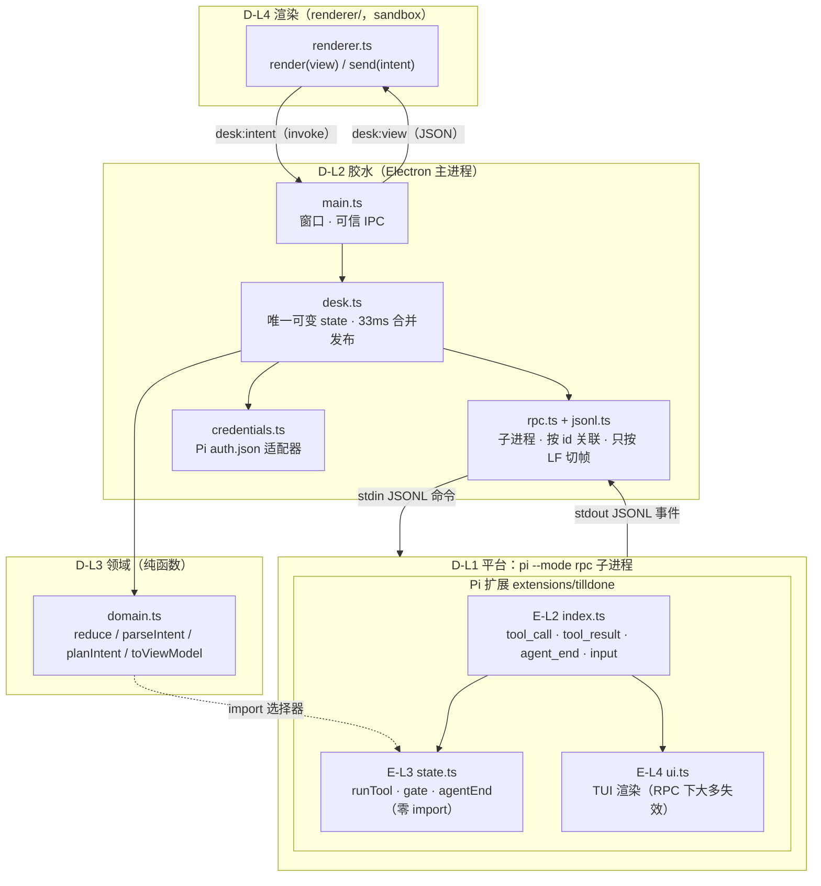
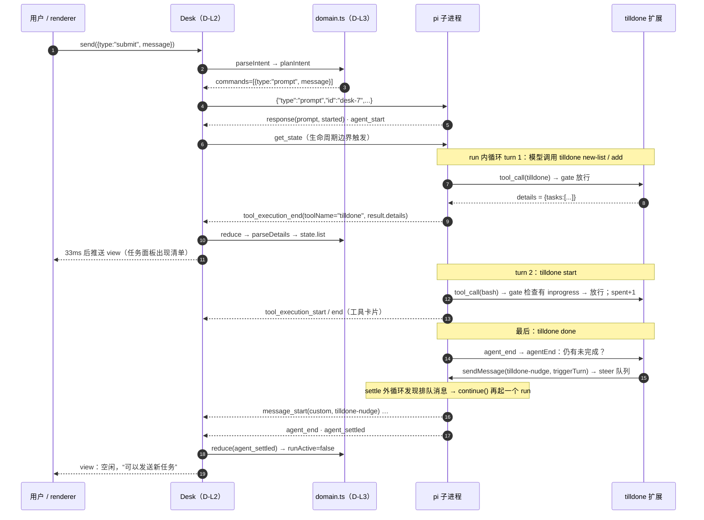

# 边牧 · TillDone Desk 技术白皮书：两套四层结构、RPC 驱动的双循环、任务门禁与“羊不进圈，边牧不歇”

> 版本：v1.0 · 2026-10-31
> 对象：`apps/tilldone`（边牧任务桌面，Electron 客户端）与它驱动的 Pi 扩展 `extensions/tilldone`（四层重写版）
> 依赖：`@earendil-works/pi-coding-agent` 1.4.0（外部 `pi` 可执行文件，RPC 模式）、Electron 45.1.0、`proper-lockfile` 4.1.2
> 验证：撰写时运行 `apps/tilldone` 下 `bun test test/*.test.ts`，4 个文件 48 项测试全部通过（522 个断言）；仓库根下 `bun test extensions/tilldone/state.test.ts`，64 项测试全部通过（413 个断言）
> 姊妹篇：`apps/chinese-chess/docs/chinese-chess-whitepaper.md`（楚河 · 象棋）、`apps/five-llm/docs/five-llm-whitepaper.md`（弈境 · 五子棋）

## 摘要

边牧任务桌面（TillDone Desk）是一个 Electron 桌面应用，用来替代 Pi 的终端界面跑 TillDone 扩展。TillDone 给编码 agent 立了两条规矩：**先列清单、认领一个任务，才许动手**（门禁）；**清单没做完，不许停**（督促）。中文名“边牧”来自一个比喻：任务是羊，装上 TillDone 的 AI 是边牧，用户是牧羊人，羊不进圈，边牧不歇。

和楚河、弈境相比，这个应用有三点不同：

1. **Harness Engineering：两套四层结构叠在一起。** 扩展自己是四层（L2 胶水 `index.ts`、L3 领域 `state.ts`、L4 渲染 `ui.ts`，L1 是 Pi），桌面端又是一套四层（L1 平台 = Pi 子进程 + Electron，L2 主进程胶水，L3 纯函数投影，L4 渲染页面）。两套结构只在一个地方相接：桌面端的 L3 直接 import 扩展 L3 的零依赖选择器 `parseDetails`、 `countByStatus`、 `current`、 `STATUS_ICON`。**扩展一行没改**，同一份扩展既能在 Pi TUI 里跑，也能被桌面端驱动。
2. **Loop Engineering：桌面端不进 Pi 进程，只在 RPC 线上观察双循环。** 楚河用 Pi SDK 在进程内装配 session；边牧桌面则以 `pi --mode rpc --no-session --no-extensions --no-skills -e extensions/tilldone` 启动子进程，用 JSONL 收发。扩展在 run 内循环挂 `tool_call`（门禁 + 计数）、`tool_result`（细分提示），在 run 结束时挂 `agent_end`（督促），督促消息通过 steer 队列让 settle 外循环**在同一次 settle 里再起一个 run**。桌面端因此只把 `agent_settled` 当作“空闲”，`agent_end` 不算。
3. **Prompt / Context Engineering：规矩写成模型读得懂的字符串。** 门禁拒绝理由、工具说明、认领任务时的“先想想要不要细分”、每 15 次工具调用一次的细分提示、督促消息，全部定义在扩展 L3 的常量里，是模型每一步都能看到的“护栏文本”。桌面端额外加了两条人对模型说话的通道：运行中发出的消息一律走 **steer**（下一步就送达），任务面板上的“细分”按钮把“请把 #N 拆小”作为一条普通消息发给模型，由模型决定怎么拆。

本文按 5W1H 逐层走读：第 2 章先用边牧放羊的比喻建立直觉，第 3 章讲两套四层，第 4 章讲双循环和接入点，第 5 章讲任务领域与桌面领域，第 7 章讲 Electron 层，第 8 章跨层看提示词与上下文，第 9 章给出评审意见。

---

## 0. 阅读约定

### 0.1 层的编号

与楚河、弈境白皮书和 `discussions/2026-10-28-four-layer-harness.md` 一致，**自下而上**编号。本文涉及两套四层，用前缀区分：

**扩展的四层（`E-`）**

| 编号 | 名称 | 文件 |
|---|---|---|
| E-L1 | Pi Agent Loop | Pi 本身（未改动） |
| E-L2 | 胶水 | `ext/index.ts` |
| E-L3 | 任务领域 | `ext/state.ts`（零 import） |
| E-L4 | TUI 渲染 | `ext/ui.ts` |

**桌面端的四层（`D-`）**

| 编号 | 名称 | 文件 |
|---|---|---|
| D-L1 | 平台 | 外部 `pi` 子进程、Electron 运行时 |
| D-L2 | 胶水（唯一可变状态） | `src/main.ts`、 `preload.ts`、 `desk.ts`、 `rpc.ts`、 `jsonl.ts`、 `config.ts`、 `credentials.ts` |
| D-L3 | 领域（纯函数） | `src/domain.ts`、 `appearance.ts`、 `api-domain.ts` |
| D-L4 | 渲染 | `renderer/`（`renderer.ts`、 `api-settings.ts`、 `index.html`、CSS） |

L0（模型提供商）两套共用：默认 `openai-codex/gpt-6.1-sol`，走 Codex 订阅。

### 0.2 双循环术语

沿用本仓库走读系列的定义：

- **settle 外循环**（续跑—停稳，Settle Loop）：`AgentSession._startRun()` 里的 `while`。首个 run 结束后，因重试、压缩、排队消息或 `agent_before_settle` 续跑请求再起一个 run，直到停稳，最后发出 `agent_settled`。
- **run 内循环**（模型—工具，Agent Loop）：`agent-loop.js` 的 `runLoop()`，反复执行 turn。一个 turn = 一次 LLM 流式回复 + 这条回复里所有工具调用的执行。
- 计数符号：`N` = run 数，`M` = turn 数（即 LLM 请求数），`K` = 工具调用数。

### 0.3 代码快照说明

本文描述 `main` 分支上 `329601a`（2026-10-31，“always steer while running, show queued messages, guard split”）时的代码。`apps/tilldone` 与 `extensions/tilldone` 在撰写时没有未提交改动。引用写作 `路径:行号`，路径简写如下：

- `ext/` = `extensions/tilldone/`
- `desk/` = `apps/tilldone/`
- `pi/` = `/opt/homebrew/lib/node_modules/@earendil-works/pi-coding-agent/dist/`（1.4.0 编译产物）

### 0.4 参考资料与可信度

| 文档 | 内容 | 本文如何使用 |
|---|---|---|
| `specs/tilldone-electron/prompt.md` | 桌面端的原始需求：RPC 事实、四层规则、MVP 功能、计费约束、测试要求 | 设计意图的来源；与实现对照（3.1、9.2 节） |
| `specs/tilldone-electron/rpc-probe.jsonl` | 一次真实 RPC 运行的录制样本（`desk/test/fixtures/` 下有一份原样拷贝） | RPC 字段和事件顺序的依据 |
| `discussions/2026-10-28-four-layer-harness.md` | 四层定义与 L2 插入点 | 四层划分的来源 |
| `discussions/2026-10-28-l4-web-desktop-and-plugin-harness.md` | L4 走向桌面 / Web 的路线、Pi 被驱动的四种方式 | 7.2 节选型背景 |
| `discussions/2026-10-29-tilldone-naming-border-collie.md` | 中文名“边牧”和唯一认可的比喻映射 | 第 2 章 |
| `desk/README.md` | 运行方式、RPC 限制、安全、凭据说明 | 行为说明；与源码不一致处见 9.2 节 |
| `walkthroughs/tilldone.html`、 `walkthroughs/tilldone-4-layers.html` | 原版扩展与四层重写版的走读 | 扩展 B1–B3 修复的背景 |
| Pi 文档 `docs/rpc.md`、 `rpc-commands.md`、 `rpc-extension-ui.md` | RPC 协议 | 命令语义（steer / follow_up / clear_queue） |

可信度排序：源码与测试 > 录制样本 > README 与需求稿 > 讨论稿。不一致之处以源码为准。

---

## 1. 引言：要解决什么问题

### 1.1 Why：编码 agent 的两个老毛病

让 LLM 编码 agent 干一件多步骤的活，常见两种失败：

- **没想清楚就动手。** 一上来就改文件、跑命令，做到一半才发现方向不对。
- **做到一半就收工。** 模型写一句“我已经完成了主要部分”就结束这一轮，剩下几步没人管。

TillDone 用一个任务清单工具同时治这两个毛病。清单本身不稀奇，稀奇的是它被做成了**规矩**：没有清单、没有认领任务，除了只读工具以外的工具都会被拦下；还有任务没完成，run 一结束就被推着继续。

原版 `extensions/tilldone.ts`（726 行，单文件）在 Pi TUI 里已经能用。四层重写版 `extensions/tilldone/` 把它拆成胶水 / 领域 / 渲染，修了 B1–B3 三类问题（状态被原地改写、批量调用时门禁看不到上一次调用的结果等），之后又加了显式的 `start` / `done`、 `split` 细分、只读工具放行和细分提示。

### 1.2 Why：为什么还要一个桌面端

Pi TUI 能跑 TillDone，但有两处不够：

- **任务进度看不全。** TUI 里只有底部 footer 的几行和一个“正在做”的 widget，完整清单要敲 `/tilldone` 打开浮层。
- **TUI 组件在 RPC、Web 等非终端界面里用不了。** `setWidget` 传的是 TUI 组件工厂，`setFooter`、 `ui.custom()` 也只在终端里有效（录制样本证实：RPC 下 `setWidget` 永远不带 `widgetLines`）。

桌面端要回答的问题是：**能不能不改扩展、不嵌入 Pi，只靠 RPC 线上的事件，做出一个比 TUI 更好用的任务工作台？**

### 1.3 What：三个工程视角

| 视角 | 关心什么 | 本文章节 |
|---|---|---|
| Harness Engineering | 层怎么分、依赖朝哪、谁是权威 | 第 3 章 |
| Loop Engineering | 规矩挂在双循环的哪个点上、桌面端在 RPC 线上看到什么 | 第 4 章 |
| Prompt / Context Engineering | 规矩怎样变成模型能读的文字、人怎样在运行中插话 | 第 5、8 章 |

---

## 2. 一个比喻：边牧放羊

比喻沿用 `discussions/2026-10-29-tilldone-naming-border-collie.md` 定下的唯一版本：**任务是羊，装上 TillDone 的 AI 是边牧，用户是牧羊人。** 本章把它扩展到桌面端。

### 2.1 总表

| 牧场 | TillDone | 对应机制 | 在哪里 |
|---|---|---|---|
| 牧羊人 | 用户 | 发出指令 | 桌面端输入框 |
| 口哨 | 用户的 prompt | RPC `prompt` | `desk/src/domain.ts:269` |
| 半路再吹一声 | 运行中插话 | RPC `steer`（下一步送达） | `desk/src/domain.ts:268-269` |
| 边牧 | 装上 TillDone 的 AI | Pi + `tilldone` 工具 | `pi --mode rpc -e extensions/tilldone` |
| 羊 | 任务 | `ListState.tasks` | `ext/state.ts:17-31` |
| 出栏前点数 | 先列清单才准动手 | 门禁：无任务时拦截 | `ext/state.ts:377-384` |
| 一次盯住一只 | 先认领才干活，同时只有一只在赶 | 门禁：无 `inprogress` 时拦截；`start` 自动暂停其他任务 | `ext/state.ts:310-332` |
| 羊进圈 | 任务完成 | `done` ✓ | `ext/state.ts:315` |
| 羊不进圈，边牧不歇 | 没做完不许停 | 督促：`agentEnd` 注入 `tilldone-nudge` 并续跑 | `ext/state.ts:409-421` |
| 一群羊分成小群 | 粗任务拆成子任务 | `split` 原位替换 | `ext/state.ts:345-355` |
| 牧羊人指着一群羊说“分开赶” | 面板上的“细分”按钮 | 一条 steer / prompt 消息，由模型决定怎么拆 | `desk/src/domain.ts:256-262` |
| 看牧场的瞭望台 | 桌面端 | Electron 窗口，任务面板常驻 | `desk/renderer/` |

### 2.2 逐层展开

**瞭望台（D-L4）。** 牧羊人站在瞭望台上，看得见每只羊在哪、哪只正在被赶、几只已进圈；也看得见边牧刚才做了什么（对话区和折叠的工具卡片）。瞭望台本身不管羊，只把看到的画出来，把牧羊人的口哨传下去。

**传令兵（D-L2）。** 瞭望台和牧场之间有一个传令兵。他把牧羊人的话翻译成边牧听得懂的口令（RPC 命令），也把牧场上发生的每件事（RPC 事件）原样记下来、交给记账员。他是唯一手里拿着账本的人。

**记账员（D-L3）。** 记账员只做纯计算：拿到一条事件，在旧账上算出新账（`reduce`）；拿到牧羊人的一句话，判断该发什么口令（`planIntent`）；最后把账本整理成瞭望台能直接画的样子（`toViewModel`）。他从不碰牧场，也不碰瞭望台。

**边牧的训练手册（E-L3）。** 什么时候准出栏、一次赶几只、羊没进圈要不要再跑一趟，全写在手册里。手册不知道自己被谁读，所以桌面端的记账员也能直接翻它（复用选择器）。

### 2.3 比喻失效的地方

- **边牧不会真的“不歇”。** 督促每条用户输入只触发一次（`nudged` 闩锁），边牧被推一次之后如果还是停了，就真停了，等牧羊人再吹哨。这是有意的：防止模型和督促消息互相推着无限续跑。
- **牧羊人说“分开赶”，边牧可以不听。** “细分”按钮只是一条消息，模型可能认为任务已经够小而不拆；按钮会在这次 settle 结束时恢复可点。
- **瞭望台只看得到“本次放牧”。** 桌面端用 `--no-session` 启动 Pi，重启或开新会话，羊群和对话都清空。TUI 下扩展能从会话分支恢复清单（`restore`），桌面端用不到这条路。

---

## 3. 两套四层架构（Harness Engineering）

### 3.1 四层的来历与原则

需求稿 `specs/tilldone-electron/prompt.md` 给了四条硬规则，实现全部遵守：

| 规则 | 实现 |
|---|---|
| L1 不修改，`extensions/tilldone/` 一行都不改 | 桌面端以 `-e <repo>/extensions/tilldone` 加载扩展；扩展路径从 `app.getAppPath()` 解析（`desk/src/config.ts:8`） |
| L2 是唯一持有可变状态的地方，不写业务规则 | `Desk` 类持有 `state`，每次只做 `this.state = reduce(this.state, record)`（`desk/src/desk.ts:26-36`） |
| L3 不 import Electron、Node 或 L2/L4，`bun test` 不启动 Electron 就能跑 | `desk/src/domain.ts:6-10` 只 import 扩展的 `state.ts` 和同层的 `appearance.ts`、 `api-domain.ts` |
| L4 只画视图模型、只发意图，不解析 RPC，不存业务状态 | `desk/renderer/renderer.ts:1-4` 的文件头注释；renderer 不 import 任何领域代码 |

### 3.2 全景



图里只有一条虚线跨越了两套结构：`D-L3 → E-L3`。这是整个设计里最关键的一条依赖，3.4 节单独讲。

### 3.3 各层职责（What / Who）

| 层 | What：负责什么 | Who：谁调用它 | 不做什么 |
|---|---|---|---|
| E-L1 Pi | 双循环、工具调度、会话、RPC 输出 | 子进程入口 | — |
| E-L2 `index.ts` | 持有扩展唯一的 `model` 单元；把 Pi 事件翻译成 L3 转移和 L4 重绘 | Pi 扩展运行时 | 不写业务规则，不写模型可见字符串 |
| E-L3 `state.ts` | 工具行为 `runTool`、门禁 `gate`、细分计数 `toolCalled`、督促 `agentEnd`、快照解析 `parseDetails` | E-L2；桌面端 D-L3 | 零 import |
| E-L4 `ui.ts` | 状态栏、widget、footer、工具卡片、`/tilldone` 浮层 | E-L2 | 不写状态 |
| D-L1 | Pi 子进程、Electron | — | 不改动 |
| D-L2 | 子进程生命周期、JSONL 收发、id 关联、时钟、偏好文件、凭据文件、IPC、视图推送 | Electron | 不写业务规则 |
| D-L3 | `reduce(state, record)`、意图校验与规划、视图模型、界面文案 | D-L2 | 不碰 I/O |
| D-L4 | DOM 绘制、粘贴图片草稿、滚动位置 | 用户 | 不解析 RPC，不缓存模型 |

### 3.4 依赖方向：一个零依赖的领域文件被两边共用

`ext/state.ts` 开头写明“Zero imports by design”（`ext/state.ts:4-5`），测试里也强制检查。这让它同时满足两种用法：

- 在 Pi 进程内，E-L2 调它的 `runTool`、 `gate`、 `agentEnd`，决定工具怎么执行、拦不拦、推不推。
- 在 Electron 主进程内，D-L3 调它的 `parseDetails`、 `countByStatus`、 `current`、 `STATUS_ICON`，把 RPC 线上的快照还原成同一种 `ListState`，再算进度和当前任务（`desk/src/domain.ts:6`, `:171`, `:295-296`）。

结果是**任务的数据格式只有一个定义**。扩展把 `toDetails(list)` 写进工具结果的 `details`（`ext/state.ts:142-151`），桌面端用同一个 `parseDetails` 读回来，格式不对就返回 `undefined`、保持旧清单（`desk/src/domain.ts:171`）。需求稿要求“优先复用、不要复制一份”，实现做到了。

反过来，桌面端**不调用** `runTool` 或 `gate`。桌面端不重新计算业务结果，只投影 Pi 报告的结果。规矩只在 Pi 进程里执行一次，桌面端只读。

### 3.5 一次任务的端到端时序

以“用户在空闲时发一句话，边牧建清单、认领、干活、标记完成”为例：



注意第一次 `agent_end` 之后桌面端**仍显示运行中**：`agent_end` 在 D-L3 里不是空闲转移（`desk/src/domain.ts:141` 的注释），只有 `agent_settled` 才清掉 `runActive`（`:142`）。

### 3.6 不变量：谁是权威

| 事实 | 权威 | 桌面端怎么拿到 |
|---|---|---|
| 任务清单 | 扩展的 `model.list`（Pi 进程内） | **只**从 tilldone 工具的 `tool_execution_end` 里的 `result.details` 取完整快照（`desk/src/domain.ts:170-176`） |
| 当前任务 | 清单里第一个 `inprogress` | 用 `current(list)` 现算，不依赖 `setWidget` |
| 是否在运行 | Pi 的 run 状态 | `agent_start` 置真、`agent_settled` 置假，外加 `get_state` 的 `isStreaming` / `isCompacting`（`desk/src/domain.ts:90-92`） |
| 模型、思考深度、是否支持图片 | Pi 的 `get_state` | 启动时、生命周期边界、每 2 秒轮询（`desk/src/desk.ts:60-68`） |
| 待送达消息 | Pi 的 steering / followUp 队列 | `queue_update` 事件（`desk/src/domain.ts:124-128`） |
| 确认弹窗的超时 | Pi | 桌面端按 `timeout` 倒计时，到点**只关弹窗**，不替 Pi 应答（`desk/src/domain.ts:109-112`） |
| 外观偏好 | 桌面端 `appearance.json` | D-L2 在偏好变化时写盘（`desk/src/desk.ts:27-32`） |
| API 凭据 | Pi 的 `~/.pi/agent/auth.json` | D-L2 适配器读写；凭据**不进**领域状态和视图模型 |

---

## 4. Pi 双循环与接入点（Loop Engineering）

### 4.1 Pi 1.4.0 的双循环（源码定位）

| 结构 | 源码位置 | 与边牧的关系 |
|---|---|---|
| settle 外循环 | `pi/core/agent-session.js:1423` `_startRun()`；`:1449` 首次 `agent.prompt`；`:1450` 起 `while` | 督促消息让这里多转一圈 |
| 运行中标志 | `pi/core/agent-session.js:1068` `isStreaming` 返回 `_isAgentRunActive` | `agent_end` 期间仍为真，所以督促走 steer 分支 |
| 扩展发消息 | `pi/core/agent-session.js:1844` `sendCustomMessage`；`:1857-1862` 运行中 → `agent.steer(...)` | 督促被放进 steering 队列 |
| before-settle 边界 | `pi/core/agent-session.js:1564-1578`：没有处理器时看 `hasQueuedMessages()` | 有排队消息 → `continue()` |
| `agent_settled` | `pi/core/agent-session.js:689-690` | 桌面端唯一的“空闲”信号 |
| 队列事件 | `pi/core/agent-session.js:654-660` `_emitQueueUpdate` | 桌面端“待送达”列表 |
| RPC 命令 | `rpc-mode.js` 中 `steer`（:319） `abort`（:327） `clear_queue`（:331） | 桌面端只用这几条加 `prompt`、 `get_state`、 `extension_ui_response` |
| run 内循环 | `pi/…/agent-loop.js` `runLoop()`；工具前置钩子 `beforeToolCall` 接到扩展的 `tool_call` | 门禁所在 |

### 4.2 边牧怎样使用双循环

一句用户输入 = 一次 settle。settle 里通常有 1 个 run，被督促时有 2 个（`N ≤ 2`，因为督促每条输入只发一次）。每个 run 有若干 turn，每个 turn 里模型可能调用多个工具。

| 阶段 | 发生了什么 | 扩展在这里做什么 |
|---|---|---|
| 用户输入（`prompt`） | 开始一次 settle | `input` 事件：复位 `nudged` 闩锁 |
| run 1 · turn 1 | 模型调用 `tilldone new-list` / `add` | `tool_call`：门禁放行 tilldone |
| run 1 · turn 2 | 模型调用 `tilldone start #1` | 结果文本末尾附 `SPLIT_CUE` |
| run 1 · turn 3..M | 模型调用 `read` / `bash` / `edit` … | `tool_call`：门禁检查 + `spent` 计数；每 15 次由 `tool_result` 附细分提示 |
| run 1 · 最后一个 turn | 模型只回文本 | — |
| run 1 结束 | `agent_end` | `agentEnd`：有未完成任务 → 督促消息进 steer 队列 |
| run 2（仅当被督促） | 模型看到督促，继续干或标记 done | `agent_end`：`nudged` 已为真 → 不再督促 |
| 停稳 | `agent_settled` | 桌面端：空闲 |

运行中用户再发消息，桌面端发 `steer`。按 `rpc-commands.md`，steer 在当前 turn 的工具执行完、下一次 LLM 请求之前送达，不会打断正在执行的工具。

### 4.3 接入点总表（5W1H 速查）

**表 4-1　扩展在 Pi 里挂了什么**

| # | 接入点 | Where | When：每次 settle 几次 | Why |
|--|------------|--------|--------|------------|
| ① | `session_start` / `session_tree` | `ext/index.ts:48-52` | 会话开始 / 分支切换各 1 次 | 从会话分支里最后一个有效 `details` 恢复清单。`--no-session` 下恢复为空 |
| ② | `pi.on("tool_call")` | `ext/index.ts:54-61` | 每个工具调用 1 次（`K` 次） | 门禁 `gate`；非 tilldone 工具计入 `spent`，到 15 的倍数时记下提示 |
| ③ | `pi.on("tool_result")` | `ext/index.ts:63-68` | 有提示的那次调用 1 次 | 把细分提示追加到这次工具结果的 `content` 末尾 |
| ④ | `pi.on("agent_end")` | `ext/index.ts:70-74` | 每个 run 结束 1 次（`N` 次） | 督促：有未完成任务且本条输入没督促过 → `sendMessage(nudge)`，带 `triggerTurn: true` |
| ⑤ | `pi.on("input")` | `ext/index.ts:76-79` | 每条用户输入 1 次 | 复位 `nudged` 闩锁 |
| ⑥ | `registerTool` 注册 `tilldone`，串行执行 | `ext/index.ts:81-99` | 模型调用时 | 唯一能改清单的入口；串行保证同批下一次调用的门禁看得到上一次的结果（B3） |
| ⑦ | `ctx.ui.confirm` | `ext/index.ts:90-92` | `new-list` / `clear` 且有未完成任务时 | 保护未完成的工作；RPC 下变成 confirm 类型的 `extension_ui_request` |
| ⑧ | `registerCommand` 注册 `/tilldone` | `ext/index.ts:101-110` | TUI 下用户敲命令 | 打开浮层。RPC 下不起作用，桌面端本地拦截 |

**表 4-2　桌面端在 RPC 线上用了什么**

| # | 方向 | 记录 | 处理位置 | 用途 |
|--|---|------------|--------|----------|
| a | 出 | `prompt` / `steer`（可带 `images`） | `desk/src/domain.ts:264-272` | 空闲发 prompt，运行中一律 steer |
| b | 出 | `clear_queue` + `abort` | `desk/src/domain.ts:263` | 停止：先清掉待送达消息，再中止 |
| c | 出 | `get_state` | `desk/src/desk.ts:70-76` | 模型、思考深度、流式 / 压缩状态、图片能力 |
| d | 出 | `extension_ui_response` | `desk/src/domain.ts:252-255`、 `:275-279` | 确认弹窗应答；`select` / `input` / `editor` 立即回 `cancelled: true` |
| e | 入 | `agent_start` / `agent_settled` | `desk/src/domain.ts:140-142` | 运行闩锁 |
| f | 入 | `message_start` / `message_update` / `message_end` | `desk/src/domain.ts:144-163` | 对话区：用户、助手、督促三种消息；按 `contentIndex` 拼接 `text_delta` |
| g | 入 | `tool_execution_start` / `_update` / `_end` | `desk/src/domain.ts:164-176` | 工具卡片；tilldone 的 `details` 更新清单 |
| h | 入 | `extension_ui_request`，method 为 setStatus / confirm / notify | `desk/src/domain.ts:177-190` | 状态栏文本、确认弹窗、通知 |
| i | 入 | `queue_update` | `desk/src/domain.ts:124-128` | “⏳ 待送达”列表 |
| j | 入 | `response`（失败） | `desk/src/domain.ts:130` | 错误条 |
| k | 本地 | `desk_*` 记录（tick、exit、stderr、偏好、API 设置…） | `desk/src/domain.ts:103-123` | 时钟和传输层事实也走同一个 `reduce` |

### 4.4 逐个接入点详解

#### ② 门禁：出栏前点数

`gate`（`ext/state.ts:377-384`）按顺序检查三件事，任一不满足就拦下：

1. 清单为空 → `GATE_REASON.noTasks`
2. 全部完成 → `GATE_REASON.allDone`
3. 没有 `inprogress` → `GATE_REASON.noneActive`

`tilldone` 自己和只读工具 `read`、 `grep`、 `find`、 `ls`（`ext/state.ts:375`）永远放行。只读放行是 `1e35a3d` 加的：“规划往往需要先读一份规格文件”，读不改变任何东西，没有理由拦。

拦截时 Pi 把 `reason` 作为工具错误返回给模型。所以拒绝理由本身就是提示词，写成了模型照着做就能通过的指令（“You MUST use `tilldone new-list` or `tilldone add` …”）。

#### ②③ 细分提示：一只羊赶太久了

`toolCalled`（`ext/state.ts:389-399`）给当前任务记账：每个非 tilldone 工具调用 `spent + 1`，到 15 的倍数时返回一条提示。`spent` 不持久化，当前任务一换就清零（`ext/state.ts:261`）。

提示**不在 `tool_call` 时发**，因为那时工具还没执行。E-L2 用 `toolCallId` 把提示暂存进一个 Map（`ext/index.ts:31`、 `:59`），等这次调用的 `tool_result` 回来再追加到结果末尾（`:63-68`）。模型看到的是“工具结果 + 一行 💡”，不需要额外的消息或 turn。

#### ④⑤ 督促：羊不进圈，边牧不歇

`agentEnd`（`ext/state.ts:409-421`）在还有未完成任务、且 `nudged` 为假时，返回一条 `customType: "tilldone-nudge"` 的消息，并把 `nudged` 置真。E-L2 用 `sendMessage(nudge, { triggerTurn: true })` 发出（`ext/index.ts:73`）。

为什么这会在**同一次 settle** 里续跑：`agent_end` 发生时 `_isAgentRunActive` 仍为真（`pi/core/agent-session.js:1068`），`sendCustomMessage` 走“运行中”分支，把消息放进 steering 队列（`:1857-1862`）。run 返回后，settle 外循环检查到有排队消息，调用 `continue()` 再起一个 run。

`input` 事件复位闩锁（`ext/state.ts:423-425`）。闩锁的作用是**每条用户输入最多督促一次**：如果模型被督促后仍然停下，说明它可能真的卡住了，该把控制权交还给人。

#### ⑦ 确认：只在有未完成工作时问

`new-list` 和 `clear` 会丢掉当前清单。`3e96feb` 之后，只有清单里**还有未完成任务**时才问（`ext/state.ts:288-298`、 `:356-362`），注释给出了理由：“已完成的清单可以从会话分支找回”。

RPC 下确认变成 `extension_ui_request`：`{id, method:"confirm", title, message, timeout:30000}`。桌面端弹出模态框，显示倒计时，用户点允许 / 拒绝时回 `extension_ui_response`，`id` 原样回显。超时由 Pi 自己处理，桌面端到点只关弹窗（`desk/src/domain.ts:109-112`），过期的应答会被丢弃（`:253`）。

#### a 运行中一律 steer

`329601a` 之前，运行中用户可以选择 steer 还是 follow-up。现在固定为 steer（`desk/src/domain.ts:268`），注释给出了判断：“运行中发消息，用户就是在给进行中的工作改方向”。follow-up 要等 agent 完全停下才送达，而 TillDone 的督促会让 agent 尽量不停，两者放在一起，follow-up 可能要等很久。

送达之前，消息显示在输入框上方的“⏳ 待送达”列表里（`queue_update` → `state.queued`）。settle 结束或 Pi 退出时清空（`desk/src/domain.ts:122`、 `:142`）。

#### 细分按钮：牧羊人指，边牧拆

任务面板上每个未完成任务有一个“细分”按钮。点下后 `planIntent`（`desk/src/domain.ts:257-262`）：

1. 找到这个任务，确认它没完成、也没有正在等待的细分请求；
2. 按界面语言取文案 `splitRequest`，填入 id 和任务文本；
3. 空闲时发 `prompt`，运行中发 `steer`；
4. 记一条 `desk_split_requested`，按钮变成“细分中…”并禁用。

按钮恢复有两种情况（`desk/src/domain.ts:172-173`、 `:142`）：下一次 tilldone 结果里这个任务**不再是未完成**（被 `split` 替换掉了，或被标记完成），或者这次 settle 结束了。第二种覆盖了“模型决定不拆”的情况。

关键的设计取舍写在注释里：“牧羊人指出任务，有上下文的模型决定子任务”（`desk/src/domain.ts:256`）。桌面端不自己拆，也不调用 `split`。

### 4.5 一次 settle 的时间线

下面是一个被督促一次的典型 settle，按桌面端在 RPC 线上看到的顺序：

| 时刻 | RPC 事件（出 / 入） | D-L3 状态变化 | 界面 |
|---|---|---|---|
| t0 | 出 `prompt` | — | 输入框清空 |
| t0+ | 入 `response(prompt)`、 `agent_start` | `runActive = true` | “运行中”，停止按钮可用 |
| | 出 `get_state` → 入 `response(get_state)` | `streaming = true` | — |
| | 入 `message_start(user)` | 追加用户消息 | 对话区出现用户消息 |
| | 入 `message_update(text_delta)` × n | 拼接助手文本 | 流式显示（33ms 合并） |
| | 入 `tool_execution_start(tilldone)` | 追加工具卡片 | 折叠的“tilldone · 运行中” |
| | 入 `extension_ui_request(setStatus)` | `statuses.tilldone` | 状态栏“📋 …: 3 tasks (3 remaining)” |
| | 入 `tool_execution_end(tilldone)` | `list = parseDetails(details)` | 任务面板刷新 |
| | 入 `tool_execution_*(bash)` … | 工具卡片 | — |
| | 入 `message_end(assistant)` | 用权威内容替换 | — |
| t1 | 入 `agent_end` | **无变化** | 仍显示运行中 |
| | 入 `message_start(custom, tilldone-nudge)` | 追加督促消息 | 督促样式的消息 |
| | …（run 2）… | | |
| t2 | 入 `agent_end`、 `agent_settled` | `runActive = false`，清空 `queued`、 `pendingSplits` | “可以发送新任务” |
| | 出 `get_state` | `streaming = false` | — |

### 4.6 刻意没有使用的东西

| 机制 | 为什么没用 |
|---|---|
| Pi SDK 进程内嵌入 | 需求要求“不嵌入 Pi”；RPC 让扩展在 TUI 和桌面端行为一致，见 7.2 节 |
| `follow_up` 命令 | 见 4.4 节 a；TillDone 场景下运行中的消息就是改方向 |
| `setWidget` / `setFooter` / `ui.custom()` | RPC 下拿不到 TUI 组件；当前任务从 `details` 现算，`/tilldone` 本地拦截 |
| `select` / `input` / `editor` | MVP 不做；立即回 `cancelled: true`，避免 Pi 卡住（`desk/src/domain.ts:275-279`） |
| `agent_before_settle` 续跑 | 督促用排队消息续跑，不需要 before-settle 处理器 |
| 会话持久化 | `--no-session`；重启即新会话 |
| 模型切换命令 | 渲染端不能改模型；只能启动时用 `TILLDONE_MODEL` 指定 |

---

## 5. L3 业务层：规矩怎样变成状态转移

本章分两部分：扩展的任务领域（E-L3）和桌面端的投影领域（D-L3）。

### 5.1 任务领域：一个冻结的值，九个动作

`Model = { list, nudged, spent }`（`ext/state.ts:39-43`）。`list` 是持久化的部分，后两个只在当前进程内有效。所有 `ListState` 都从 `makeList` 产生，深度冻结（`ext/state.ts:122-125`）：任何地方原地修改都会抛错，而不是悄悄改写历史。这是 B1 修复的核心。

九个动作（`ext/state.ts:46`）：

| 动作 | 参数 | 行为 | 要点 |
|---|---|---|---|
| `new-list` | `text`=标题，`description` | 换一张新清单 | 有未完成任务时先问 |
| `add` | `text` 或 `texts[]` | 追加 idle 任务 | 批量 |
| `start` | `id` | 标为 `inprogress`，其他 `inprogress` 自动暂停为 idle | 重复调用无变化；结果附 `SPLIT_CUE` |
| `done` | `id` | 标为 `done` | 重复调用无变化 |
| `remove` | `id` | 删除 | — |
| `update` | `id` + `text` | 改文本 | — |
| `list` | — | 返回文本清单 | — |
| `clear` | — | 清空 | 有未完成任务时先问 |
| `split` | `id` + `texts[]`（≥2） | 原位替换成子任务；第一个子任务继承原状态；子任务带 `from` | 已完成的任务不能拆 |

`start` / `done` 是 `264f8b8` 从原来的“toggle”改来的。toggle 的问题是重复调用会“走过头”（done 再 toggle 一次变回 idle）；现在每个动作写明目标状态，重复调用是空操作（`ext/state.ts:314-316`）。

`split` 让“一次只有一只羊在赶”这个不变量保持住：拆分正在进行的任务时，只有第一个子任务继承 `inprogress`，其余是 idle（`ext/state.ts:349-350`）。

### 5.2 两个时机的细分提示

模型什么时候最适合判断任务大小？`6f0a8b1` 选了两个时机：

- **刚认领时**（`SPLIT_CUE`，`ext/state.ts:114`）：“模型对任务大小了解最多、还没花任何成本的时候”。`start` 的结果文本末尾附一句“如果这个任务包含两个以上能分别验证的步骤，现在就拆”。
- **做了很久时**（`SPLIT_HINT_EVERY = 15`，`ext/state.ts:117`）：一个任务吃掉 15 次工具调用还没完成，大概是太粗了，每到 15 的倍数提醒一次。

工具说明里也写了同样的原则（`ext/state.ts:89-90`）：“任务要小到一次专注的改动就能完成和验证；发现任务更大就拆，不要让它长；发现当前任务以外的工作，加成新任务。”

### 5.3 快照与恢复：复制进，复制出

`toDetails`（`ext/state.ts:142-151`）出站时给每个任务做一份普通对象拷贝，从此归会话所有。`parseDetails`（`:168-178`）入站时把会话里读到的东西当作不可信数据，逐字段校验，任何一处不对整份返回 `undefined`。`restore`（`:181-185`）按分支顺序取最后一个有效快照。

`from` 字段在没有值时**不出现**（`copyTask`，`ext/state.ts:128-130`），所以 `split` 出现之前写下的会话，线上格式一个字节都不变，新旧版本能互相恢复。

桌面端用的就是这个 `parseDetails`。坏快照不会让面板清空，只会被忽略。

### 5.4 桌面领域：一个 reducer 吃下所有事实

D-L3 的核心是 `reduce(state, record)`（`desk/src/domain.ts:101-194`）。它的输入有两类：

- **Pi 的 RPC 记录**：原样喂进来，不认识的类型直接忽略（`:12` 的注释：“RPC 是可扩展的”）。
- **D-L2 自己生成的 `desk_*` 记录**：时钟（`desk_tick`）、进程退出（`desk_exit`）、stderr、偏好、系统主题、API 设置的各个阶段、细分请求。

时间和传输层事实也变成记录，所以 D-L3 里没有 `Date.now()`，没有 I/O，测试可以用固定的时钟值回放。`State`（`:40-68`）全部字段只读，每次转移返回新对象。

几个值得注意的转移：

- **`get_state` 轮询保持引用不变**（`:136-137`）：2 秒一次的轮询通常什么都没变，此时直接返回原 `state`，D-L2 就能跳过发布。
- **助手消息三段式**（`:144-163`）：`message_start` 建条目，`text_delta` 按 `contentIndex` 累加，`text_end` 和 `message_end` 用权威内容替换累加结果，防止丢字或重复。
- **督促单独成类**（`:148`）：`role: "custom"` 且 `customType: "tilldone-nudge"` 的消息记为 `nudge`，界面上有单独的标签和样式。
- **只有 tilldone 的结果改清单**（`:171`）：其他工具结束只更新工具卡片。

### 5.5 意图：渲染端只能说这几句话

渲染端发来的东西先过 `parseIntent`（`desk/src/domain.ts:214-231`）做形状校验，再过 `planIntent`（`:232-274`）变成 RPC 命令和本地事件。渲染端没有办法发任意 RPC 命令。

| 意图 | 校验 | 产出 |
|---|---|---|
| `submit` | 文本 ≤ 100000 字符；图片 ≤ 10 张、类型白名单、base64 格式、单张 ≤ 20MB | `prompt` / `steer`；`/tilldone` 被本地拦截为聚焦任务面板 |
| `abort` | — | `clear_queue` + `abort` |
| `confirm` | `id` 为字符串，弹窗存在且未过期 | `extension_ui_response` |
| `splitTask` | 正整数 id，任务未完成，没有待处理的同一请求 | `prompt` / `steer` + `desk_split_requested` |
| `restart` | 仅在 Pi 已退出时 | 重启子进程 |
| `newSession` | 仅在已连接且空闲时 | 重启子进程（新的 `--no-session` 会话） |
| `preferences` | 主题 7 选 1、语言 2 选 1 | `desk_preferences` |
| `apiOpen` / `apiClose` / `apiLink` / `apiSave` | 提供商白名单、key 格式 | 本地凭据操作，不发 RPC |

图片多一道检查：当前模型不支持图片输入时，带图的 `submit` 直接丢弃（`:267`）。图片能力来自 `get_state` 里 `model.input` 是否含 `"image"`（`:135`），模型变了会自动更新。

### 5.6 视图模型：纯 JSON，带缓存

`toViewModel`（`desk/src/domain.ts:293-324`）把状态整理成渲染端直接能画的 JSON：文案、外观、状态栏、输入框可用性、任务面板（含每项的图标、状态标签、是否当前、能否细分、是否细分中）、待送达列表、对话条目、当前弹窗与剩余秒数。

两处优化：

- **条目缓存**（`:282-291`）：消息和工具对象不可变，所以用 `WeakMap` 按对象缓存它们的视图条目。注释说明了原因：没有缓存时，每个流式 token 都会把整段历史（包括每个工具结果的 JSON）重新序列化一遍。
- **隐藏无文本的助手轮次**（`:292`、 `:313`）：只调用了工具、没有文本的助手消息不显示，因为它要说的就是下一张工具卡片（`21a0d68`）。

---

## 6. 回到四层原则：什么进模型的上下文

四层讨论稿的 L3 原则是“上下文管理是手段，业务语义是内容”。TillDone 的业务语义很少，但每一条都必须让模型看见，否则规矩不起作用。

### 6.1 一张表：每类信息的去向

| 信息 | 定义在 | 进模型上下文吗 | 怎么进 |
|---|---|---|---|
| 工具说明（九个动作、只读放行、要拆小） | `ext/state.ts:80-100` | 是，每次请求 | 工具声明 |
| 当前清单 | `ext/state.ts` `ListState` | 是，按需 | 每次 tilldone 调用的结果文本；`list` 动作 |
| 门禁拒绝理由 | `ext/state.ts:102-109` | 是，被拦时 | 工具错误 |
| `SPLIT_CUE` | `ext/state.ts:114` | 是，`start` 时 | 工具结果末尾 |
| 15 次细分提示 | `ext/state.ts:397` | 是，每 15 次 | 工具结果末尾 |
| 督促消息 | `ext/state.ts:417` | 是，run 结束且未完成时 | 自定义消息（`display: true`） |
| 用户插话、细分请求 | 桌面端输入 / `appearance.ts` 的 `splitRequest` | 是 | steer / prompt 消息 |
| 粘贴的图片 | 桌面端 | 是（模型支持时） | 消息里的 image 块 |
| `spent`、 `nudged` | `ext/state.ts` `Model` | **否** | 只在扩展内部决策 |
| 桌面端状态（运行中、队列、弹窗、外观） | `desk/src/domain.ts` | **否** | 只给界面 |
| API 凭据 | `auth.json` | **否** | Pi 自己解析，桌面端不转发 |

### 6.2 “错误即提示词”

门禁是这套设计里最省事的提示词工程：它不在系统提示词里写“请先建清单”，而是在模型真的试图越过规矩的那一刻，用工具错误告诉它下一步该调用什么。模型照着做，下一次调用就会通过。确认被拒绝时也一样：`"Clear cancelled by user."` 作为工具结果返回（`ext/state.ts:361`），模型知道用户不同意。

---

## 7. D-L4 Electron 桌面层：把牧场可视化

### 7.1 从 Pi TUI 到 Electron：失去了什么，补回了什么

| TUI 下的东西 | RPC 下的情况 | 桌面端怎么处理 |
|---|---|---|
| `setStatus` 状态文本 | 可用：`statusKey` / `statusText` | 直接显示在底部状态栏 |
| `setWidget`（“WORKING ON #N”） | 不可用：没有 `widgetLines` | 任务面板里高亮当前任务，顶部写“正在进行 #N: …” |
| `setFooter`（进度 + 最近 5 项） | 不可用 | 常驻的任务面板：标题、描述、进度条、完整清单 |
| `/tilldone` 浮层（`ui.custom()`） | 不可用 | 本地拦截，聚焦任务面板 |
| 工具卡片 `renderCall` / `renderResult` | 不可用（TUI 组件） | 通用折叠卡片：工具名 · 状态，展开看参数和结果 JSON |
| `confirm` | 可用：`extension_ui_request` | 模态框 + 倒计时，默认焦点在“拒绝” |
| 终端里的 Ctrl+V 粘贴截图 | — | 输入框支持粘贴图片，macOS 上 Ctrl+V 也能粘贴（`desk/src/main.ts:57-62`） |

### 7.2 Pi 接入方式选型：RPC 子进程

`discussions/2026-10-28-l4-web-desktop-and-plugin-harness.md` 列过 Pi 被驱动的几种方式。楚河选了 Pi SDK 进程内嵌入（每手一个内存 session），边牧选了 RPC 子进程。理由：

| 维度 | RPC 子进程（边牧） | SDK 进程内（楚河） |
|---|---|---|
| 扩展是否需要改 | 不用，`-e` 加载，TUI 和桌面端行为相同 | 楚河的扩展本来就是为 SDK 写的工厂 |
| 进程隔离 | Pi 和它的工具在子进程里，崩溃不带走 Electron | 同一进程 |
| 可观察性 | 只有 RPC 线上的事件；`setWidget` 等 TUI 能力丢失 | 能直接订阅 session 事件 |
| 协议成本 | 要自己做 JSONL 切帧、id 关联、超时、背压 | 函数调用 |
| 适合什么 | 包一个已有扩展、做通用 agent 外壳 | 宿主要深度控制每一回合 |

TillDone 本来就是一个通用编码 agent 的扩展，要的是“Pi + 一个扩展”的原样行为，RPC 更合适。

### 7.3 进程模型与安全边界

```text
Electron 主进程（D-L2 + D-L3）
 ├─ BrowserWindow：sandbox、contextIsolation、无 nodeIntegration
 │   └─ renderer（D-L4）── preload 只暴露 send(intent) / onView(cb)
 └─ pi 子进程（shell: false）── stdin / stdout JSONL，stderr 只作诊断
```

| 措施 | 位置 |
|---|---|
| 计费边界：`anthropic/*` 模型在窗口创建和子进程启动**之前**拒绝并退出 | `desk/src/config.ts:6`；`desk/src/main.ts:14-17` |
| CSP：只允许本地脚本和样式，图片只允许 `blob:`，禁止网络、frame、object、表单提交 | `desk/renderer/index.html:7` |
| 禁止新窗口、导航、webview、权限请求 | `desk/src/main.ts:52-54`、 `:69-72` |
| IPC 来源校验：sender、主 frame、页面 URL 三者都要对 | `desk/src/main.ts:43-45` |
| preload 只暴露两个函数，回调不暴露 Electron 事件对象 | `desk/src/preload.ts:3-11` |
| 外部文本一律 `textContent` | `desk/renderer/renderer.ts` 全文 |
| 子进程不经 shell 启动 | `desk/src/rpc.ts:24-26` |
| 凭据脱敏：所有 RPC 记录在进入状态之前，把已知 key 替换成 `[REDACTED]` | `desk/src/desk.ts:46-49` |

README 说得很清楚：这些措施保护的是**渲染端边界**，不保护宿主免受 Pi 工具的影响。Pi 和它加载的扩展拥有当前用户在工作目录里的全部权限。

### 7.4 传输层：JSONL、id 与背压

- **切帧只按 LF**（`desk/src/jsonl.ts:3-23`）：去掉行尾 `\r`，用 `StringDecoder` 跨块解码 UTF-8。需求稿特别警告不要用 Node 的 `readline`，它会在 JSON 字符串里的 U+2028 / U+2029 处断行。测试覆盖了“一条记录拆成几块”“一块里多条记录”“字符串里有 U+2028”三种情况。
- **按 id 关联**（`desk/src/rpc.ts:69-80`）：每个请求分配 `desk-N`，挂一个带超时的 pending；响应到达时按 id 取出。所有记录（包括响应）都先交给领域，再做关联。
- **写入串行**（`desk/src/rpc.ts:60-68`）：每次写入排在上一次之后，并等待写回调，遵守管道背压。
- **退出**（`desk/src/rpc.ts:82-94`）：先关 stdin，等 1 秒，再 SIGTERM，再等 1 秒，再 SIGKILL。退出时所有 pending 请求被拒绝，领域收到 `desk_exit`。
- **代际号**（`desk/src/desk.ts:51`、 `:55`）：重启后旧子进程迟到的记录按代际号丢弃，不会污染新会话。

### 7.5 状态推送：合并与去重

流式回复时每个 token 都是一条 `message_update`。`4d05ddc` 之前每条都发布一次完整视图，IPC 和渲染端都被淹没。现在：

- **33ms 合并**（`desk/src/desk.ts:8`、 `:33-35`）：状态变了就排一次发布，33ms 内的后续变化合并进同一次。
- **视图没变就不发**（`desk/src/domain.ts:94-99` `viewChanged`）：只有时钟走了、又没有弹窗在倒计时，不算变化。
- **意图处理完立即发**（`desk/src/desk.ts:77-80`）：用户点了按钮，返回前就能看到效果。
- **渲染端增量更新**（`desk/renderer/renderer.ts:165-218`）：对话条目按 id 复用 DOM 元素，只改变化的文本；任务列表和待送达列表用内容签名判断是否重建；文本相同时不写 `textContent`（否则会打断原生下拉框）。

### 7.6 可视化了什么，还缺什么

已经有的：

- 任务面板：标题、描述、进度条、每项状态图标和标签、当前任务高亮、`#N ← #M` 显示子任务来自哪个任务（`13ff64b`）、细分按钮、每个任务进行期间的大模型调用次数（按 `turn_start` 计）和工具调用次数（不含 tilldone，达到 15 次细分提示阈值后加强调）。
- 对话区：用户 / 助手 / 督促 / 通知四种消息，工具卡片默认折叠、展开后保持展开。
- 输入区：待送达列表、粘贴的图片缩略图、提示文字（连接中 / 可发送 / 运行中 · 消息会在下一步送达边牧 / 重启后继续）。
- 状态栏：模型、思考深度、运行状态、tilldone 状态文本、工作目录。
- 告警条：Pi 退出或报错时显示，带“重启 Pi”按钮；stderr 放在可展开的诊断区。
- 设置：7 种主题（系统 / 浅色 / 深色 / 素纸 / 星夜 / 水墨 / 霓虹），4 个快捷切换按钮，中英文界面，API Key 设置。
- 新会话按钮：仅在已连接且空闲时可用，二次确认后重启 Pi。

还缺的（README 也承认）：Markdown 渲染、思考内容显示、模型 / 思考深度选择、会话恢复、`select` / `input` / `editor` 类扩展 UI。

### 7.7 持久化

| 数据 | 在哪 | 生命周期 |
|---|---|---|
| 外观偏好 | Electron userData 下 `appearance.json`（0600） | 跨重启 |
| API 凭据 | Pi 的 `auth.json`（默认 `~/.pi/agent/auth.json`） | 与 Pi 共用 |
| 对话与任务清单 | Pi 进程内存（`--no-session`） | 重启或新会话即丢失 |
| 渲染端草稿、滚动位置、展开状态 | DOM | 页面内 |

### 7.8 凭据适配器：前端，不是第二个保险箱

API Key 设置写的是 Pi 自己的 `auth.json`，不另建存储（`desk/src/credentials.ts`）：

- 路径解析与 Pi 一致，支持 `PI_CODING_AGENT_DIR`（`:11-16`）。
- 保存时用与 Pi 兼容的 `proper-lockfile` 加锁，**在锁内重读**最新文件，只合并本次修改的提供商，写入 0600 临时文件、校验内容、再 rename（`:61-97`）。这样 Codex OAuth 并发刷新写下的内容不会被覆盖。
- 文件格式错误、是符号链接、拿不到锁，都直接失败，不会丢掉已有凭据。
- 已有的 key 永远不发给渲染端；视图里只有“来源”（Pi key / Pi OAuth / Pi 命令 / 环境变量 / 无）。
- 查看状态不执行 `!command` 类型的凭据、不刷新 OAuth、不向提供商验证。
- 保存**不会**切换模型、重启 Pi 或提交 prompt。

---

## 8. Prompt Engineering 与 Context Engineering（跨层审视）

### 8.1 模型每次请求实际看到的上下文

| 角色 | 内容 |
|---|---|
| system | Pi 默认系统提示词（`--no-skills`：无技能索引；`--no-extensions`：只加载 tilldone） |
| tools | Pi 内置工具 + `tilldone`（`TOOL.description` 约 1000 字符，含九个动作和拆小原则） |
| user | 用户的第一句话（可带图片） |
| assistant / toolResult | tilldone 结果文本：清单变化，加上可能的 `SPLIT_CUE` 和细分提示；被拦工具的错误：`GATE_REASON.*` |
| custom | `tilldone-nudge` 督促消息（被督促时） |
| user | 运行中的 steer：用户插话、细分请求 |

系统提示词不是扩展写的。TillDone 没有用 `before_agent_start` 改系统提示词，所有规矩都通过**工具说明 + 工具结果 + 自定义消息**传达。这让它对 Pi 版本升级和其他扩展的系统提示词改动都不敏感。

### 8.2 提示词的三个时机

| 时机 | 文本 | 目的 |
|---|---|---|
| 事前（每次请求都在） | 工具说明 | 告诉模型规矩和建议 |
| 事中（触发规矩时） | 门禁理由、`SPLIT_CUE`、15 次提示、确认被拒 | 在决策点给出可执行的下一步 |
| 事后（run 结束时） | 督促消息，列出未完成任务 | 防止半途收工 |

### 8.3 人在环中：两条新通道

TUI 下，用户在运行中也能输入，但桌面端把它做成了明确的产品行为：

- **插话即转向。** 运行中的消息一律 steer，送达前显示在“待送达”里。停止按钮先清队列再中止，不会出现“停下了，但刚才排队的消息又让它跑起来”。
- **细分请求。** 把“这个任务太粗”的判断交给看得见全局的人，把“怎么拆”交给有上下文的模型。这是 Delegation 的一个小例子：人给信号，模型做决定。

### 8.4 C&D 框架：Compaction 与 Delegation

**Compaction。** 桌面端没有改 Pi 的压缩设置，沿用用户的 Pi 配置；`get_state` 的 `isCompacting` 会让界面显示“运行中”。TillDone 的清单天然抗压缩：清单的权威在扩展内存里，每次 tilldone 调用的结果都带着清单的最新变化，模型随时可以调用 `list` 拿回全貌。

**Delegation。** 清单本身就是模型给自己的“外部记忆”：与其在上下文里记住“我还有三步没做”，不如写进一个会被门禁和督促守着的工具。

### 8.5 一处语言耦合

界面语言会影响一段**模型可见**的文本：细分请求 `splitRequest` 按 `state.preferences.language` 取中文或英文（`desk/src/domain.ts:260`）。README 说“只有界面标签会翻译”，这一处是例外。目前影响不大（模型中英文都能读），但如果以后要对模型行为做回归测试，这是一个变量，见 9.2 节。

---

## 9. 评审：亮点、风险与改进建议

### 9.1 设计亮点

1. **扩展零改动，领域零复制。** 桌面端靠 RPC 驱动、靠 import 复用 `state.ts`，同一份规矩在 TUI 和桌面端只有一份实现、一份格式定义。
2. **所有事实都过同一个 reducer。** RPC 事件、时钟、进程退出、偏好、凭据操作阶段，全部变成记录进 `reduce`。D-L3 因此可以用真实录制样本回放测试，不需要 Electron。
3. **“空闲”的定义对了。** 以 `agent_settled` 而不是 `agent_end` 为准，督促续跑期间界面不会误报空闲。
4. **规矩写成可执行的错误。** 门禁理由、确认取消、细分提示都告诉模型下一步具体做什么。
5. **防无限续跑。** `nudged` 闩锁让督促每条输入最多一次。
6. **传输层很扎实。** 只按 LF 切帧、跨块 UTF-8、写入背压、id 关联加超时、代际号丢弃迟到记录、分级退出。
7. **安全边界清楚，并说明了它不保护什么。** 计费边界在窗口创建之前生效。
8. **性能问题有针对性的修复。** 33ms 合并、`viewChanged` 去重、`WeakMap` 条目缓存、渲染端签名比较。每一处都有注释说明为什么。

### 9.2 风险与改进建议

| # | 问题 | 影响 | 建议 |
|---|---|---|---|
| R1 | **README 过时**：仍写“During a run, select steer or follow-up”，而 `329601a` 已改为运行中一律 steer | 读者以为有选择器 | **已修复**（与本文同一提交）：README 改为“运行中一律 steer”，并补上“待送达”列表的说明 |
| R2 | **两个中文 slogan 并存**：讨论稿定的是“羊不进圈，边牧不歇”，界面上曾是另一句 | 文案不统一 | **已修复**：界面、README、测试统一为“羊不进圈，边牧不歇” |
| R3 | **每条 RPC 记录都做一次 JSON 往返脱敏**（`desk/src/desk.ts:46-49`），包括每个流式 token | 长回复、大工具结果时主进程 CPU 开销上升 | 只对可能带凭据的记录类型（如 stderr、错误、工具结果）脱敏，或先做子串检查再序列化 |
| R4 | **对话和工具结果无上限增长**：`state.messages`、 `state.tools` 只追加 | 一个会话跑很久后内存和渲染变慢 | 设一个保留窗口，或把旧工具结果截断为摘要 |
| R5 | **重启即丢清单**：`--no-session`，扩展的 `restore` 用不上 | 崩溃或误点新会话后，进行中的清单没了 | 可选持久化会话，或至少在重启前把最后一份 `details` 存下来，供新会话以 `new-list` + `add` 重建 |
| R6 | **细分请求的语言随界面变化**（8.5 节） | 模型输入受界面设置影响，回归测试多一个变量 | 模型可见文本固定一种语言，或在 README 里明确这个例外 |
| R7 | **只显示第一个确认弹窗**：`confirms` 是数组，视图只取 `[0]` | 目前扩展同时最多一个确认，暂无问题 | 保持现状，但在注释里写明假设 |
| R8 | **细分按钮在“模型决定不拆”时要等 settle 结束才恢复** | 长 settle 里按钮一直是“细分中…” | 可接受；或者在下一次 tilldone 结果到达、任务仍未被拆时就提示“边牧认为不需要拆” |
| R9 | **`spent` 不在线上** | 桌面端看不到“这个任务已经吃了多少次工具调用” | **已补**：D-L3 从 `tool_execution_start` 自己数（不改扩展），任务面板显示次数，达到细分提示阈值后加强调 |
| R10 | **无 Markdown 渲染**，助手回复以纯文本显示 | 代码块、列表的可读性差 | 引入一个安全的 Markdown 渲染（输出仍需经过消毒，不能放宽 CSP） |

---

## 10. 结论

边牧任务桌面用约 1300 行 TypeScript（`src/` + `renderer/` 的 `.ts`）回答了一个问题：**能不能不改扩展、不嵌入 Pi，只靠 RPC 线上的事件，做出一个比 TUI 更好用的 agent 工作台。** 答案是能，代价是丢掉 TUI 专属的 widget / footer / 浮层，用常驻的任务面板补回来。

可以概括为四句话：

- **Harness**：两套四层只在一个零依赖的领域文件上相接；规矩只在 Pi 里执行一次，桌面端只投影。
- **Loop**：门禁挂在 run 内循环的 `tool_call`，督促挂在 `agent_end` 并借 steer 队列让 settle 外循环多转一圈；桌面端以 `agent_settled` 为空闲。
- **Rules as prompts**：规矩用工具说明、工具错误、结果附注和督促消息表达，不改系统提示词。
- **Human in the loop**：运行中插话即转向，细分按钮让人指出问题、让模型决定怎么拆。

下一步最有价值的三件事：

1. **控制长会话的开销**：R3、R4，让桌面端能稳定跑完一个大任务。
2. **让清单活过重启**：R5，这是桌面端相对 TUI 唯一的功能退步。
3. **处理细分请求的语言耦合**：R6，为以后的模型行为回归测试去掉一个变量。

（R1、R2 已在文档发布后修复，R9 已补上。）

---

## 附录 A：源码索引

**扩展（`ext/` = `extensions/tilldone/`）**

| 主题 | 位置 |
|---|---|
| 零 import 声明 | `ext/state.ts:1-10` |
| `Task` / `ListState` / `Model` | `ext/state.ts:17-43` |
| 九个动作 | `ext/state.ts:46` |
| 工具说明 `TOOL` | `ext/state.ts:80-100` |
| 门禁理由 `GATE_REASON` | `ext/state.ts:102-109` |
| 确认超时、`SPLIT_CUE`、 `SPLIT_HINT_EVERY` | `ext/state.ts:111-117` |
| 冻结构造 `makeList` | `ext/state.ts:122-125` |
| 快照 `toDetails` / `parseDetails` / `restore` | `ext/state.ts:142-185` |
| 工具行为 `runTool` | `ext/state.ts:282-366` |
| 只读工具、门禁 `gate` | `ext/state.ts:375-384` |
| 细分计数 `toolCalled` | `ext/state.ts:389-399` |
| 督促 `agentEnd` / 闩锁复位 `userInput` | `ext/state.ts:409-425` |
| 选择器 `countByStatus` / `current` | `ext/state.ts:429-438` |
| 事件挂载（session、tool_call、tool_result、agent_end、input） | `ext/index.ts:48-79` |
| 工具注册（sequential、confirm） | `ext/index.ts:81-99` |
| `/tilldone` 命令 | `ext/index.ts:101-110` |
| TUI 渲染 `paint` | `ext/ui.ts:21-33` |

**桌面端（`desk/` = `apps/tilldone/`）**

| 主题 | 位置 |
|---|---|
| 配置与计费边界 | `desk/src/config.ts:4-9` |
| JSONL 切帧 | `desk/src/jsonl.ts:3-23` |
| 子进程启动参数 | `desk/src/rpc.ts:24-26` |
| 记录分发与 id 关联 | `desk/src/rpc.ts:27-36` |
| 串行写入 / 请求 / 分级退出 | `desk/src/rpc.ts:60-94` |
| 合并发布 | `desk/src/desk.ts:8`、 `:26-44` |
| 凭据脱敏 | `desk/src/desk.ts:46-49` |
| 启动、代际号、轮询 | `desk/src/desk.ts:50-76` |
| 意图执行 | `desk/src/desk.ts:81-111` |
| `State` | `desk/src/domain.ts:40-68` |
| `isRunning` / `viewChanged` | `desk/src/domain.ts:90-99` |
| `reduce` | `desk/src/domain.ts:101-194` |
| `parseIntent` / `planIntent` | `desk/src/domain.ts:214-274` |
| 立即取消不支持的 UI 请求 | `desk/src/domain.ts:275-279` |
| 视图条目缓存、`toViewModel` | `desk/src/domain.ts:282-324` |
| 文案（含 `splitRequest`） | `desk/src/appearance.ts` |
| 凭据适配器 | `desk/src/credentials.ts:11-102` |
| 窗口、IPC 校验、权限 | `desk/src/main.ts:43-78` |
| preload | `desk/src/preload.ts:3-11` |
| 渲染主函数 | `desk/renderer/renderer.ts:126-234` |
| 粘贴图片 | `desk/renderer/renderer.ts:109-125` |
| CSP | `desk/renderer/index.html:7` |

**测试**

| 文件 | 覆盖 |
|---|---|
| `desk/test/domain.test.ts` | 录制样本回放、流式拼接、督促、确认过期、意图规划、细分、图片、待送达队列、视图缓存 |
| `desk/test/glue.test.ts` | JSONL 切帧、配置与计费拒绝、id 关联、启动失败、假 Pi 回放确认、发布合并 |
| `desk/test/appearance.test.ts` | 默认中文 + 跟随系统、7 种主题、偏好校验 |
| `desk/test/api.test.ts` | auth.json 路径与格式、保留 / 替换 / 删除、并发锁、异常文件 |
| `desk/test/smoke.ts`、 `api-smoke.ts` | 真实 Electron 窗口 + 假 Pi（需要图形桌面，不在 `bun test` 里） |
| `ext/state.test.ts` | 任务领域全部转移、门禁、督促、细分、B1 复制边界 |

## 附录 B：术语表

| 术语 | 含义 |
|---|---|
| settle 外循环（Settle Loop） | `_startRun()` 中反复启动 run 直到停稳的循环 |
| run 内循环（Agent Loop） | `runLoop()` 中反复执行 turn 的循环 |
| turn | 一次 LLM 回复加上这条回复中所有工具调用的执行 |
| 门禁（gate） | `tool_call` 时检查清单状态，不满足就拦下非只读工具 |
| 督促（nudge） | run 结束仍有未完成任务时注入的 `tilldone-nudge` 消息，每条用户输入最多一次 |
| `nudged` 闩锁 | 记录本条输入是否已督促过；`input` 事件复位 |
| `spent` | 当前任务已消耗的非 tilldone 工具调用数，用于细分提示 |
| `details` | tilldone 工具结果里的完整清单快照，桌面端唯一的任务数据来源 |
| steer | RPC 命令：运行中排队，在当前 turn 的工具执行完、下一次 LLM 请求前送达 |
| follow-up | RPC 命令：等 agent 完全停下才送达；桌面端不再使用 |
| 意图（intent） | 渲染端发给主进程的受限请求，经 `parseIntent` 校验 |
| `desk_*` 记录 | D-L2 生成的本地事实（时钟、退出、偏好等），与 RPC 记录走同一个 `reduce` |
| 代际号（generation） | 每次启动 Pi 递增；旧子进程的迟到记录按它丢弃 |
| 边牧 / 羊 / 牧羊人 | 装上 TillDone 的 AI / 任务 / 用户 |
