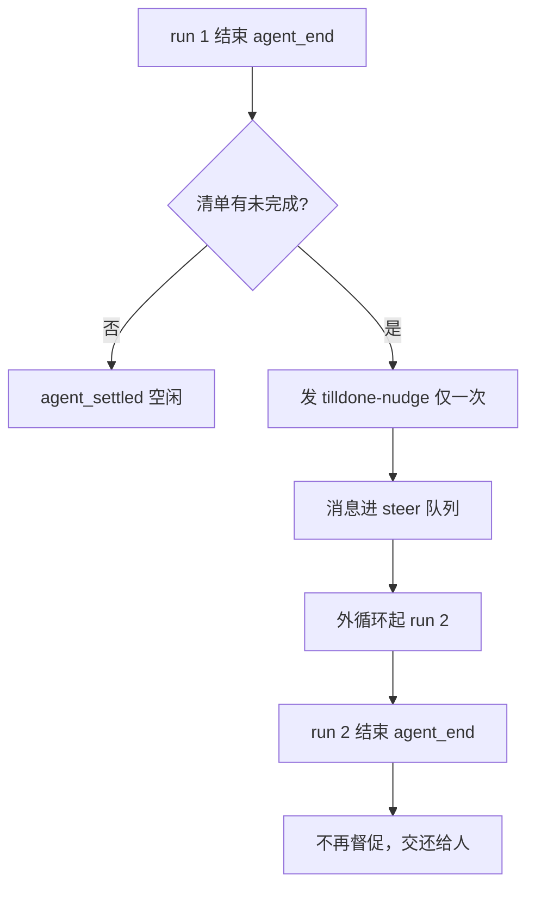

# 督促只发一次与子 agent 取舍

> 一句话摘要：说清 TillDone 的督促为什么只发一次，以及子 agent（`--print` 形态）为什么不加载 TillDone，哪部分价值还剩。

## 核心要点

- 督促只发一次是设计选择，不是技术限制：第二次停下时模型手里没有新信息，再催只会空转。
- 不设成 0 次是因为模型容易半途收工，留一层兜底，防止漏做最后一个任务。
- 子 agent 命令行不带 `-e tilldone`，原文把它列在 §7 的坑 1，属于“没做”，不是“不能做”。
- TillDone 的门禁、督促、拆分三项能力都依赖“多轮 run + 会话文件”，子 agent 两个前提都没有。
- 在子 agent 形态下真正有价值的是计数，做法是在 `subagent` 结果里回传数字，不是加载扩展。
- 原文没有督促频率的统计数据，不能说“一般都不用催”。

## 详解

### 督促为什么只发一次

原文 §4.4 的理由只有一句：被督促后模型仍停下，说明它可能真卡住了。再催只会空转。

| 次数 | 取舍理由 |
|---|---|
| 0 次 | 模型容易半途收工，需要兜底，防止漏做最后一个任务 |
| 1 次 | 设计选择，留下一次纠偏机会 |
| 2 次及以上 | 第二次停下后模型手里没有新信息，只能瞎猜或重复动作；每次督促多一个 run，至少多一次 LLM 请求，还可能带工具调用，空转要花钱 |

“run 数不超过 2”来自这个设计：每条用户输入最多督促一次。

关于“一般都不用催”：原文没有统计数据。唯一的运行记录是 2026-11-01 的 Blackjack 运行，只记了门禁被拦 5 次，没记督促次数。设计意图是门禁在前，多数情况下轮不到督促（助教补充）。反过来的问法是：如果督促频频触发，是不是说明模型不够重视清单，而不是督促次数设少了（助教补充）。

### 子 agent 为什么不加 TillDone

事实：子 agent 命令行（`pstack/index.ts:145-148`）只有 `--mode json --print --no-session`，没有 `-e tilldone`。原文 §6.3 的 grep 显示 pstack 的 `SKILL.md` 完全没提 tilldone。两个扩展互相不认识。

以下是助教的推断（原文未说）：

- **pstack 不知道自己该加。** 它是独立 npm 包，spawn 时不会主动加载一个自己没听说过的扩展。
- **加了也不好用。** `--print` 一次跑完就退出，`agentEnd` 的督促没有下一次 run 可起。`--no-session` 没有会话文件，`restore` 无从恢复清单。
- **清单没处显示。** 面板权威只认父进程 `tool_execution_end` 的 `details`，子 agent 自己那份清单进不了界面。

代价原文写明了：子 agent 内部工作量不进 `spent`，15 次拆分提示看不到。原文没说 `--print` 下是否触发 `agent_end`，这点助教也不知道。

### 价值判断：哪部分还成立

问题要拆开：真正需要判断的是 TillDone 的哪部分价值在子 agent 的运行形态下还成立；笼统地说 TillDone 有没有价值并不够。子 agent 有三个特点：单次跑完就退出、无会话文件、无界面。

| TillDone 能力 | 在子 agent 形态下 |
|---|---|
| 门禁 | 价值接近零。父 agent 已过门禁，分派前就想清楚要干什么；子 agent 再列一遍清单只多一个来回 |
| 督促 | 不成立。督促靠外循环再起一个 run，`--print` 单次跑完就退出，没有第二圈 |
| 拆分 | 没有执行者。拆完要给后续 run 分别执行，单次运行里拆完谁做 |
| 计数 | 真有价值。子 agent 做了多少工具调用对父可见，能让 15 次拆分提示和面板计数不失真 |

结论：三项原生能力都依赖“多轮 run + 会话文件”，子 agent 两个前提都没有。所以“加了再解决新问题”的前提不太成立，需要解决的可能是另一件事。

## 易错点与待思考

- **易混**：把“督促一次”当成技术限制。原文明确说这是设计选择，理由是第二次停下后没有新信息。
- **易混**：把“原文没写为什么不加”当成“原文有理由不加”。它被列在 §7 的坑 1，是缺陷，不是设计。
- **易混**：把计数需求误当成“该加载扩展”。计数靠 `subagent` 结果回传数字即可。
- **待思考 1**：如果给子 agent 加 TillDone，它的清单要不要显示在同一个面板上？
- **待思考 2**：如果子 agent 要做的是长任务，是否该让它跑 `--mode rpc` 而不是 `--print`？那时 TillDone 的价值才会回来（助教提出的方向，尚未验证）。

---

## 附：原始对话

### 问 1：没理解, 为啥只是催一次? 不是2次或者一直催下去, 知道Max Out? 

> 没理解, 为啥只是催一次? 不是2次或者一直催下去, 知道Max Out? 
> 
> 实际上, 是不是一般都不用催?

**先答“为什么是 1”。** 这是设计选择，不是技术限制。原文 §4.4 的理由只有一句：被督促后模型仍停下，说明它可能真卡住了。再催只会空转。

- **不是 0 的原因**：模型容易半途收工。留下一层兜底，防止它漏做最后一个任务。
- **不是 2 或 3 的原因**：第二次停下后，模型手里没有新信息。再催它，它只能瞎猜或重复动作。
- **成本具体**：每次督促都多一个 run，至少多一次 LLM 请求，还可能带工具调用。空转要花钱。

**再说第二个问题：原文没有统计数据。** 原文没写“一般不用催”。我不知道实际频率。原文里唯一的运行记录是 2026-11-01 的 Blackjack 运行，它只记了门禁被拦 5 次，没记督促次数。

我能说的是设计意图（我的补充）：门禁在前，多数情况下应该轮不到督促。门禁让模型一开始就必须建清单、认领任务。督促只在“清单建了但没做完就停”这种场景出现。

那么反过来问：如果督促频频触发，是不是说明模型不够重视清单，而不是督促次数设少了？

### 问 2：请解释我选中的这段话。为什么不在子进程里加tilldone扩展?

> 请解释我选中的这段话。为什么不在子进程里加tilldone扩展?

**先说清楚：原文没有给出“为什么不加”的理由。** 它把这件事列在 §7 的坑 1，当成缺陷，不是设计。所以下面是原文事实加我的推断，我标出来。

**事实：** 子 agent 命令行（`pstack/index.ts:145-148`）只有 `--mode json --print --no-session`，没有 `-e tilldone`。原文 §6.3 的 grep 显示，pstack 的 SKILL.md 完全没提 tilldone。两个扩展互相不认识。

**我的推断（原文未说）：**
- **pstack 不知道自己该加。** 它是独立 npm 包。spawn 时不会主动加载一个自己没听说过的扩展。
- **加了也不好用。** `--print` 一次跑完就退出，`agentEnd` 的督促没有下一次 run 可起。`--no-session` 没有会话文件，`restore` 无从恢复清单。
- **清单没处显示。** 面板权威只认父进程 `tool_execution_end` 的 `details`。子 agent 自己那份清单进不了界面。

所以更像“没做”，不是“不能做”。代价原文写明了：子 agent 内部工作量不进 `spent`，15 次拆分提示看不到。

那如果给子 agent 加 tilldone，它的清单要不要显示在同一个面板上？

### 问 3：我对于 tilldone 的原生能力的价值, 还有疑虑. 如果没有价值, 当然,

> 我对于 tilldone 的原生能力的价值, 还有疑虑. 如果没有价值, 当然, 就不加了. 如果有价值, 那值得加, 同时, 去解决其带来的新问题, 比如: (给子 agent 加 tilldone，它的清单要不要显示在同一个面板上？)

**先把问题拆开：不是 TillDone 有没有价值，而是它的哪部分价值在子 agent 的运行形态下还成立。**

子 agent 是 `--mode json --print --no-session`。三个特点：单次跑完就退出、无会话文件、无界面。对照 TillDone 的三个能力：

- **门禁价值接近零。** 父 agent 已经过了门禁，分派前就想清楚要干什么。子 agent 再走一遍“先列清单”，只多一个来回。
- **督促不成立。** 督促靠外循环再起一个 run。`--print` 单次跑完就退出，没有第二圈。原文没说 `--print` 下是否触发 `agent_end`，这点我不知道。
- **拆分没有执行者。** 拆了要给后续 run 分别执行。单次运行里拆完，谁做？

我的判断：这三项都依赖“多轮 run + 会话文件”。子 agent 两个前提都没有。

**真有价值的是计数。** 子 agent 内部做了多少工具调用，对父可见。这能让 15 次拆分提示和面板计数不失真。但做法是在 `subagent` 结果里回传数字，不是加载 tilldone 扩展。原文 §7 坑 1 写的正是这个代价，不是“该加扩展”。

所以“加了再解决”的前提不太成立：要解决的可能是另一件事。

值得想：如果子 agent 要做的是长任务，是不是该让它跑 `--mode rpc` 而不是 `--print`，那时 TillDone 的价值才回来？
